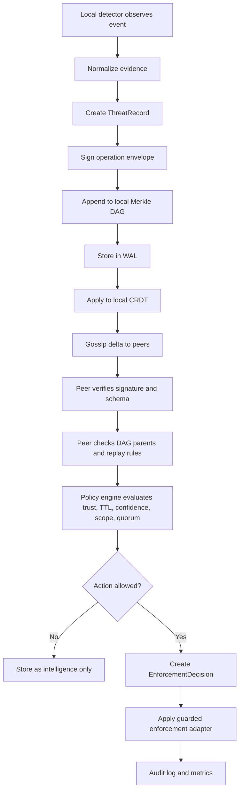
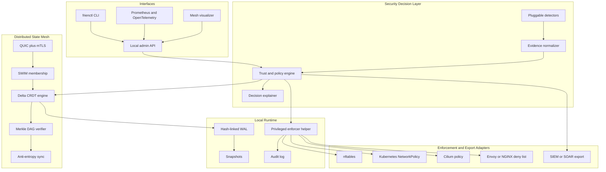
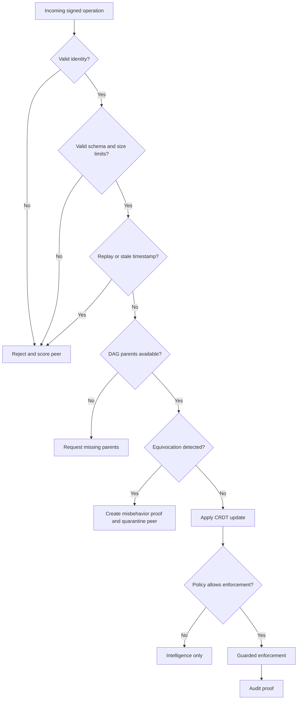
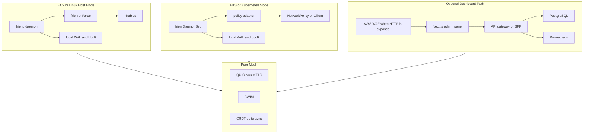

# frien

## Plan of Action

### A Decentralized Security-State Mesh for Secure, Scalable Distributed Infrastructure

frien is a headless distributed systems project focused on secure state sharing, trust-aware decision making, and safe automated response across a fleet of machines. The core idea is simple: when one node observes a security-relevant event, the rest of the fleet should be able to learn about it, verify where it came from, evaluate it through policy, and respond without depending on a single central coordinator.

Post-quantum cryptography can be included as a future-facing hardening option, but it is not the main identity of the project. The main identity of frien is secure distributed coordination for infrastructure defense.

---

## 1. Objective

Build a decentralized security-state mesh that allows infrastructure nodes to:

1. Detect security-relevant events locally.
2. Convert local observations into signed, evidence-backed threat records.
3. Propagate security state across peers using gossip and CRDTs.
4. Verify operation provenance with signatures and tamper-evident history.
5. Detect protocol-level misbehavior such as equivocation.
6. Evaluate incoming state through a trust and policy engine before action.
7. Enforce safe mitigations through pluggable adapters such as nftables, Kubernetes NetworkPolicy, Cilium, Envoy, or SIEM/SOAR export.
8. Protect frien itself through least privilege, network isolation, secure defaults, and strong auditability.

The reusable primitive is the distributed security-state layer. The first applied use case is autonomous threat sharing and guarded enforcement across edge, cloud, and Kubernetes fleets.

---

## 2. Problem Statement

Modern infrastructure is distributed, but security response is often centralized, slow, or isolated per host.

Common problems:

- Local tools such as log-based blockers can detect abuse on one host but do not naturally coordinate with the rest of a fleet.
- Central security platforms introduce dependency on a control service, network reachability, API limits, and central availability.
- Edge nodes, regional servers, IoT gateways, Kubernetes nodes, and multi-cloud workloads often operate outside a clean perimeter.
- A compromised node can publish misleading security signals if the system blindly trusts authenticated participants.
- Automated blocking is dangerous without policy, TTLs, protected ranges, quorum, rollback, and a clear explanation trail.
- Security agents themselves are high-value targets because they often run with privileged access.

frien solves this by combining distributed systems primitives with security controls:

> Share security state fast, verify its origin, converge without central coordination, and enforce only after policy says the action is safe.

---

## 3. Product Positioning

frien is best described as:

> A decentralized security-state mesh that helps infrastructure nodes defend collectively through gossip, CRDT convergence, signed operation history, trust-aware policy, and guarded enforcement.

frien is not:

- A SIEM replacement.
- A full detection platform.
- A blockchain.
- A central threat-intelligence database.
- A crypto research project.
- A tool that blindly blocks anything another node reports.

The detector layer is intentionally pluggable. The differentiator is the secure distributed coordination layer.

---

## 4. Design Principles

| Principle | Meaning in frien |
|-----------|------------------|
| Local-first operation | Nodes keep working when disconnected from a central service because there is no required central service. |
| Secure by default | Admin APIs bind locally, peer traffic requires mTLS, firewall profiles deny unnecessary access, and enforcement starts guarded. |
| No implicit trust | A signed message proves who sent it, not that the content is true. Policy decides whether the content can trigger action. |
| Least privilege | The main daemon runs unprivileged; only a small enforcer helper gets the minimum OS capability needed. |
| Safe enforcement | TTLs, protected CIDRs, confidence thresholds, quorum, dry-run, rollback, and rate limits are built into the enforcement path. |
| Explainability | Every action must answer: who reported it, what evidence was attached, which policy approved it, and what changed. |
| Tamper evidence | Operation history is signed and linked through a Merkle DAG so peers can detect missing, conflicting, or altered history. |
| Scalability | Gossip, delta-state CRDTs, anti-entropy sync, snapshots, and bounded message sizes prevent naive full-state flooding. |
| Crypto agility | Classical crypto is the baseline; PQC can be enabled where supported without making the whole design depend on one algorithm family. |

---

## 5. Target Use Cases

| Use Case | What frien Does |
|----------|------------------|
| Edge fleet threat sharing | If one edge node sees abusive traffic, peers receive evidence-backed state within seconds. |
| Kubernetes workload protection | frien can translate approved decisions into NetworkPolicy, Cilium policy, or ingress deny rules. |
| Multi-cloud security coordination | Security state can move across AWS, GCP, Azure, and on-prem nodes without a single coordinator. |
| Tamper-evident incident trail | Security decisions and peer behavior are stored as signed, hash-linked records. |
| Safe automated blocking | Guarded enforcement prevents one noisy detector or compromised peer from causing fleet-wide damage. |
| Security posture validation | frien can inspect its own firewall, permissions, certificates, open ports, and runtime hardening. |

---

## 6. End-to-End Workflow



Key point: propagation and enforcement are separate. A node may accept a threat record into the mesh but refuse to enforce it if policy does not allow action.

---

## 7. High-Level Architecture



---

## 8. Trust-Aware Decision Flow



This is the most important correction to the original plan: signatures prove provenance, not truth. frien must verify protocol correctness and then use policy before any action is taken.

---

## 9. Core Data Model

### ThreatRecord

```json
{
  "id": "threat_01HZX...",
  "indicator": "203.0.113.44",
  "indicator_type": "ip",
  "reason": "ssh_bruteforce",
  "severity": "medium",
  "confidence": 0.91,
  "ttl": "1h",
  "scope": "fleet",
  "detector": "authlog_bruteforce_v1",
  "evidence": {
    "failed_attempts": 128,
    "window": "60s",
    "target_service": "sshd"
  },
  "reported_by": "node_edge_12",
  "hlc": "2026-05-16T10:20:30.000Z-4-node_edge_12",
  "parents": ["bafy..."],
  "signature": "base64..."
}
```

### EnforcementDecision

```json
{
  "id": "decision_01HZY...",
  "action": "block",
  "target": "203.0.113.44",
  "adapter": "nftables",
  "mode": "guarded",
  "expires_at": "2026-05-16T11:20:30Z",
  "approved_by_policy": "edge_block_v1",
  "required_reports": 3,
  "matched_reports": 4,
  "rollback_token": "rollback_01HZZ..."
}
```

### PeerState

```json
{
  "node_id": "node_edge_12",
  "role": "edge",
  "trust_tier": "standard",
  "status": "alive",
  "cert_fingerprint": "sha256:...",
  "last_seen": "2026-05-16T10:20:30Z",
  "misbehavior_score": 0
}
```

---

## 10. Technical Architecture

### Layer 1: Transport

- QUIC via `quic-go`.
- mTLS for peer authentication.
- Certificate pinning or private CA for controlled deployments.
- Optional hybrid post-quantum key exchange where supported by the Go TLS stack.
- Connection pooling, bounded streams, deadline handling, and backpressure.
- Explicit max message sizes and per-peer rate limits.

### Layer 2: Membership

- SWIM-style membership with `alive`, `suspect`, `dead`, and `left` states.
- Seed-node bootstrap for predictable environments.
- Optional mDNS for local lab and LAN discovery.
- Failure detection tuning per deployment profile.
- Membership messages can piggyback bounded CRDT deltas.

### Layer 3: Distributed State

- Initial CRDT: expiring delta OR-Set for threat records and enforcement decisions.
- Later CRDTs: LWW-Map for node metadata, G-Counter for telemetry, LWW-Register for small config values.
- Hybrid Logical Clocks for causality without requiring clock sync.
- Anti-entropy sync through root hash comparison and DAG walk.
- Property-based tests for convergence, idempotency, commutativity, and associativity.

### Layer 4: Tamper-Evident Verification

- Every operation is placed in a signed envelope.
- Operation envelopes include operation hash, node identity, HLC, sequence, parent hashes, and signature.
- Operations form a Merkle DAG for tamper-evident history.
- Peers detect missing parents, malformed history, replays, and equivocation.
- Equivocation produces a portable misbehavior proof that can quarantine a peer.

### Layer 5: Trust and Policy Engine

The policy engine decides whether received state can trigger action.

Policy inputs:

- reporter identity
- trust tier
- detector type
- evidence fields
- confidence
- TTL
- severity
- target scope
- protected CIDRs
- quorum requirements
- recent false-positive history
- peer misbehavior score

Example policy:

```yaml
policy:
  id: edge_block_v1
  action: block
  min_confidence: 0.85
  require_independent_reports: 3
  max_ttl: 1h
  protected_cidrs:
    - 127.0.0.0/8
    - 10.0.0.0/8
    - 172.16.0.0/12
    - 192.168.0.0/16
  deny_if_target_is_admin_endpoint: true
  rollback_on_error: true
```

### Layer 6: Detection

- Pluggable Go `Detector` interface.
- Initial detectors:
  - SSH brute-force from auth logs.
  - HTTP rate anomaly from access logs.
  - Port scan signal from local firewall logs.
  - Manual operator report through CLI.
- Detectors produce evidence, not direct firewall actions.
- Detector output must pass normalization and policy before enforcement.

### Layer 7: Enforcement

- Primary Linux adapter: nftables.
- Avoid legacy iptables for new work.
- Optional adapters:
  - Kubernetes NetworkPolicy.
  - Cilium policy.
  - Envoy or NGINX deny list.
  - Cloud firewall export.
  - SIEM/SOAR webhook.
- Enforcement supports dry-run, guarded mode, rollback, max changes per minute, and TTL-based expiration.

### Layer 8: Storage

- Append-only WAL for operation durability.
- Hash-linked WAL entries for tamper evidence.
- Snapshots for faster startup.
- bbolt for local indexed metadata.
- Signed snapshots.
- Crash recovery tests.
- Tombstone garbage collection after safe TTL windows.

### Layer 9: Observability

- Structured logs.
- Prometheus metrics.
- OpenTelemetry traces for gossip, sync, policy decisions, and enforcement.
- Health checks:
  - peer count
  - convergence lag
  - rejected operations
  - policy denials
  - enforcement status
  - certificate expiry
  - WAL health

---

## 11. Self-Protection Plan

frien protects infrastructure, but it must also protect itself.

### Network Protection

Default ports:

| Surface | Default Bind | Default Exposure |
|---------|--------------|------------------|
| Peer mesh | `udp/7443` | Allowed only from configured peer CIDRs or known peers |
| Admin API | Unix socket or `127.0.0.1:9443` | Local only |
| Metrics | `127.0.0.1:9109` | Local or monitoring CIDR only |
| Debug | Disabled | Local only when explicitly enabled |

Firewall defaults:

- deny inbound by default
- allow established and related traffic
- allow peer port only from trusted peer ranges
- allow admin only through localhost, VPN, or bastion
- allow metrics only from monitoring systems
- rate-limit peer handshakes
- rate-limit admin authentication attempts
- separate frien self-protection chains from customer enforcement chains

### Built-In Hardening Profiles

Planned CLI:

```bash
frienctl harden status
frienctl harden doctor
frienctl harden apply --profile dev
frienctl harden apply --profile server
frienctl harden apply --profile edge
frienctl harden apply --profile kubernetes
```

Profiles:

| Profile | Purpose |
|---------|---------|
| `dev` | Local-only testing, no kernel enforcement by default. |
| `server` | Peer CIDR allowlist, local admin API, metrics restricted. |
| `edge` | Strict inbound deny, peer-only mesh, stronger rate limits. |
| `kubernetes` | NetworkPolicy or Cilium-aware deployment. |
| `strict` | mTLS required, signed config, no anonymous bootstrap, hardened systemd settings. |

### Privilege Separation

Processes:

| Component | Privilege Level | Responsibility |
|-----------|-----------------|----------------|
| `friend` | unprivileged | mesh, policy, storage, API, detectors |
| `frien-enforcer` | minimal OS capability | nftables or host-level enforcement |
| `frienctl` | user CLI | operator commands |

The main daemon should not run as root. The enforcer helper receives only the minimum capability required for the selected adapter.

Suggested systemd hardening:

```ini
User=frien
Group=frien
NoNewPrivileges=true
ProtectSystem=strict
ProtectHome=true
PrivateTmp=true
PrivateDevices=true
ReadWritePaths=/var/lib/frien /run/frien
RestrictAddressFamilies=AF_INET AF_INET6 AF_UNIX
MemoryDenyWriteExecute=true
```

### API Protection

- Admin API local-only by default.
- Optional OIDC for dashboard access.
- RBAC roles: `viewer`, `operator`, `admin`, `breakglass`.
- Short-lived API tokens with scopes.
- Request size limits.
- Strict CORS when HTTP is enabled.
- CSRF protection for browser sessions.
- Secure cookies for dashboard sessions.
- No default passwords.
- No public registration.
- Full audit trail for admin actions.

### Storage Protection

Recommended paths:

| Path | Purpose | Permissions |
|------|---------|-------------|
| `/etc/frien` | config | root-owned, `0750` |
| `/etc/frien/keys` | private keys | root-owned, `0700`; key files `0600` |
| `/var/lib/frien` | WAL, DAG, snapshots | `frien` user, `0700` |
| `/run/frien` | sockets | `frien` user, `0750` |

Additional controls:

- encrypted private keys where feasible
- optional TPM, KMS, or HSM-backed keys
- signed snapshots
- hash-linked audit log
- startup integrity checks
- safe backup and restore procedures

### Kubernetes Protection

If deployed as a DaemonSet:

- run main container as non-root
- read-only root filesystem
- drop all Linux capabilities in the main container
- isolate the privileged enforcer into a separate container or DaemonSet
- use minimal Kubernetes RBAC
- use a dedicated namespace
- apply default-deny NetworkPolicy
- allow only peer traffic, DNS, metrics, and required API calls
- sign container images
- scan images in CI

---

## 12. Safety Model for Enforcement

frien should never treat a new threat record as an automatic block command.

Required safeguards:

- dry-run mode for new policies
- protected CIDR list
- protected host list
- protected service list
- TTL required for all deny actions
- max TTL per policy
- max new actions per minute
- quorum for fleet-wide action
- local-only action for low-confidence records
- rollback token for every adapter change
- policy simulator before rollout
- emergency allowlist
- operator override with audit reason

Example CLI:

```bash
frienctl policy test --file edge-block.yaml --record sample-threat.json
frienctl explain block 203.0.113.44
frienctl enforcement rollback rollback_01HZZ
frienctl enforcement dry-run --policy edge_block_v1
```

---

## 13. Differentiators

These features make frien stand out as a serious distributed systems and security project:

1. Live mesh visualizer showing peer health, gossip propagation, convergence status, and quarantined peers.
2. Attack simulation mode for a repeatable demo: detect on node A, propagate, verify, approve, enforce, and audit.
3. Byzantine behavior demo where a malicious node sends conflicting operations and frien generates proof.
4. Policy simulator that shows why a threat record would or would not trigger enforcement.
5. `frienctl explain` for any action, including evidence, quorum, policy, TTL, and adapter state.
6. Self-hardening check through `frienctl harden doctor`.
7. Kubernetes and Cilium integration as a practical cloud-native extension.
8. Tamper-evident audit chain for incident review.
9. Safe rollback of security actions.
10. Crypto-agile design with optional PQC hardening where the runtime supports it.

---

## 14. Repository Structure

```text
frien/
  cmd/
    friend/                 # main daemon
    frienctl/               # CLI
    frien-enforcer/         # minimal privileged helper
  internal/
    api/                    # local admin API
    audit/                  # audit log and explain data
    config/                 # config loading and validation
    crdt/                   # OR-Set, LWW map, counters
    detector/               # detector interface and built-ins
    enforcer/               # adapter interfaces
    harden/                 # self-protection checks and profiles
    membership/             # SWIM membership
    policy/                 # trust and policy evaluation
    storage/                # WAL, snapshots, bbolt indexes
    transport/              # QUIC, mTLS, peer sessions
    verify/                 # signatures, Merkle DAG, equivocation
  pkg/
    proto/                  # protobuf definitions
    sdk/                    # detector and adapter SDK
  deploy/
    docker/
    kubernetes/
    systemd/
  docs/
    ARCHITECTURE.md
    PROTOCOL.md
    SECURITY.md
    THREAT_MODEL.md
    OPERATIONS.md
  dashboards/
    grafana.json
  tests/
    integration/
    chaos/
    adversarial/
  Makefile
  README.md
```

---

## 15. Libraries and Build Choices

### Build Directly

- SWIM membership implementation.
- Delta OR-Set for threat records.
- Hybrid Logical Clock.
- Operation envelope format.
- Merkle DAG verifier.
- Equivocation detection.
- Trust and policy evaluation layer.
- WAL and snapshot coordination.
- nftables adapter wrapper.
- Self-hardening checks.

### Use Existing Libraries

- `quic-go` for QUIC transport.
- `google.golang.org/protobuf` for wire types.
- `google.golang.org/grpc` if gRPC is selected for internal APIs.
- Go standard `crypto/tls` and `crypto/x509` for TLS and identity.
- Go standard `crypto/mlkem` where optional PQC hardening is used.
- `go.etcd.io/bbolt` for embedded metadata indexes.
- `rs/zerolog` or Go `slog` for structured logging.
- `prometheus/client_golang` for metrics.
- `go.opentelemetry.io/otel` for traces.
- `pgregory.net/rapid` for property-based tests.
- Optional OPA/Rego integration after the first policy engine is stable.

---

## 16. Testing Strategy

| Test Type | What It Proves |
|-----------|----------------|
| Unit tests | Each component behaves correctly in isolation. |
| Property tests | CRDT convergence and operation idempotency hold under random operation orders. |
| Integration tests | Multiple local nodes join, gossip, sync, and enforce safely. |
| Adversarial tests | Malformed messages, replay, stale operations, oversized payloads, and equivocation are rejected. |
| Crash tests | WAL replay and snapshots recover state correctly. |
| Chaos tests | Nodes can restart, partition, rejoin, and converge. |
| Policy tests | Enforcement decisions match policy under edge cases. |
| Security tests | Admin API, parser boundaries, config validation, and privilege separation are checked. |
| Performance tests | Propagation latency, memory use, CPU use, and sync cost stay within target bounds. |

Initial measurable targets:

- 3 to 5 node local cluster syncs a threat record within 2 seconds.
- Replayed operation is rejected.
- Conflicting operation from the same node sequence produces a misbehavior proof.
- Protected CIDRs cannot be blocked by default policy.
- `frienctl explain` can show why an action happened.
- Node restart recovers state from WAL and snapshot.

---

## 17. Reference Material

| Topic | Reference |
|-------|-----------|
| Zero trust architecture | NIST SP 800-207 |
| Secure software development | NIST SP 800-218 SSDF |
| Container security | NIST SP 800-190 |
| Application security verification | OWASP ASVS |
| Linux packet filtering | nftables documentation |
| Kubernetes traffic isolation | Kubernetes NetworkPolicy documentation |
| Membership protocol | SWIM paper |
| CRDT foundation | Shapiro et al. CRDT papers |
| Causal ordering | Hybrid Logical Clocks |
| Byzantine CRDTs | Kleppmann, Making CRDTs Byzantine Fault Tolerant |
| BFT CRDT continuation | Blocklace and process-commutative distributed object research |
| PQC optional hardening | NIST FIPS 203, FIPS 204, SP 800-227, Go crypto docs |

---

## 18. Technology Stack and Architecture Constraints

This section defines the recommended stack and the constraints to keep the project focused. The core mesh should stay small, local-first, and dependency-light. Dashboard, admin, AWS, stream processing, and WAF features should sit around the mesh rather than become required for the mesh to function.

### Core Runtime Stack

| Area | Recommended Choice | Reason |
|------|--------------------|--------|
| Primary language | Go 1.26+ | Strong networking, concurrency, static binaries, good standard crypto, and practical systems tooling. |
| Peer transport | QUIC via `quic-go` | Multiplexed streams over UDP, good fit for gossip and peer sessions. |
| Peer authentication | mTLS with private CA | Every node has a cryptographic identity; no anonymous peer traffic. |
| Wire format | Protocol Buffers | Stable schema evolution and efficient binary encoding. |
| Local API | gRPC or REST over Unix socket | Admin operations should be local by default; HTTP can be enabled explicitly. |
| CLI | Go-based `frienctl` | Same language and shared protocol types as the daemon. |
| Local state | bbolt plus append-only WAL | Embedded, simple, durable, and no required external database. |
| Policy config | YAML initially | Human-readable and easy to test. OPA/Rego can be added later if policy complexity grows. |
| Logging | Go `slog` or `zerolog` | Structured logs with low overhead. |
| Metrics | Prometheus client | Easy local scraping and dashboard integration. |
| Tracing | OpenTelemetry | Useful for sync, gossip, policy, and enforcement latency. |
| Linux enforcement | nftables | Modern Linux packet filtering path. |
| Cloud-native enforcement | Kubernetes NetworkPolicy and Cilium | Safer fit for containerized workloads than host firewall mutation alone. |

### Dashboard and Admin Panel Stack

The dashboard should be optional. frien must remain usable through the CLI and local API.

| Area | Recommended Choice | Reason |
|------|--------------------|--------|
| Web framework | Next.js App Router | Good fit for a real-time admin panel, nested views, and API integration. |
| UI language | TypeScript | Stronger contracts for API responses and dashboard state. |
| UI components | Tailwind CSS plus a small component library | Fast dashboard development without custom UI sprawl. |
| Real-time updates | Server-Sent Events first, WebSockets later | SSE is simpler for one-way mesh updates; WebSockets only when bidirectional live control is needed. |
| Charts | Recharts or ECharts | Mesh health, propagation latency, peer state, and enforcement trends. |
| Graph visualization | Cytoscape.js or React Flow | Peer topology, gossip paths, quarantined nodes, and decision lineage. |
| Auth for dashboard | OIDC | Avoid custom password systems. |
| Dashboard API path | Backend-for-frontend service | The dashboard should not talk directly to every node from the browser. |

Admin panel views:

- mesh topology
- peer health
- propagation timeline
- threat records
- policy decisions
- enforcement status
- quarantine and misbehavior proofs
- hardening posture
- audit explorer
- `explain` view for any block or deny action

Dashboard constraints:

- dashboard is not required for mesh operation
- admin API binds locally by default
- public dashboard exposure is disabled by default
- every dashboard action maps to an audited API command
- read-only mode must exist
- dangerous actions require confirmation and audit reason

### Database Choices

frien has two different storage needs: local node state and optional dashboard/query state. They should not be mixed.

| Storage Need | Recommended Choice | Required? | Notes |
|--------------|--------------------|-----------|-------|
| Node WAL | append-only local files | Yes | Source of recovery for local operations. |
| Node indexes and snapshots | bbolt | Yes | Embedded local state; no external service needed. |
| Dashboard relational data | PostgreSQL | Optional | Useful for users, saved views, audit search, and dashboard metadata. |
| Time-series metrics | Prometheus | Optional | Best initial choice for metrics and alerts. |
| Long-term metrics | Amazon Managed Service for Prometheus, Timestream, or VictoriaMetrics | Optional | Add only after the metrics volume justifies it. |
| Audit archive | S3-compatible object storage | Optional | Good for signed snapshots, audit bundles, and support artifacts. |
| Full-text search | OpenSearch | Optional | Useful only if audit/event search becomes large. |

Database constraints:

- the core mesh must not require PostgreSQL, Kafka, Redis, or any cloud database
- each node must be able to start, recover, and enforce local policy using only local disk
- dashboard storage can fail without breaking the mesh
- audit data should be append-only or tamper-evident
- external databases should be adapters, not core dependencies

### Kafka, Queues, and Event Streaming

Kafka is not required for the core design.

Use Kafka, Amazon MSK, Redpanda, or NATS JetStream only when there is a clear integration need:

- exporting high-volume threat events to analytics systems
- feeding SIEM or SOAR pipelines
- replaying audit events into a data lake
- bridging frien events into an existing event platform
- running detached detection jobs outside the mesh

Do not put Kafka in the critical path for peer sync. frien already has its own distributed state propagation through gossip, CRDT deltas, and anti-entropy. Adding Kafka to the core would reintroduce a central dependency and weaken the point of the project.

Recommended stance:

| Question | Decision |
|----------|----------|
| Is Kafka needed for MVP? | No. |
| Is Kafka needed for CRDT sync? | No. |
| Is Kafka useful for external analytics? | Yes, as an optional adapter. |
| AWS equivalent if needed? | Amazon MSK. |
| Simpler alternative for early builds? | Webhook export or local file export. |

### Cache and Coordination Services

Redis is not required for the core mesh.

Use Redis only for optional dashboard caching or rate-limit state if the admin panel becomes multi-instance. Do not use Redis for CRDT correctness, peer membership, or enforcement decisions.

### WAF and Edge Protection

WAF is relevant only for HTTP-facing surfaces such as the dashboard, public API gateway, or demo site. It does not protect QUIC peer gossip directly.

Recommended WAF plan:

- keep admin and dashboard private by default
- if exposed through AWS, place the dashboard behind CloudFront or an Application Load Balancer with AWS WAF
- enable managed rule groups for common HTTP attacks
- add rate limiting for login and sensitive admin routes
- restrict admin routes by VPN, SSO group, source CIDR, or device posture where possible
- log WAF decisions to the security audit pipeline
- never rely on WAF as the only protection layer

WAF constraints:

- WAF does not replace mTLS
- WAF does not validate peer operations
- WAF does not protect host-level agent ports unless traffic is HTTP(S) through supported AWS resources
- peer mesh traffic should be protected with mTLS, security groups, firewall policy, and message verification

### AWS Deployment Stack

frien should support two AWS deployment paths.

#### EC2 Host Mode

Use this for Linux host enforcement through nftables.

Recommended AWS components:

- EC2 instances in private subnets
- Security Groups allowing peer UDP only between frien nodes
- Systems Manager Session Manager for admin access instead of public SSH where possible
- AWS Private CA or internal CA for node certificates
- AWS KMS for key wrapping
- Secrets Manager or SSM Parameter Store for bootstrap material
- CloudWatch Logs or OpenTelemetry Collector for logs
- Amazon Managed Service for Prometheus and Amazon Managed Grafana for metrics
- S3 for signed audit bundles and snapshots

Constraints:

- peer ports should not be open to the public internet
- admin API should stay local or behind a private access path
- nftables enforcement requires host-level permissions
- load balancers are not required for the peer mesh
- cross-region mesh needs explicit latency, cost, and failure-domain testing

#### EKS Mode

Use this for Kubernetes-native policy enforcement.

Recommended AWS components:

- Amazon EKS
- frien DaemonSet for node-local agent behavior
- restricted main container
- separate enforcer permissions where needed
- Kubernetes RBAC with least privilege
- NetworkPolicy or Cilium for workload enforcement
- AWS Load Balancer Controller only for dashboard ingress
- AWS WAF on dashboard ingress through ALB or CloudFront
- IAM Roles for Service Accounts for AWS API access
- ECR for signed container images
- CloudWatch, Amazon Managed Service for Prometheus, and OpenTelemetry Collector for observability

Constraints:

- avoid privileged pods except for the smallest possible enforcer scope
- host firewall mutation inside Kubernetes should be avoided unless required
- prefer Kubernetes-native policy adapters before nftables inside clusters
- dashboard should be separate from node agents
- cluster network plugin must support NetworkPolicy if that adapter is used

### Deployment Topologies



### Stack Decisions by Phase

| Phase | Required Stack | Explicitly Deferred |
|-------|----------------|---------------------|
| Phase 0 | Go, config, docs, CI | dashboard, Kafka, AWS automation |
| Phase 1 | Go daemon, CLI, WAL, metrics | Next.js, PostgreSQL |
| Phase 2 | QUIC, mTLS, SWIM | Kafka, Redis |
| Phase 3 | CRDT, HLC, anti-entropy | OpenSearch, long-term metrics store |
| Phase 4 | signatures, Merkle DAG, adversarial tests | PQC signatures unless needed |
| Phase 5 | policy YAML, nftables, rollback | Kubernetes adapter |
| Phase 6 | Next.js dashboard, graph visualization, Prometheus | Kafka unless event export needs it |
| Phase 7 | Kubernetes manifests, AWS deployment templates, WAF for dashboard | multi-region automation until single-region path is stable |

### Non-Negotiable Constraints

- no central service required for mesh correctness
- no external database required for node startup or local enforcement
- no blind enforcement from remote reports
- no public admin API by default
- no root main daemon
- no unlimited TTL blocks
- no blocking of protected CIDRs by default
- no unbounded gossip messages
- no unsigned operation acceptance
- no dashboard-only workflows; every critical workflow must be possible through CLI/API

---

## 19. External Service Decision Matrix

| Service or Tool | Use in frien | Decision |
|-----------------|--------------|----------|
| PostgreSQL | dashboard metadata, audit search, users, saved views | Optional |
| bbolt | local node index and snapshots | Required |
| WAL files | local operation durability | Required |
| Kafka or Amazon MSK | external analytics and event replay | Optional adapter only |
| Redis | dashboard cache or rate-limit helper | Optional, not core |
| Prometheus | metrics collection | Recommended |
| OpenTelemetry Collector | logs, metrics, traces routing | Recommended |
| OpenSearch | large audit/event search | Optional later |
| S3 | audit archive and signed snapshot bundles | Optional |
| AWS WAF | HTTP dashboard/API protection | Optional when HTTP is exposed |
| AWS KMS | key wrapping | Optional but useful on AWS |
| AWS Private CA | node certificate issuing | Optional AWS path |
| EKS | Kubernetes deployment path | Optional |
| EC2 | host-level deployment path | Recommended for nftables demo |
| CloudFront or ALB | dashboard ingress | Optional |

---

## 20. Phasewise Implementation Roadmap

### Phase 0: Project Definition and Safety Baseline

Goal: define the exact build target before writing complex distributed code.

Deliverables:

- finalized threat model
- protocol sketch
- initial data model
- config format
- repository scaffold
- CI baseline
- security defaults document
- local-only admin API decision

Exit criteria:

- `frien` naming is consistent.
- initial `SECURITY.md`, `THREAT_MODEL.md`, and `PROTOCOL.md` exist.
- basic lint, test, and build workflow passes.

### Phase 1: Secure Node Foundation

Goal: create a single secure node process with identity, config, storage, and observability.

Deliverables:

- `friend` daemon
- `frienctl` CLI
- config validation
- node identity generation
- mTLS certificate loading
- structured logging
- Prometheus metrics
- WAL skeleton
- systemd service draft

Exit criteria:

- one node starts, exposes local health, writes WAL entries, and shuts down cleanly.

### Phase 2: Peer Transport and Membership

Goal: form a small mesh and track peer liveness.

Deliverables:

- QUIC peer sessions
- mTLS peer authentication
- SWIM membership
- seed-node join
- peer state table
- rate limits and message size limits
- local cluster integration test

Exit criteria:

- 3 to 5 nodes discover each other, detect failure, and handle rejoin.

### Phase 3: CRDT State Mesh

Goal: replicate threat records without central coordination.

Deliverables:

- HLC implementation
- expiring OR-Set
- delta propagation
- anti-entropy sync
- property-based convergence tests
- replay-safe operation IDs

Exit criteria:

- threat records converge across all live peers under reordered and duplicated delivery.

### Phase 4: Signed History and Misbehavior Detection

Goal: make state tamper-evident and detect protocol-level malicious behavior.

Deliverables:

- signed operation envelope
- Merkle DAG parent tracking
- root hash exchange
- missing-parent fetch
- equivocation detection
- misbehavior proof format
- peer quarantine state

Exit criteria:

- conflicting operations from the same node sequence produce a proof and quarantine event.

### Phase 5: Policy and Guarded Enforcement

Goal: safely decide what can become action.

Deliverables:

- trust and policy engine
- policy YAML format
- confidence, TTL, quorum, and protected CIDR checks
- dry-run enforcement mode
- nftables adapter
- rollback tokens
- `frienctl explain`

Exit criteria:

- an approved threat record is enforced locally with TTL and rollback.
- a protected target is denied by policy and logged with explanation.

### Phase 6: Detection, Visualization, and Demo

Goal: turn the mesh into a usable security workflow.

Deliverables:

- SSH brute-force detector
- HTTP rate anomaly detector
- manual report command
- live mesh visualizer
- attack simulation mode
- malicious-peer simulation mode
- Grafana dashboard
- demo cluster scripts

Exit criteria:

- demo shows detect, propagate, verify, policy approval, enforcement, audit, rollback, and malicious peer quarantine.

### Phase 7: Integrations and Hardening

Goal: add deployment and platform integrations.

Deliverables:

- `frienctl harden doctor`
- hardening profiles
- Kubernetes manifests
- NetworkPolicy adapter
- Cilium adapter prototype
- signed release workflow
- SBOM generation
- image scanning
- fuzz tests for protocol handlers

Exit criteria:

- frien can be deployed on Linux hosts and Kubernetes with documented secure defaults.

---

## 21. Scrum Sprint Plan

Each sprint is two weeks. The roadmap assumes one focused builder. Scope can be expanded with more contributors by splitting ownership across transport, state, policy, and adapters.

### Sprint 0: Planning and Repository Reset

Sprint goal: convert the idea into a buildable specification.

Backlog:

- rename all project language to frien
- write threat model
- define `ThreatRecord`, `OperationEnvelope`, `PeerState`, and `EnforcementDecision`
- define initial config file
- scaffold Go module and command layout
- add CI for build, test, lint, and vulnerability checks

Demo:

- repository builds
- CLI prints version and validates config
- threat model and protocol notes are readable

### Sprint 1: Single Node Foundation

Sprint goal: run one secure node locally.

Backlog:

- daemon lifecycle
- config loading
- node identity
- local admin API
- WAL append and replay skeleton
- structured logs
- metrics endpoint
- basic systemd unit

Demo:

- start node
- inspect health through `frienctl status`
- restart node and confirm WAL replay

### Sprint 2: Mesh Transport and Membership

Sprint goal: make nodes find and monitor each other.

Backlog:

- QUIC listener and dialer
- mTLS peer authentication
- peer session manager
- SWIM ping and ping-req
- seed-node join
- peer table command
- integration test for 3 nodes

Demo:

- 3 nodes join
- one node stops
- peers mark it suspect then dead

### Sprint 3: CRDT Replication

Sprint goal: make threat records converge.

Backlog:

- HLC
- operation IDs
- expiring OR-Set
- delta gossip
- anti-entropy root exchange
- convergence property tests
- `frienctl report ip`

Demo:

- report an IP on node A
- nodes B and C converge without central coordination

### Sprint 4: Signed DAG and Adversarial Behavior

Sprint goal: make history verifiable.

Backlog:

- operation signing
- canonical operation encoding
- Merkle DAG storage
- parent validation
- replay rejection
- equivocation proof
- quarantine state
- malicious-node simulation

Demo:

- malicious node sends conflicting operations
- honest peers detect proof and quarantine it

### Sprint 5: Policy and Enforcement

Sprint goal: turn replicated state into safe action.

Backlog:

- policy YAML
- trust tiers
- quorum checks
- protected CIDR checks
- dry-run mode
- nftables adapter
- TTL expiry
- rollback
- `frienctl explain`

Demo:

- accepted record triggers dry-run
- policy-approved record creates nftables entry
- protected CIDR is refused
- rollback removes enforcement

### Sprint 6: Detectors and Operator Experience

Sprint goal: make the system useful from end to end.

Backlog:

- SSH brute-force detector
- HTTP rate anomaly detector
- manual report workflow
- mesh visualizer
- Grafana dashboard
- audit views
- attack simulation mode

Demo:

- simulated brute-force event is detected, propagated, approved, enforced, displayed, and explained

### Sprint 7: Deployment Hardening and Integrations

Sprint goal: prepare safe deployment paths.

Backlog:

- `frienctl harden doctor`
- hardening profiles
- Kubernetes manifests
- default-deny NetworkPolicy examples
- Cilium adapter prototype
- signed artifacts
- SBOM
- fuzz tests
- chaos tests

Demo:

- hardening report identifies unsafe settings
- Kubernetes deployment starts with restricted permissions
- chaos test shows nodes rejoin and converge
