# Frien: Distributed Cloud Threat Intelligence Engine
### Architecture Design Document & Software Requirements Specification
**Version:** 1.0.0 | **Status:** Draft | **Date:** April 2026

---

## Table of Contents

1. [Executive Summary](#1-executive-summary)
2. [Software Requirements Specification (SRS)](#2-software-requirements-specification)
3. [System Architecture Overview](#3-system-architecture-overview)
4. [Distributed Systems Design](#4-distributed-systems-design)
5. [Coordinator (Master) Design](#5-coordinator-master-design)
6. [Worker Design](#6-worker-design)
7. [MapReduce Execution Model](#7-mapreduce-execution-model)
8. [Fault Tolerance & Replication](#8-fault-tolerance--replication)
9. [Security Architecture](#9-security-architecture)
10. [Storage Architecture](#10-storage-architecture)
11. [Task Cancellation & Lifecycle](#11-task-cancellation--lifecycle)
12. [Detection Engine & Plugin System](#12-detection-engine--plugin-system)
13. [Findings Output Layer](#13-findings-output-layer)
14. [Consistency & Concurrency Model](#14-consistency--concurrency-model)
15. [Observability & Audit](#15-observability--audit)
16. [API Specification](#16-api-specification)
17. [Deployment Architecture](#17-deployment-architecture)
18. [Academic Foundations & Lecture Mapping](#18-academic-foundations--lecture-mapping)
19. [Work Breakdown Structure (WBS)](#19-work-breakdown-structure)
20. [Future Roadmap](#20-future-roadmap)
21. [OWASP Top 10:2025 Coverage](#21-owasp-top-102025-coverage)

---

## 1. Executive Summary

### 1.1 Problem Statement

Cloud environments in 2026 generate billions of log events daily across CloudTrail, VPC Flow Logs, IAM audit trails, and Kubernetes audit logs. The recent Vercel breach (April 19, 2026) — caused by a stolen OAuth token from a third-party AI tool pivoting into internal Google Workspace and cloud environments — and the Lovable BOLA vulnerability (April 20, 2026) — which exposed source code, database credentials, and AI chat histories of every project created before November 2025 for 48 days after responsible disclosure — illustrate a structural problem: **the security tooling ecosystem cannot keep pace with the scale and velocity of modern cloud threats.**

Existing solutions are either:
- Too expensive (Splunk at ~$15,000/year for 5GB/day before SIEM add-ons)
- Too operationally complex (ELK stack requiring dedicated cluster engineers)
- Not built for distributed cross-account correlation (native AWS tools produce isolated, uncorrelated alerts)
- Closed-source (Wiz, Datadog), making community contribution and auditability impossible

The result: **multi-environment breaches take an average of 276 days to contain**, and attackers are achieving full AWS environment compromise within 24 hours of credential theft.

### 1.2 Solution

**Frien** is an open-source, distributed cloud threat intelligence engine built on a MapReduce architecture. It ingests raw cloud logs at scale, processes them in parallel across a fleet of workers, and produces correlated threat findings mapped to MITRE ATT&CK techniques — all without requiring expensive proprietary infrastructure.

### 1.3 Key Differentiators

- **Distributed by design** — not a single-process scanner bolted onto a log storage system
- **Pluggable detection rules** — community-contributable detectors as Go plugins or WASM modules
- **Cloud-agnostic** — works with AWS, GCP, Azure logs via S3-compatible storage
- **Production-grade fault tolerance** — Raft consensus, checkpointing, speculative execution
- **Security-first internals** — mTLS everywhere, encrypted intermediate files, audit trail on all operations
- **SARIF + MITRE ATT&CK output** — integrates directly with GitHub, VS Code, and every major security workflow
- **Open source** — Apache 2.0, fully auditable, community extensible

### 1.4 Target Users

- Security engineers at cloud-native startups and mid-market companies
- Platform/DevSecOps teams managing multi-account AWS environments
- Incident responders needing rapid distributed log correlation
- Compliance teams requiring automated evidence of continuous monitoring

---

## 2. Software Requirements Specification

### 2.1 Functional Requirements

#### FR-01: Log Ingestion
- The system SHALL ingest logs from S3-compatible object storage
- The system SHALL support CloudTrail, VPC Flow Logs, IAM Access Analyzer, GuardDuty findings, and Kubernetes audit logs
- The system SHALL support both real-time (triggered) and scheduled batch ingestion modes
- The system SHALL allow users to specify time ranges and account filters for ingestion scope

#### FR-02: Distributed Processing
- The system SHALL distribute log processing across multiple worker nodes via a coordinator
- The system SHALL support parallel Map phase execution across all available workers
- The system SHALL enforce a synchronization barrier: Reduce phase begins only after all Map tasks complete (with optional pipelining as a future feature)
- The system SHALL handle worker failures by reassigning tasks within a configurable timeout (default: 10 seconds)

#### FR-03: Threat Detection
- The system SHALL execute pluggable threat detector functions in the Map phase
- The system SHALL correlate threat signals across log sources in the Reduce phase
- The system SHALL produce structured findings with severity scores (CRITICAL, HIGH, MEDIUM, LOW, INFO)
- The system SHALL map every finding to at least one MITRE ATT&CK technique ID
- The system SHALL calculate blast radius for each finding (affected accounts, services, resources)

#### FR-04: Job Management
- The system SHALL accept job submissions via HTTP REST API
- The system SHALL maintain a priority queue with three tiers: EMERGENCY, SCHEDULED, BACKGROUND
- The system SHALL assign unique Job IDs upon submission
- The system SHALL support graceful and immediate job cancellation
- The system SHALL provide real-time job status via API

#### FR-05: Output & Integration
- The system SHALL output findings in SARIF v2.1.0 format
- The system SHALL output findings in JSON format for programmatic consumption
- The system SHALL support webhook notifications on finding emission
- The system SHALL retain findings in S3-compatible storage with configurable retention

#### FR-06: Security
- The system SHALL authenticate all coordinator-worker communication via mTLS
- The system SHALL encrypt intermediate files at rest (AES-256, per-job key)
- The system SHALL maintain an immutable audit log of all operations
- The system SHALL never log or store raw credential values from scanned logs

### 2.2 Non-Functional Requirements

#### NFR-01: Performance
- The system SHALL process 1GB of CloudTrail logs within 60 seconds on a 4-worker cluster
- The system SHALL support horizontal scaling to 100+ workers
- The coordinator SHALL assign tasks to idle workers within 500ms of heartbeat receipt
- Finding emission latency (Map completion → SARIF output) SHALL be under 30 seconds

#### NFR-02: Reliability
- The system SHALL tolerate the failure of up to N/2 - 1 coordinator replicas (Raft quorum)
- The system SHALL guarantee at-least-once finding emission (idempotent Reduce ensures no duplicates)
- The system SHALL recover coordinator state from the latest valid checkpoint after a crash
- Task reassignment after worker failure SHALL occur within 2x the heartbeat timeout

#### NFR-03: Security
- All inter-node communication SHALL use TLS 1.3
- Worker certificates SHALL be rotated on each worker restart
- Intermediate files containing parsed log events SHALL be encrypted and securely wiped on job completion or worker exit
- The system SHALL be deployable in air-gapped environments with no external network dependencies

#### NFR-04: Operability
- The system SHALL be distributed as a single binary supporting `coordinator` and `worker` modes
- The system SHALL load configuration from `config.toml`
- The system SHALL expose Prometheus-compatible metrics on `/metrics`
- Deployment SHALL be compatible with systemd, Docker, and Kubernetes

#### NFR-05: Extensibility
- New detector plugins SHALL be deployable without recompiling the core binary
- The plugin interface SHALL be stable across minor versions
- The system SHALL support WASM-based plugins as an alternative to Go `.so` files

### 2.3 Constraints

- Written in Go 1.22+
- S3-compatible object storage required (AWS S3, MinIO, GCS with S3 interop)
- Minimum cluster: 1 coordinator + 1 worker (single-node mode for development)
- No JVM dependency (intentional — avoids Spark/Flink operational overhead)

### 2.4 Assumptions

- Input logs are pre-split into individual objects in S3 (one object = one Map task)
- All nodes have network access to the S3-compatible storage endpoint
- Workers are deployed in the same network segment or VPN as the coordinator
- Users manage their own S3 credentials and IAM permissions for log access

---

## 3. System Architecture Overview

### 3.1 High-Level Architecture

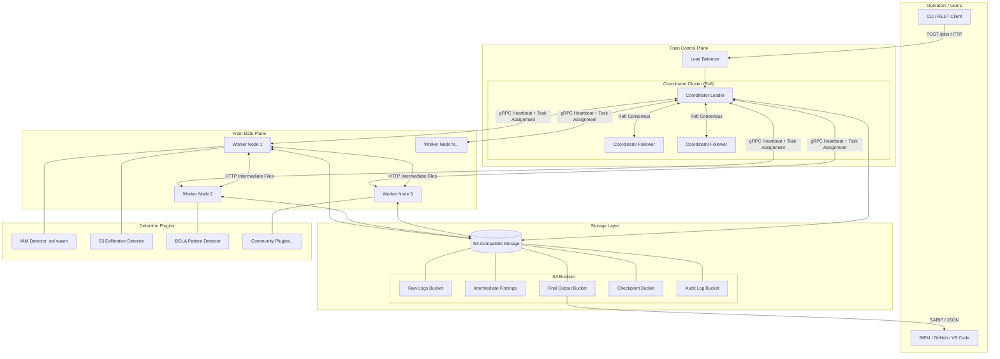

### 3.2 Single Binary Execution Model

Frien is compiled into a single executable with two operational modes:

```
frien coordinator    # Runs as coordinator daemon
frien worker         # Runs as worker daemon
frien submit         # CLI client for job submission
frien status         # CLI client for job/finding status
```

Configuration is loaded from `config.toml`. This model ensures:
- Single artifact to build, version, and deploy
- systemd, Docker, and Kubernetes friendly
- No dependency mismatch between coordinator and worker versions

### 3.3 Network Topology

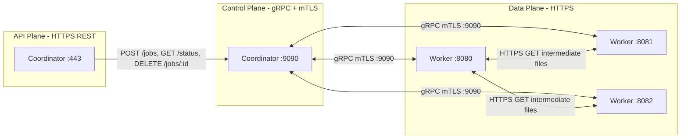

---

## 4. Distributed Systems Design

### 4.1 Coordinator Cluster with Raft Consensus

Frien runs the coordinator as a **replicated state machine** using the **Raft consensus algorithm**. This is the most critical distributed systems decision in the architecture — it transforms a single point of failure (one coordinator process) into a fault-tolerant cluster.

#### Why Raft Over ZooKeeper?

ZooKeeper is a proven external coordination service. However, for Frien:
- Raft is embedded directly — no external dependency, simpler deployment
- ZooKeeper's ZAB protocol has similar guarantees but requires a separate operational footprint
- Raft's leader election and log replication are simpler to reason about for our specific state (job queue + task status)
- Raft is natively available in Go via the `etcd/raft` library

#### Raft Implementation Details

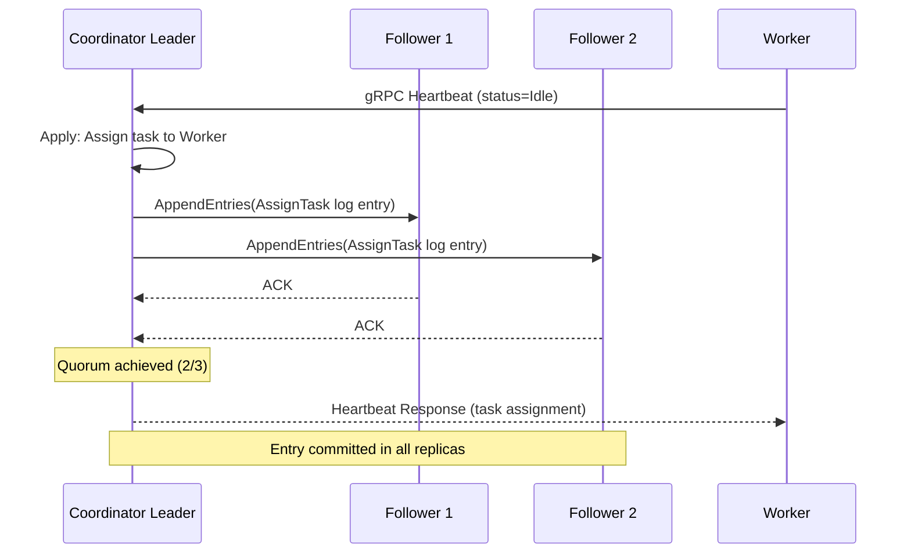

**State Machine Transitions:**
- All state mutations (task assignment, completion, cancellation) are appended as log entries
- Entries are only committed after quorum acknowledgement (N/2 + 1 coordinators)
- Coordinator leader handles all writes; followers serve as hot standbys
- On leader failure, Raft elects a new leader within a configurable election timeout (default: 150-300ms randomized)

#### Coordinator Cluster Size Recommendations

| Cluster Size | Tolerated Failures | Use Case |
|---|---|---|
| 1 | 0 | Development / single-node |
| 3 | 1 | Standard production |
| 5 | 2 | High-availability enterprise |

### 4.2 Worker Architecture

Workers are **stateless compute nodes** that:
1. Register with the coordinator via gRPC on startup
2. Receive tasks via heartbeat responses (pull model)
3. Execute Map or Reduce functions via loaded detector plugins
4. Store intermediate results locally and serve them over HTTPS
5. Report task completion via heartbeats
6. Exit cleanly or crash — the coordinator detects failure via missed heartbeats

Workers are intentionally stateless with respect to job metadata. All job state lives in the coordinator cluster. This means a crashed worker can be replaced by simply starting a new worker process — it registers, gets reassigned tasks, and processing continues.

### 4.3 Pull-Based Scheduling with Backpressure

Frien uses a **pull-based scheduling model** piggybacked on gRPC heartbeats. Workers do not receive pushed task assignments. Instead:

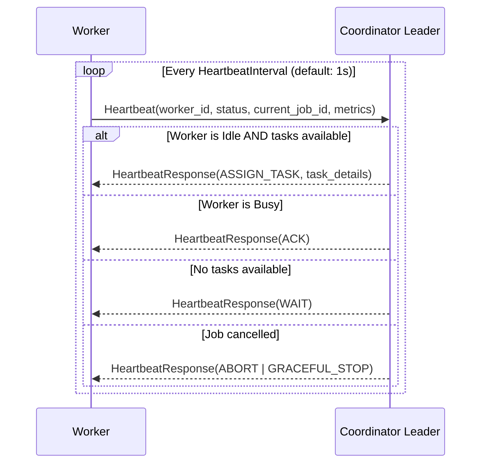

**Why pull-based?**
- The coordinator only assigns work to workers proven alive (just sent a heartbeat)
- Natural backpressure: busy workers don't receive new tasks
- Simplifies coordinator logic — no need to track worker capacity separately from liveness

### 4.4 Priority Queue Scheduling

Unlike simple FIFO scheduling, Frien implements a **three-tier priority queue**:

| Tier | Priority | Use Case | Examples |
|---|---|---|---|
| EMERGENCY | Highest | Active incident response | Triggered by GuardDuty finding, manual IR invocation |
| SCHEDULED | Medium | Routine security scans | Nightly CloudTrail analysis, weekly IAM review |
| BACKGROUND | Lowest | Historical analysis | Forensic investigation of past time windows |

The coordinator's task scheduler always drains EMERGENCY tasks before SCHEDULED, and SCHEDULED before BACKGROUND. Within a tier, tasks are ordered FIFO.

---

## 5. Coordinator (Master) Design

### 5.1 Coordinator State Machine

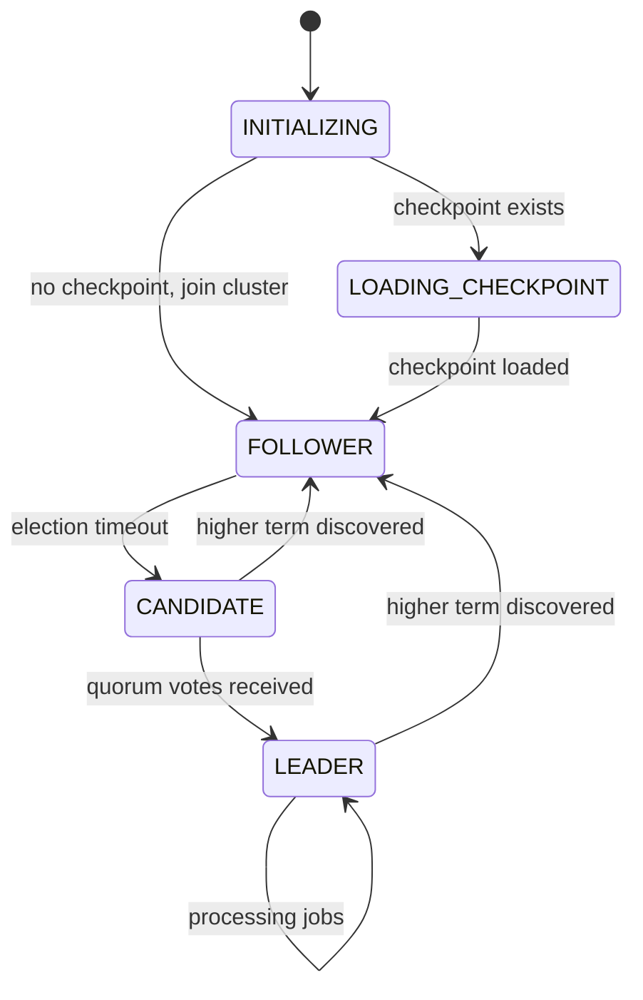

### 5.2 Job Lifecycle State Machine

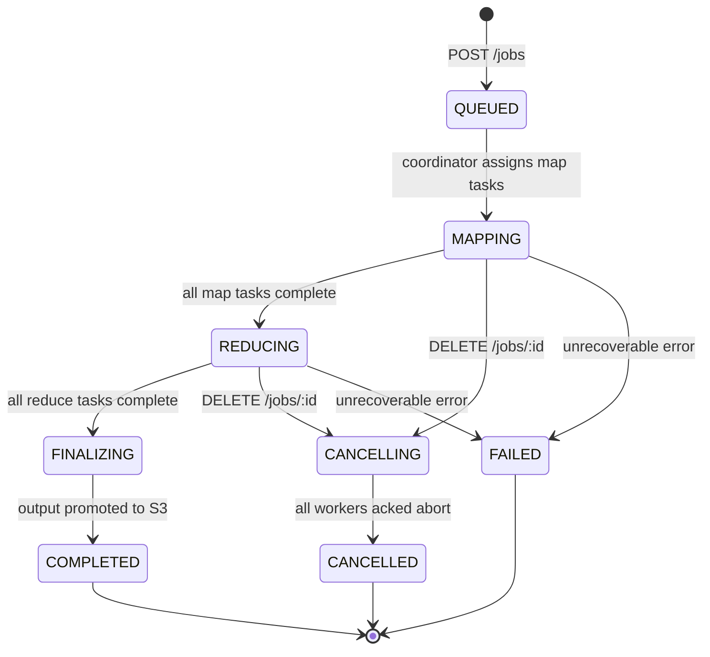

### 5.3 Coordinator Internal Components

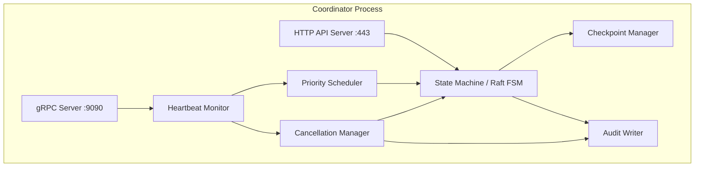

### 5.4 Checkpointing Strategy

Coordinator state is periodically snapshotted to S3 using a safe write pattern:

```
1. Serialize state → JSON blob
2. Write to s3://bucket/checkpoints/checkpoint-<timestamp>.tmp
3. CopyObject → s3://bucket/checkpoints/checkpoint-latest.json
4. DeleteObject(checkpoint-<timestamp>.tmp)
5. Prune: retain last N checkpoints (default: 5)
```

**Why snapshots over WAL?**
- Bounded size — a snapshot is the full state at a point in time, not an unbounded log
- Simpler recovery — load latest valid snapshot, re-execute tasks since snapshot (idempotent)
- If newest snapshot is corrupt (crash mid-write), fall back to snapshot N-1

**Checkpoint interval:** Configurable, default 30 seconds. Critical state transitions (job completion, cancellation, worker failure) trigger immediate checkpoints.

---

## 6. Worker Design

### 6.1 Worker Lifecycle

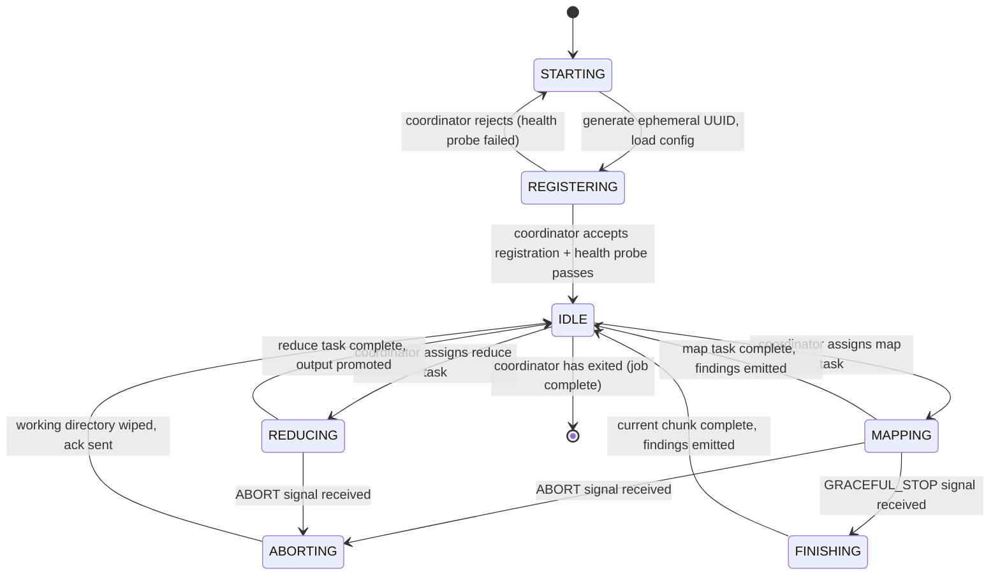

### 6.2 Worker Registration with Health Probe

Worker identity is **ephemeral** — a new UUID is generated on each startup. This means:
- Crashed and restarted workers register as completely new workers
- The coordinator never attempts to reconcile returning workers with past identities
- No stale state can bleed between worker restarts

During registration, the coordinator issues a `GET /health` probe to the worker's self-reported HTTPS address. This verifies:
- The worker is actually reachable at its reported address
- The worker's TLS certificate is valid
- The worker's HTTP server is operational before any intermediate file URLs are distributed to Reduce workers

Workers whose health probe fails are **rejected** — their registration is denied. They must retry.

### 6.3 Worker Directory Structure

```
/tmp/frien-worker-<uuid>/         # systemd RuntimeDirectory, wiped on exit
    map/
        mr-<job_id>-<task_id>-<partition>.tmp    # in-progress intermediate
        mr-<job_id>-<task_id>-<partition>.signals # completed, ready to serve
    reduce/
        reduce-<job_id>-<task_id>-<attempt_id>.tmp  # in-progress reduce output
    plugins/
        <detector_name>.so           # loaded detector plugins
    keys/
        job-<job_id>.key             # per-job AES-256 key for intermediate encryption
```

All files under this directory are encrypted at rest. The directory is managed by systemd's `RuntimeDirectory=` directive — automatically provisioned on start, automatically destroyed on exit/crash.

### 6.4 Intermediate File Atomicity

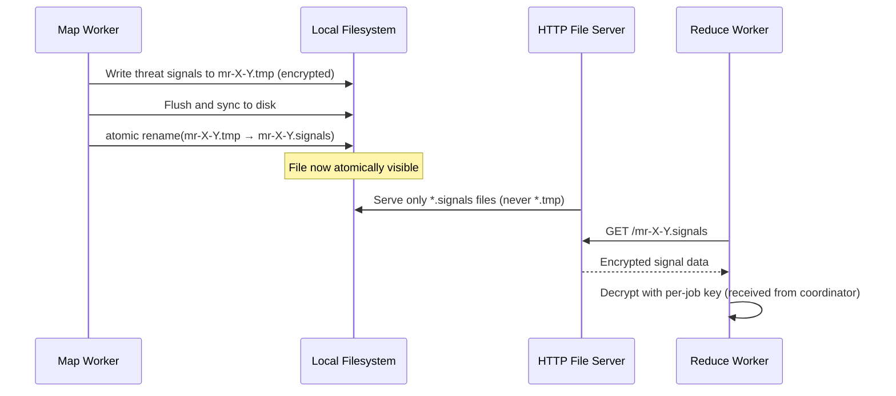

The `.tmp` → `.signals` atomic rename guarantees that Reduce workers can never read a partial intermediate file, even if the Map worker crashes mid-write.

---

## 7. MapReduce Execution Model

### 7.1 Overall Execution Flow

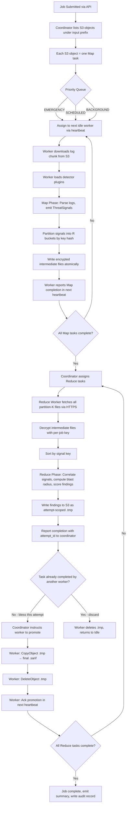

### 7.2 Map Phase: Threat Signal Emission

Each Map worker processes one S3 log object (one chunk). The Map function:

1. Downloads the raw log file from S3
2. Parses it into structured `RawLogEvent` objects (JSON-aware for CloudTrail, TSV for VPC Flow)
3. Passes each event through all loaded detector plugins
4. Each detector's `Map()` function emits zero or more `ThreatSignal` objects
5. Signals are partitioned into R buckets using `ihash(signal.CorrelationKey) % R`
6. Each bucket is written as an encrypted intermediate file

**ThreatSignal structure:**
```go
type ThreatSignal struct {
    CorrelationKey  string          // e.g., "iam:role/DataPipelineRole"
    SignalType      string          // e.g., "PRIVILEGE_ESCALATION_ATTEMPT"
    Severity        SeverityLevel
    Timestamp       time.Time
    SourceAccount   string
    SourceRegion    string
    RawEvent        json.RawMessage // original log event (encrypted at rest)
    DetectorName    string
    MITREAttackID   string          // e.g., "T1078"
    Evidence        map[string]any
}
```

### 7.3 Reduce Phase: Correlation and Scoring

Each Reduce worker processes all signals for one correlation key partition. The Reduce function:

1. Fetches all intermediate files for partition K from Map workers via HTTPS
2. Decrypts files using the per-job key (received from coordinator at task assignment)
3. Groups signals by `CorrelationKey`
4. For each key, runs the detector's `Reduce()` function to correlate signals across accounts/regions/time
5. Computes **blast radius**: which accounts, services, and resources are reachable from the compromised identity
6. Scores the finding based on: signal severity × count × blast radius × asset criticality
7. Emits a structured `Finding` object

### 7.4 Reduce Phase Fault Tolerance — Dead Map Worker Scenario

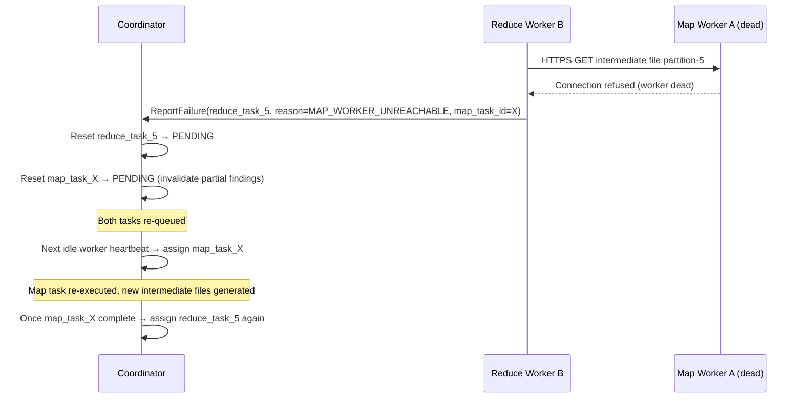

This handles the critical scenario where a Map worker completes its task, goes idle, and then dies — taking its intermediate files offline before Reduce workers can fetch them.

### 7.5 Speculative Execution (Straggler Mitigation)

If a job is near completion (configurable threshold, e.g., >90% tasks done) but blocked on one slow worker:

1. Coordinator identifies the straggler (task running > 2× median task duration)
2. Coordinator assigns the same task to another idle worker as a **speculative attempt**
3. Both workers race to complete the task
4. First worker to report completion is blessed as the winner
5. The slower worker receives an ABORT signal on its next heartbeat
6. Speculative tasks are only launched after a minimum delay (default: 10s) to avoid thrashing on transient slowdowns

---

## 8. Fault Tolerance & Replication

### 8.1 Failure Taxonomy

| Failure Type | Detection Mechanism | Recovery Action |
|---|---|---|
| Worker crash mid-Map | Missed heartbeats (timeout) | Reset task → PENDING, reassign |
| Worker crash mid-Reduce | Missed heartbeats OR Reduce worker reports fetch failure | Reset both Reduce + corresponding Map task |
| Worker network partition | Missed heartbeats | Same as crash |
| Coordinator leader crash | Raft leader election | New leader elected within election timeout |
| Coordinator follower crash | Raft continues with remaining quorum | No action needed if quorum maintained |
| S3 write failure (checkpoint) | Explicit error return | Retry with exponential backoff |
| Partial intermediate file | Atomic rename prevents this | Not applicable |
| Corrupt checkpoint | Checksum validation on load | Fall back to checkpoint N-1 |

### 8.2 Primary-Backup Replication for Coordinator

The coordinator cluster uses Raft, which is a form of **primary-backup replication with strong consistency**:

- The **leader** (primary) handles all writes and task assignments
- **Followers** (backups) replicate the log and are ready to become leader on failure
- All state transitions are **committed** only after quorum acknowledgement — no split-brain possible
- Unlike basic primary-backup, Raft handles the case where the primary crashes **while sending** a log entry — the entry is only committed if a majority received it

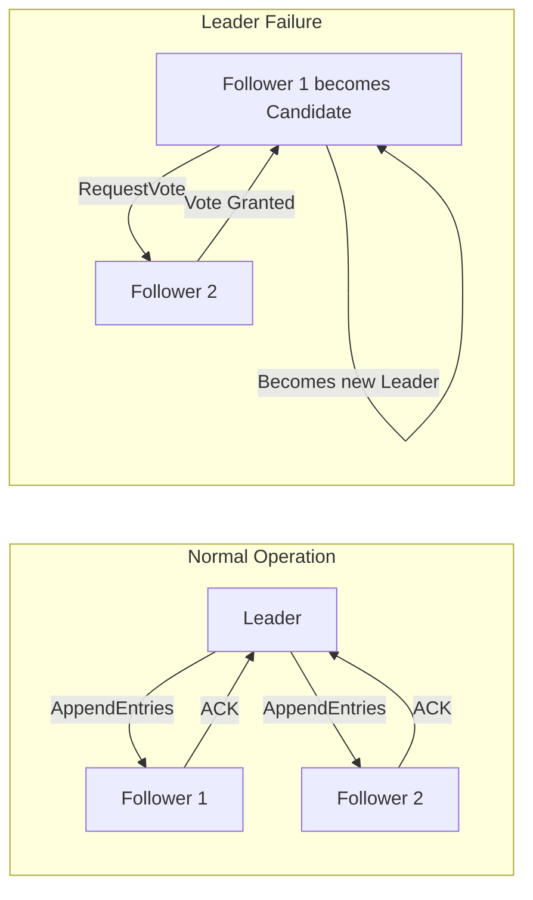

### 8.3 Idempotency and At-Least-Once Semantics

MapReduce tasks in Frien are **idempotent by design**:
- Re-executing a Map task on the same log chunk produces the same threat signals
- Reduce finalization uses attempt-scoped UUIDs (worker-generated on task start) — if two workers race to complete the same Reduce task, the coordinator blesses exactly one winner; the other's output is discarded
- The coordinator's finalization check (`task already completed?`) is protected by the Raft state machine — it's an atomic compare-and-set

This means **at-least-once task execution** with **exactly-once finding output** — the correct semantics for a security tool where duplicate findings would create noise.

### 8.4 Worker Failure During Reduce Finalization (Race Condition Handling)

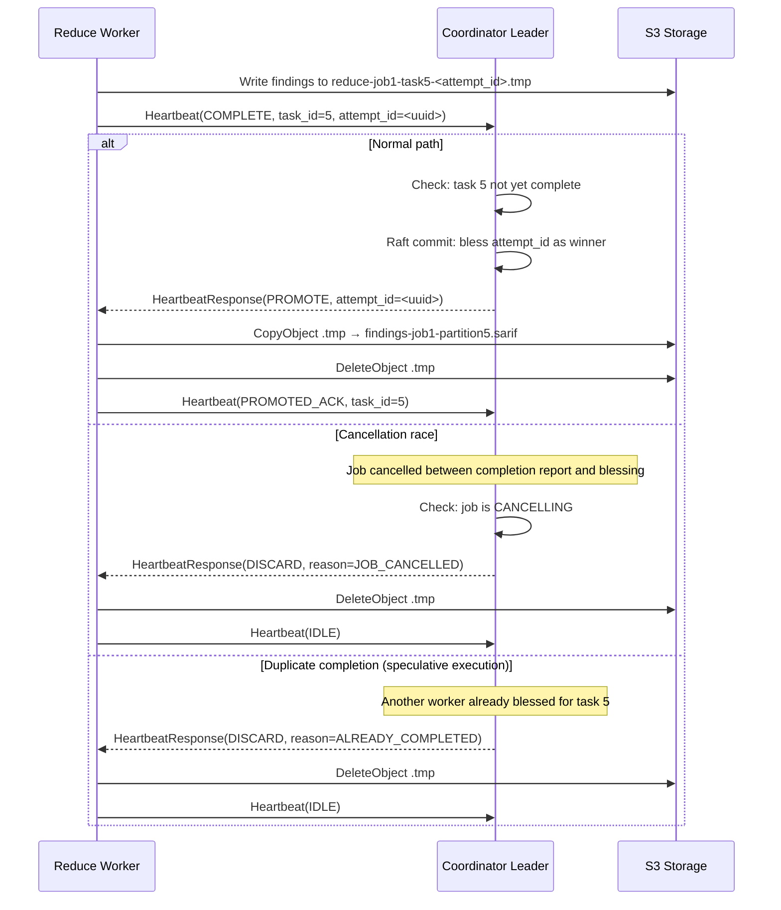

---

## 9. Security Architecture

### 9.1 mTLS Between All Nodes

Frien replaces network-level security dependencies with **mutual TLS (mTLS)** for all coordinator-worker communication:

- Each coordinator generates a self-signed CA on first boot
- Workers receive a signed certificate from the coordinator CA during registration
- Worker certificates include the worker UUID as the Common Name
- Certificates are rotated on each worker restart (ephemeral identity = ephemeral cert)
- The coordinator validates the worker's certificate on every gRPC call — a worker presenting an expired or revoked cert is immediately disconnected

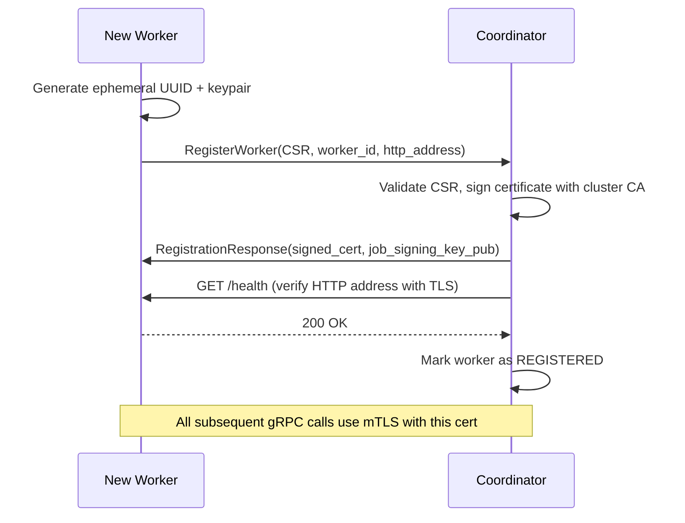

### 9.2 Encrypted Intermediate Files

All intermediate files stored on worker local storage are encrypted with **AES-256-GCM**:

- A unique 256-bit key is generated per job by the coordinator
- The key is distributed to workers only at task assignment time (via the encrypted gRPC channel)
- Keys are never written to disk — held in memory only for the duration of the task
- On task completion, the in-memory key is zeroed
- Worker directories are securely wiped on exit (not just unlinked — overwritten then deleted)

### 9.3 No Credential Retention Policy

Frien processes logs that may contain credential values (API keys in CloudTrail events, tokens in VPC flow metadata). The system enforces:

- **Redaction**: The log parser layer redacts known credential patterns (AWS access key format, JWT tokens, private key material) before passing events to detectors
- **No raw event storage**: The `RawEvent` field in `ThreatSignal` is encrypted and only decrypted in the Reduce phase — never written to plaintext storage
- **Finding output scrubbing**: SARIF findings output never includes the raw credential value — only its presence, format, and location are noted

### 9.4 Audit Trail

Every operation in Frien generates a structured audit record written to an immutable S3 bucket (with Object Lock enabled):

```json
{
  "event_id": "uuid",
  "event_type": "TASK_ASSIGNED | JOB_SUBMITTED | JOB_CANCELLED | WORKER_REGISTERED | FINDING_EMITTED",
  "timestamp": "RFC3339",
  "actor": "api_token_id | worker_id | system",
  "job_id": "...",
  "task_id": "...",
  "worker_id": "...",
  "details": {},
  "mitre_relevance": "T1562.001"
}
```

Cancellation of an active threat detection job is mapped to **MITRE ATT&CK T1562 — Impair Defenses**, flagged as a potential security event, and included in the findings output.

### 9.5 Threat Model

| Threat | Mitigation |
|---|---|
| Man-in-the-middle between coordinator and worker | mTLS with certificate pinning |
| Rogue worker claiming to be legitimate | Worker certificate signed by coordinator CA; unauthorized workers cannot present a valid cert |
| Intermediate file snooping | AES-256-GCM encryption at rest; key never persisted to disk |
| Coordinator state tampering | Raft consensus — requires compromising quorum (N/2 + 1 nodes) |
| Log injection in scanned data | Input validation + redaction layer before detector invocation |
| Cancellation used to suppress findings | Audit log + MITRE T1562 mapping; cancelled jobs' partial findings preserved in GRACEFUL mode |
| Checkpoint corruption | Checksum validation; N checkpoint retention with fallback |

---

## 10. Storage Architecture

### 10.1 S3 Bucket Layout

```
s3://frien-<cluster-id>/
├── jobs/
│   └── <job_id>/
│       ├── manifest.json          # job metadata, task list, detector config
│       └── status.json            # current job status (for fast API queries)
├── outputs/
│   └── <job_id>/
│       ├── findings-partition-0.sarif
│       ├── findings-partition-1.sarif
│       └── summary.json           # aggregated finding counts, severity distribution
├── checkpoints/
│   ├── checkpoint-latest.json
│   ├── checkpoint-<ts-1>.json
│   └── checkpoint-<ts-2>.json
├── audit/
│   └── <YYYY>/<MM>/<DD>/
│       └── audit-<ts>.jsonl       # append-only audit records
└── plugins/
    └── <detector_name>-<version>.so   # community detector plugins
```

### 10.2 Intermediate Storage (Local to Worker)

Intermediate files — threat signals emitted by Map workers — are stored **locally on worker nodes**, not in S3. This avoids:
- Write amplification: writing transient data to object storage
- Latency: local filesystem reads are faster than S3 GETs for the Reduce phase
- Cost: S3 PUT/GET costs for ephemeral data

Workers serve intermediate files over HTTPS using a Go `http.FileServer` restricted to `.signals` files only (never `.tmp`).

### 10.3 GFS-Inspired Design Decisions

Frien's storage model draws inspiration from the **Google File System (GFS)** paper:
- **Large sequential reads over random access**: Log chunks are read sequentially; Frien's S3 layout is optimized for this (range requests for large files)
- **Relaxed consistency for intermediate data**: Intermediate files are write-once, read-once — no need for strong consistency here
- **Master (coordinator) tracks chunk locations**: The coordinator tracks which worker holds which intermediate partition, analogous to GFS's master tracking chunk server locations
- **Append-only outputs**: Findings files are written once and never modified — same pattern as GFS append semantics

---

## 11. Task Cancellation & Lifecycle

### 11.1 Cancellation Modes

Frien supports two cancellation modes, addressing different operational scenarios:

**Immediate Cancellation** (`DELETE /jobs/{id}?mode=immediate`)
- All in-flight workers are instructed to abort immediately
- Working directories are wiped securely
- All partial S3 outputs are deleted
- Findings are marked `INVALIDATED`
- Use case: job submitted by mistake, emergency resource reclamation

**Graceful Cancellation** (`DELETE /jobs/{id}?mode=graceful`)
- Workers currently executing a task are allowed to finish their current log chunk
- No new tasks are assigned after the cancellation signal
- Findings emitted before cancellation are preserved as `PARTIAL`
- Use case: operator wants to stop a long scan but preserve findings collected so far

### 11.2 Complete Cancellation Flow

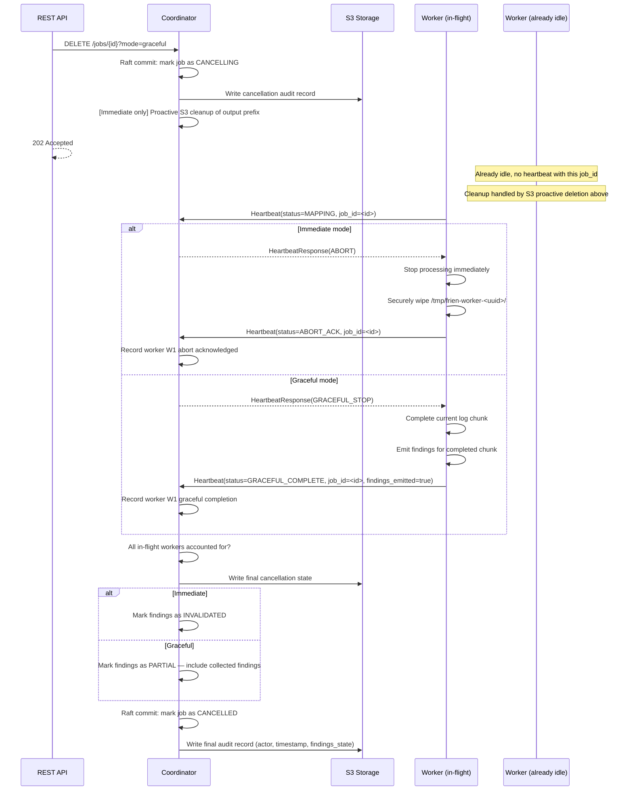

### 11.3 Cancellation Fence for Reduce Finalization

If a cancellation arrives while a Reduce task is in the process of being blessed:

```
Worker reports COMPLETE for task 5
    → Coordinator checks: is job CANCELLING?
        → YES (Immediate): discard completion report, send ABORT, skip CopyObject
        → YES (Graceful): bless completion, include findings in PARTIAL output
        → NO: normal finalization path
```

This is an atomic check in the Raft state machine — no race condition is possible because the cancellation and the task completion are both Raft log entries that are applied in order.

### 11.4 Cancellation as a Security Event

Cancellation of an active threat detection scan is itself a potentially suspicious action. Frien:
- Maps cancellation events to **MITRE ATT&CK T1562.001 — Disable or Modify Tools**
- Includes cancellation in the findings output as an `INFO` severity finding
- Retains the audit record in the immutable audit S3 bucket regardless of findings invalidation
- Alerts via webhook if an EMERGENCY-tier job is cancelled (configurable)

---

## 12. Detection Engine & Plugin System

### 12.1 Detector Plugin Interface

```go
// All detectors implement this interface
type Detector interface {
    // Metadata
    Name()         string
    Version()      string
    Description()  string
    Severity()     SeverityLevel
    LogSources()   []LogSource   // CloudTrail, VPCFlow, IAMAnalyzer, GuardDuty, K8sAudit
    MITREAttackIDs() []string    // e.g., ["T1078", "T1136"]

    // Map phase: called once per log event
    // Returns zero or more threat signals
    Map(event RawLogEvent) ([]ThreatSignal, error)

    // Reduce phase: called with all signals for a correlation key
    // Returns zero or more correlated findings
    Reduce(key string, signals []ThreatSignal) ([]Finding, error)
}
```

Plugins are loaded at runtime using Go's `plugin` package (`.so` files) or the `wazero` WASM runtime. Workers load plugins from their local `plugins/` directory, which is populated from S3 at startup.

### 12.2 Built-in Detectors (v1.0)

| Detector | Log Source | MITRE ATT&CK | What it detects |
|---|---|---|---|
| `iam_privilege_escalation` | CloudTrail | T1078, T1098 | IAM role assumption chains, policy attachment to self, `sts:AssumeRole` anomalies |
| `s3_exfiltration` | CloudTrail, VPC Flow | T1530 | Unusual `GetObject` volumes, cross-account S3 access, bucket policy changes |
| `credential_exposure` | CloudTrail | T1552 | Access key usage from new IPs/regions, simultaneous multi-region usage |
| `resource_discovery` | CloudTrail | T1580 | Enumeration patterns (`List*`, `Describe*` in rapid succession) |
| `lateral_movement` | CloudTrail | T1021 | Cross-account role assumption, ECS Exec abuse |
| `defense_impairment` | CloudTrail | T1562 | CloudTrail logging disabled, GuardDuty suspended, Security Hub suppressed |
| `bola_pattern` | API Gateway Logs | T1190 | Missing ownership checks in API call patterns (cross-user resource access) |
| `oauth_token_abuse` | CloudTrail, IdP Logs | T1550 | OAuth token reuse from new locations, unusual scope grants |
| `misconfiguration_scan` | AWS Config | T1190 | Public S3 buckets, open security groups, unencrypted RDS, missing MFA |

### 12.3 Detector Plugin Lifecycle

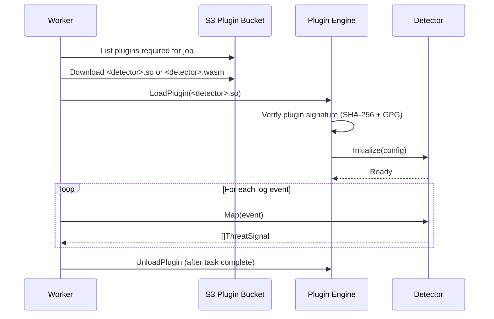

Plugin signatures are verified against a community-maintained public key registry before loading. This prevents supply chain attacks — a malicious plugin cannot be loaded without a valid signature.

---

## 13. Findings Output Layer

### 13.1 Finding Structure

```go
type Finding struct {
    ID              string          // UUID
    JobID           string
    Title           string
    Description     string
    Severity        SeverityLevel   // CRITICAL, HIGH, MEDIUM, LOW, INFO
    Score           float64         // 0.0 - 10.0, CVSS-inspired
    MITREAttackIDs  []string
    AffectedResources []Resource
    BlastRadius     BlastRadius
    Evidence        []EvidenceItem
    Remediation     RemediationGuide
    Timestamp       time.Time
    DetectorName    string
    DetectorVersion string
}

type BlastRadius struct {
    AffectedAccounts  []string
    AffectedServices  []string
    AffectedResources []string
    LateralMovementPaths []MovementPath
    EstimatedDataExposureGB float64
}
```

### 13.2 SARIF v2.1.0 Output

Findings are serialized to SARIF v2.1.0 format for integration with:
- GitHub Advanced Security (native SARIF import)
- VS Code Security extensions
- Jira / Linear (via SARIF import plugins)
- Any SIEM with SARIF support

### 13.3 Severity Scoring Model

Findings are scored using a model inspired by CVSS but adapted for cloud infrastructure:

```
Score = (Signal Severity Base) × (Blast Radius Multiplier) × (Asset Criticality) × (Temporal Factor)

Signal Severity Base:   CRITICAL=9, HIGH=7, MEDIUM=5, LOW=3, INFO=1
Blast Radius Multiplier: 1.0 (1 resource) → 2.0 (50+ resources)
Asset Criticality:      1.0 (dev) → 1.5 (staging) → 2.0 (production)
Temporal Factor:        1.0 (historical) → 1.3 (active, last 1h) → 1.5 (real-time)
```

---

## 14. Consistency & Concurrency Model

### 14.1 Consistency Guarantees by Layer

| Layer | Consistency Model | Rationale |
|---|---|---|
| Coordinator state | **Linearizable** (Raft) | Job state, task assignment must be strongly consistent — no two workers should be assigned the same task |
| Checkpoint reads | **Read-your-writes** | Coordinator always reads its own latest checkpoint |
| Intermediate files | **Write-once, eventual** | Map workers write once; Reduce workers read when all writes are confirmed complete |
| Findings output | **Linearizable at finalization** | Reduce finalization uses Raft-backed atomic compare-and-set |
| Audit log | **Append-only, eventually consistent** | S3 Object Lock ensures immutability; slight delay acceptable |

### 14.2 Distributed Transactions for Job State

Job lifecycle transitions (QUEUED → MAPPING → REDUCING → COMPLETED) require **atomic multi-key updates** — updating both the job status and the task list atomically. Frien handles this via the Raft FSM:

All state mutations are encoded as Raft log entries and applied atomically by the state machine. This is conceptually equivalent to a distributed transaction where the Raft cluster is the transaction coordinator — inspired by the design of **Google Spanner's Paxos-based transaction management**, but simplified to a single Raft group covering the coordinator cluster.

### 14.3 Optimistic Concurrency Control for Reduce Finalization

The Reduce finalization race (multiple speculative workers completing the same task) is handled using **Optimistic Concurrency Control (OCC)**:

1. Worker completes task, generates `attempt_id`
2. Worker reports completion — this is the "commit request"
3. Coordinator validates: no other attempt for this task has been committed (validation phase)
4. If valid: commit the attempt (write to Raft log, instruct worker to promote)
5. If conflict: abort this attempt (discard, instruct worker to delete `.tmp`)

This is exactly OCC's read-validate-commit cycle, applied to distributed task finalization.

### 14.4 Causal Consistency for Audit Log

The audit log uses **causal consistency** — each audit record includes a `causal_predecessor` field pointing to the previous audit record for the same job. This creates a causally ordered chain of events per job, enabling forensic reconstruction of the exact sequence of operations even if audit records arrive out of order in S3.

This is inspired by the **COPS (Clusters of Order-Preserving Servers)** model for causal consistency in geo-distributed systems.

### 14.5 Go Concurrency Model

Frien is written in Go and leverages its concurrency primitives extensively:

**Coordinator:**
- One goroutine per connected worker (handling heartbeat gRPC stream)
- One goroutine for the Raft tick loop
- One goroutine for the checkpoint writer
- One goroutine for the priority scheduler
- `sync.RWMutex` protecting the job/task state map
- `sync.Cond` for workers waiting on task availability (avoid busy-polling)

**Worker:**
- One goroutine for the gRPC heartbeat loop
- One goroutine for the HTTP file server
- One goroutine per task execution (Map or Reduce)
- `context.Context` propagated through all task execution paths — enables clean cancellation via context cancellation when ABORT is received

---

## 15. Observability & Audit

### 15.1 Metrics (Prometheus)

All components expose `/metrics` in Prometheus format:

**Coordinator metrics:**
- `frien_jobs_total{status}` — counter of jobs by final status
- `frien_tasks_pending{phase}` — gauge of pending Map/Reduce tasks
- `frien_worker_count{status}` — gauge of workers by status
- `frien_raft_leader` — gauge (1 if this node is Raft leader)
- `frien_checkpoint_age_seconds` — age of latest checkpoint

**Worker metrics:**
- `frien_tasks_processed_total{detector,phase}` — counter of processed tasks
- `frien_events_parsed_total{log_source}` — counter of parsed log events
- `frien_signals_emitted_total{detector,severity}` — counter of threat signals
- `frien_task_duration_seconds{phase}` — histogram of task durations

### 15.2 Structured Logging

All components emit structured JSON logs (compatible with CloudWatch, Datadog, Loki):
```json
{
  "level": "info",
  "timestamp": "2026-04-23T10:00:00Z",
  "component": "coordinator",
  "event": "task_assigned",
  "worker_id": "...",
  "task_id": "...",
  "job_id": "...",
  "trace_id": "..."
}
```

### 15.3 Distributed Tracing

Each job carries a `trace_id` propagated through all gRPC calls and HTTP requests. This enables end-to-end tracing of a single log event from ingestion through Map → Reduce → finding output using OpenTelemetry-compatible tracing backends (Jaeger, Tempo).

---

## 16. API Specification

### 16.1 Job Submission

```
POST /v1/jobs
Authorization: Bearer <api_token>
Content-Type: application/json

{
  "name": "nightly-cloudtrail-scan",
  "priority": "SCHEDULED",
  "log_sources": {
    "cloudtrail": "s3://my-logs/cloudtrail/2026/04/22/",
    "vpc_flow": "s3://my-logs/vpc-flow/2026/04/22/"
  },
  "aws_account_ids": ["123456789012"],
  "time_range": {
    "start": "2026-04-22T00:00:00Z",
    "end": "2026-04-22T23:59:59Z"
  },
  "detectors": ["iam_privilege_escalation", "s3_exfiltration", "credential_exposure"],
  "reduce_tasks": 10,
  "output": {
    "format": "sarif",
    "destination": "s3://my-findings/2026/04/22/",
    "webhook": "https://my-siem.example.com/webhook"
  },
  "severity_threshold": "MEDIUM"
}

Response 202 Accepted:
{
  "job_id": "job-uuid",
  "status": "QUEUED",
  "estimated_start": "2026-04-23T00:01:00Z"
}
```

### 16.2 Job Status

```
GET /v1/jobs/{job_id}

Response 200:
{
  "job_id": "...",
  "status": "MAPPING",
  "progress": {
    "map_tasks_total": 48,
    "map_tasks_complete": 31,
    "reduce_tasks_total": 10,
    "reduce_tasks_complete": 0
  },
  "findings_so_far": {
    "CRITICAL": 2,
    "HIGH": 7,
    "MEDIUM": 23
  },
  "started_at": "...",
  "elapsed_seconds": 47
}
```

### 16.3 Job Cancellation

```
DELETE /v1/jobs/{job_id}?mode=graceful|immediate
Authorization: Bearer <api_token>

Response 202 Accepted:
{
  "job_id": "...",
  "cancellation_mode": "graceful",
  "findings_state": "PARTIAL",
  "audit_record_id": "..."
}
```

### 16.4 Findings Query

```
GET /v1/jobs/{job_id}/findings?severity=HIGH,CRITICAL&mitre=T1078

Response 200:
{
  "job_id": "...",
  "findings": [ ... ],
  "total": 9,
  "sarif_download_url": "s3://..."
}
```

---

## 17. Deployment Architecture

### 17.1 Single-Node Development

```
frien coordinator &
frien worker &
frien submit --config config.toml --job job.json
```

### 17.2 Production Kubernetes Deployment

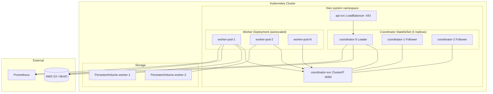

### 17.3 systemd Unit File (Worker)

```ini
[Unit]
Description=Frien Worker
After=network.target

[Service]
Type=simple
ExecStart=/usr/local/bin/frien worker --config /etc/frien/config.toml
RuntimeDirectory=frien-worker   # automatically creates + destroys /run/frien-worker/
RuntimeDirectoryMode=0700
Restart=on-failure
RestartSec=5s
# Security hardening
NoNewPrivileges=true
PrivateTmp=true
ProtectSystem=strict
ProtectHome=true

[Install]
WantedBy=multi-user.target
```

---

## 18. Academic Foundations & Lecture Mapping

This section maps every major distributed systems concept from the lecture curriculum to its concrete application in Frien. This is intentional — Frien is designed to be a **complete applied demonstration** of these concepts.

| Lecture Topic | Application in Frien |
|---|---|
| **gRPC and Threads** | Coordinator-worker heartbeat and task assignment channel. Each worker connection is handled by a dedicated goroutine. `sync.RWMutex` and `sync.Cond` protect shared state. |
| **Google File System (GFS)** | Storage architecture: coordinator tracks "chunk" (log object) locations like GFS master tracks chunk servers. Sequential read optimization, write-once intermediate files, append-only audit log. |
| **Primary-Backup Replication** | Coordinator cluster: leader handles all writes, followers are hot standbys. Raft formalizes the primary-backup model with leader election. |
| **Go Threads (goroutines)** | Worker task executor, heartbeat loop, and HTTP server each run in separate goroutines. Context cancellation propagates abort signals through goroutine trees. |
| **Raft Consensus Algorithm** | Coordinator cluster uses Raft for all state mutations. Job queue, task assignments, and cancellations are Raft log entries committed after quorum. Leader election on coordinator failure. |
| **Fault Tolerance via Raft** | Coordinator failures are handled by Raft leader election. Worker failures are handled by heartbeat timeout + task reassignment. Coordinator state survives any N/2-1 coordinator failures. |
| **ZooKeeper** | Raft is chosen over ZooKeeper for embedded operation, but ZooKeeper's sequential consistency model informs the coordinator's state machine design. The priority queue uses ZooKeeper-inspired watch semantics for task availability notification. |
| **CRAQ (Chain Replication with Apportioned Queries)** | Checkpoint replication to S3 follows a chain pattern: write to `.tmp` → copy to `latest` → delete `.tmp`. Read operations (status queries) can be served from any coordinator replica (followers) for read scaling, analogous to CRAQ's clean read from tail. |
| **Aurora (Cloud Replicated DB)** | Coordinator checkpoint storage draws from Aurora's design: write the log (Raft entries) not the data pages; storage nodes (S3) reconstruct state. Quorum writes for checkpoint durability. |
| **Frangipani / Memcached Cache Consistency** | Worker plugin cache: plugins downloaded from S3 are cached locally. Cache invalidation uses a version tag in the plugin manifest — workers re-download only when the version changes. Analogous to Frangipani's cache coherence via lock server (coordinator acts as lock server for plugin versions). |
| **Distributed Transactions** | Job lifecycle transitions (QUEUED→MAPPING→REDUCING→COMPLETED) are atomic multi-key state updates implemented as Raft log entries — equivalent to a single-shard distributed transaction. |
| **Google Spanner** | Severity scoring uses a TrueTime-inspired approach: findings include a confidence interval on detection timestamp derived from log ingestion lag. Cross-region log correlation uses causal timestamps rather than wall-clock time. |
| **Optimistic Concurrency Control** | Reduce task finalization: multiple speculative workers may complete the same task. OCC's read-validate-commit cycle selects the winner atomically without locking. |
| **Apache Spark** | Frien's architecture is consciously compared to Spark's DAG execution model. Frien chooses MapReduce's simpler two-phase model for auditability and fault-isolation. Future pipelined execution (see roadmap) moves toward Spark's DAG approach. |
| **Causal Consistency (COPS)** | Audit log uses causal predecessors per job — causally ordered chain of events enables forensic reconstruction even with out-of-order S3 delivery. |
| **Fork Consistency / Certificate Transparency** | Plugin signature verification uses a Certificate Transparency-inspired append-only log of plugin releases. Each plugin version is signed and its hash is published to an append-only transparency log — forks (signing the same version with different content) are detectable. |
| **Bitcoin / Blockchain** | Audit log tamper-evidence: audit records include the SHA-256 hash of the previous record — forming a hash chain analogous to a blockchain. Any tampering with a record invalidates all subsequent hashes, detectable on audit log verification. |
| **Blockstack** | Plugin identity and versioning uses a Blockstack-inspired model: detector plugin authors register a decentralized identity; plugin releases are signed with the author's private key and verified against their public key stored in a distributed registry. This enables community contribution without a central trusted authority for plugin signing. |

---

## 19. Work Breakdown Structure (WBS)

### Phase 1 — Foundation (Weeks 1–4)

```
1.0 Core Infrastructure
    1.1 Repository setup, CI/CD (GitHub Actions), Go module init
    1.2 Config loader (config.toml with viper)
    1.3 Single binary CLI (cobra) with coordinator/worker/submit/status commands
    1.4 Structured logging (zerolog)
    1.5 Prometheus metrics scaffolding

2.0 Storage Layer
    2.1 S3 client abstraction (AWS SDK + MinIO compatibility)
    2.2 S3 bucket layout implementation
    2.3 Safe write pattern (tmp → copy → delete) utility
    2.4 Checkpoint serialization/deserialization (JSON)
    2.5 Audit log writer (append-only S3 JSONL)
```

### Phase 2 — Core MapReduce Engine (Weeks 5–8)

```
3.0 gRPC Protocol
    3.1 Protobuf definitions (heartbeat, task assignment, registration)
    3.2 mTLS setup (coordinator CA, worker cert signing)
    3.3 gRPC server (coordinator) with per-connection goroutines
    3.4 gRPC client (worker) with reconnect logic

4.0 Coordinator
    4.1 Raft integration (etcd/raft library)
    4.2 Job queue (priority queue, FIFO within tier)
    4.3 Task assignment state machine
    4.4 Heartbeat monitor + worker liveness tracking
    4.5 Checkpoint manager (periodic + on critical transitions)
    4.6 HTTP API server (job submit, status, cancel)

5.0 Worker
    5.1 Registration flow with health probe
    5.2 Heartbeat loop with task consumption
    5.3 Local directory management (encrypted, systemd RuntimeDirectory)
    5.4 HTTP file server (serve .signals files only, TLS)
    5.5 Atomic rename for intermediate files
    5.6 Graceful shutdown + secure directory wipe
```

### Phase 3 — Detection Engine (Weeks 9–12)

```
6.0 Log Parsing
    6.1 CloudTrail JSON parser
    6.2 VPC Flow Log TSV parser
    6.3 IAM Access Analyzer parser
    6.4 GuardDuty finding parser
    6.5 K8s audit log parser
    6.6 Credential redaction layer

7.0 Plugin System
    7.1 Detector interface definition
    7.2 Go .so plugin loader with signature verification
    7.3 WASM plugin loader (wazero)
    7.4 Plugin cache with version invalidation

8.0 Built-in Detectors (v1.0)
    8.1 IAM privilege escalation detector
    8.2 S3 exfiltration detector
    8.3 Credential exposure detector
    8.4 Resource discovery (enumeration) detector
    8.5 Lateral movement detector
    8.6 Defense impairment detector
    8.7 BOLA pattern detector
    8.8 OAuth token abuse detector
    8.9 Misconfiguration scanner
```

### Phase 4 — Output & Integration (Weeks 13–15)

```
9.0 Findings Layer
    9.1 Finding struct + SARIF v2.1.0 serializer
    9.2 Severity scoring model
    9.3 Blast radius calculator
    9.4 MITRE ATT&CK tagging
    9.5 Remediation guide templates

10.0 Integration
    10.1 Webhook notification on finding emission
    10.2 GitHub SARIF upload action example
    10.3 Findings query API
    10.4 Summary report generator
```

### Phase 5 — Hardening & Open Source Release (Weeks 16–18)

```
11.0 Fault Tolerance Testing
    11.1 Worker crash simulation tests
    11.2 Coordinator failover tests (Raft leader election)
    11.3 Network partition simulation
    11.4 Speculative execution correctness tests
    11.5 Cancellation race condition tests

12.0 Security Hardening
    12.1 mTLS certificate rotation test
    12.2 Intermediate file encryption verification
    12.3 Audit log hash chain verification
    12.4 Plugin signature verification test
    12.5 Credential redaction test suite

13.0 Open Source Release
    13.1 Apache 2.0 LICENSE
    13.2 CONTRIBUTING.md + plugin authoring guide
    13.3 README with quickstart (Docker Compose)
    13.4 Architecture documentation (this document)
    13.5 GitHub Actions CI (test + lint + build)
    13.6 Docker images (coordinator + worker)
    13.7 Helm chart for Kubernetes deployment
```

---

## 20. Future Roadmap

### 20.1 WASM Plugin Runtime (Phase 2)

Go's `.so` plugin system requires exact compiler version matches and does not support Windows. The roadmap includes migrating to **WebAssembly (WASM)** using the `wazero` runtime:
- Detectors written in any language that compiles to WASM (Rust, Python via Pyodide, Go)
- Cross-platform: works on Linux, macOS, Windows
- Sandboxed execution: WASM sandbox prevents malicious plugins from accessing host resources

### 20.2 Pipelined Execution (Phase 2)

Currently a hard barrier exists between Map and Reduce phases. Future work will implement pipelined execution: a Reduce task for partition K begins as soon as all Map tasks contributing to partition K complete, rather than waiting for all Map tasks globally. This reduces end-to-end latency significantly for large jobs.

### 20.3 Real-Time Streaming Mode (Phase 3)

Batch processing of historical logs is the v1.0 model. A future streaming mode will ingest CloudTrail events in real-time via SNS/SQS and apply the Map phase continuously, emitting findings with sub-minute latency.

### 20.4 Multi-Cloud Log Sources (Phase 2)

Expanding beyond AWS to GCP (Cloud Audit Logs, VPC Flow) and Azure (Activity Logs, NSG Flow Logs), with a unified log event schema across all three.

### 20.5 Even Task Sizing via S3 Range Requests

Currently each S3 object is one Map task. A 10MB chunk and a 10GB chunk are both single tasks — a source of straggler issues. Future work will implement size-based logical splitting using S3 `Range` request headers to ensure uniform task durations.

### 20.6 Decentralized Plugin Registry

A Blockstack-inspired decentralized plugin registry where plugin authors register their identity on a public append-only log, publish plugins signed with their private key, and users verify plugins against the author's registered public key — enabling a trustless community plugin ecosystem.

---

## 21. OWASP Top 10:2025 Coverage

The OWASP Top 10:2025 (confirmed January 2026) is the industry-standard reference for the most critical application security risks. Frien addresses all ten categories in two distinct ways:

- **As a detector** — Frien actively scans cloud infrastructure logs to *detect* violations of each OWASP category in the systems it monitors
- **As a secure system** — Frien's own internals are designed to *not exhibit* any of these vulnerabilities itself

Both dimensions are documented below for each category.

---

### A01:2025 — Broken Access Control *(includes SSRF)*

**Frien detects it:**
The `bola_pattern` detector specifically targets Broken Object Level Authorization — the exact vulnerability that caused the Lovable breach (April 2026), where `/projects/{id}/*` endpoints verified authentication but skipped ownership checks entirely. Frien's Map phase extracts API call patterns per identity from API Gateway logs and CloudTrail, while the Reduce phase correlates cross-user resource access attempts. The `lateral_movement` detector also catches SSRF-style patterns where compute resources (ECS, Lambda) make unexpected calls to internal metadata endpoints (`169.254.169.254`) or cross-account resources they should not reach.

**Frien is not vulnerable:**
- The coordinator API enforces resource-scoped authorization: a job can only be read, cancelled, or queried by the API token that submitted it
- mTLS ensures workers cannot impersonate each other or the coordinator
- SSRF is mitigated by restricting outbound HTTP calls from workers to a whitelist (S3 endpoint + peer worker addresses registered with the coordinator)
- All coordinator API endpoints enforce ownership checks — there is no path where `GET /v1/jobs/{id}` returns a job belonging to a different API token

---

### A02:2025 — Security Misconfiguration *(moved up from #5 in 2021)*

**Frien detects it:**
The `misconfiguration_scan` detector is entirely dedicated to this category. It ingests AWS Config snapshots and evaluates every resource against a hardened baseline:
- Public S3 buckets (the fintech scenario: bucket set to public for testing, never reverted)
- Open security groups exposing admin panels or databases to `0.0.0.0/0`
- Unencrypted RDS instances, EBS volumes, and S3 buckets
- IAM password policies not meeting minimum requirements
- CloudTrail disabled in one or more regions
- Default VPC in use for production workloads
- Missing MFA on root account and privileged IAM users

Each misconfiguration finding includes a blast radius calculation showing which downstream resources are exposed as a result.

**Frien is not vulnerable:**
- Default configuration is secure-by-default: TLS required, no debug endpoints exposed, no default credentials anywhere in the codebase
- Docker images are built with `USER nonroot` and read-only root filesystems
- The Helm chart enforces `securityContext.readOnlyRootFilesystem: true` and drops all Linux capabilities
- systemd unit enforces `NoNewPrivileges=true`, `ProtectSystem=strict`, `PrivateTmp=true`

---

### A03:2025 — Software Supply Chain Failures *(new in 2025)*

**Frien detects it:**
The `oauth_token_abuse` detector catches the exact supply chain attack vector used in the Vercel breach — a compromised third-party tool (Context.ai) whose OAuth token was used to pivot into Vercel's internal systems. Frien maps OAuth grant activity in CloudTrail and IdP logs, flagging tokens that:
- Were issued to third-party applications with broad scopes
- Are being used from new geographic locations or IP ranges not previously associated with that grant
- Belong to vendor applications that have had their own credentials compromised (cross-referenced with threat intel feeds)

**Frien is not vulnerable:**
- Plugin supply chain is hardened via GPG signature verification and a Certificate Transparency-inspired append-only plugin release log (Section 12.3)
- Go module dependencies are pinned with `go.sum` checksums and verified in CI
- Docker base images are pinned to digest (`FROM golang:1.22@sha256:...`), not floating tags
- Dependency scanning runs on every PR via GitHub Actions (govulncheck + trivy)
- No third-party OAuth integrations in Frien's own runtime — it uses static API tokens with explicitly scoped permissions

---

### A04:2025 — Cryptographic Failures

**Frien detects it:**
The `credential_exposure` detector flags cryptographic failures in monitored environments:
- Unencrypted S3 buckets storing sensitive data
- RDS instances without encryption at rest
- API calls over HTTP instead of HTTPS (detectable via CloudTrail `tlsDetails` field)
- KMS key policy misconfigurations that allow unintended decryptors
- Secrets stored in EC2 user data, environment variables, or unencrypted Parameter Store entries (detectable via CloudTrail `GetParameter` calls without `--with-decryption` flag patterns)

**Frien is not vulnerable:**
- All inter-node communication uses TLS 1.3 — TLS 1.2 and below are disabled
- Intermediate files are encrypted with AES-256-GCM — authenticated encryption, not just confidentiality
- Per-job encryption keys are generated fresh for every job, never reused, never written to disk
- No hardcoded secrets anywhere in the codebase — enforced by `gitleaks` pre-commit hook and CI secret scanning
- S3 buckets used by Frien (checkpoints, audit, output) are created with SSE-KMS encryption enforced via bucket policy

---

### A05:2025 — Injection

**Frien detects it:**
The `resource_discovery` detector flags injection-style attack patterns in cloud logs — particularly where attacker-controlled strings in API calls attempt to manipulate resource identifiers, IAM policy conditions, or S3 key paths in ways consistent with injection exploitation (e.g., path traversal in S3 key names, wildcard abuse in IAM conditions).

**Frien is not vulnerable:**
- Frien has no database backend — no SQL, NoSQL, or LDAP injection surface
- All S3 key construction uses parameterized path builders, never string concatenation with user input
- Log event data is parsed into typed structs before being passed to detectors — raw strings from log events never reach Go `exec.Command`, `os.Open`, or any shell invocation
- The HTTP API uses `gorilla/mux` with strict route patterns; path parameters are validated against allowlists before use

---

### A06:2025 — Identification and Authentication Failures

**Frien detects it:**
Authentication failures in monitored cloud environments are detected across multiple detectors:
- `credential_exposure`: Simultaneous use of the same AWS access key from multiple geographic regions (impossible travel), or access key usage from an IP not previously associated with that identity
- `iam_privilege_escalation`: Console login without MFA for privileged accounts, failed authentication spikes suggesting brute force, root account usage
- `oauth_token_abuse`: OAuth token reuse after credential rotation should have invalidated the grant

**Frien is not vulnerable:**
- The coordinator API uses signed bearer tokens (HMAC-SHA256) with short expiry (configurable, default 1 hour)
- Worker authentication uses mTLS certificates — no username/password surface exists in the worker registration flow
- Failed authentication attempts to the coordinator API are rate-limited and logged to the audit trail
- The coordinator never stores API tokens in plaintext — only HMAC-SHA256 hashes of tokens are stored, analogous to password hashing

---

### A07:2025 — Insecure Design

**Frien detects it:**
Insecure design in monitored systems manifests as structural IAM and network architecture flaws that Frien detects:
- IAM roles with `*:*` wildcard permissions (not a misconfiguration — a design flaw)
- Absence of resource-based policies on S3 buckets storing sensitive data (detected via Config)
- VPC designs with no private subnets — all resources in public subnets
- Missing VPC endpoint policies allowing all traffic

**Frien is not vulnerable:**
- The threat model (Section 9.5) was produced before a line of code was written — security is a design constraint, not an afterthought
- The pull-based scheduling model (Section 4.3) is itself a secure design choice: workers cannot be fed malicious task payloads by a rogue entity impersonating the coordinator, because mTLS certificate validation happens before any task data is accepted
- Raft consensus prevents a single compromised coordinator replica from corrupting job state — requiring quorum compromise (N/2 + 1 nodes) for any state manipulation

---

### A08:2025 — Software and Data Integrity Failures

**Frien detects it:**
Data integrity failures in monitored environments are caught by:
- `defense_impairment`: CloudTrail log tampering, S3 Object Lock removal, CloudWatch log stream deletion — all are integrity failures and map to MITRE T1562
- `misconfiguration_scan`: S3 buckets without versioning or Object Lock enabled on compliance-critical data stores
- Cross-account replication misconfigurations where audit logs are replicated to an account that the audited account can also write to (defeating the purpose of immutable logging)

**Frien is not vulnerable:**
- The audit log uses a SHA-256 hash chain (Section 9.4) — any record tampering invalidates all subsequent hashes, detectable on verification
- Plugin integrity is enforced via GPG signature verification before loading (Section 12.3)
- Checkpoint files include a SHA-256 checksum — a corrupt checkpoint is detected on load and the system falls back to checkpoint N-1
- Frien's own S3 audit bucket is configured with Object Lock in Compliance mode — records cannot be deleted or modified even by the bucket owner during the retention period

---

### A09:2025 — Security Logging and Alerting Failures

**Frien directly addresses this category** — it is, at its core, a solution to exactly this problem. The OWASP 2025 update renamed this category from "Security Logging and Monitoring Failures" to "Security **Logging and Alerting** Failures" specifically to emphasize that logs without alerting have minimal value.

**Frien detects it in monitored environments:**
- CloudTrail disabled in any region (a logging failure by definition)
- GuardDuty suspended or findings suppressed
- VPC Flow Logs disabled on production VPCs
- S3 access logging not enabled on sensitive buckets
- No alerting configured on CloudWatch alarms despite metrics existing
- Security Hub findings sitting unacknowledged beyond a configurable SLA threshold

**Frien is not vulnerable:**
- Every security-relevant event in Frien emits both a structured log record AND, where configured, a webhook alert — logs without alerting are explicitly avoided
- The audit log is append-only and written to immutable S3 storage — it cannot be silently disabled
- Prometheus metrics expose `frien_findings_emitted_total` by severity — a sudden drop to zero is itself an alertable signal (Frien going silent = Frien is broken or suppressed)
- The cancellation-as-security-event design (Section 11.4) means suppression of Frien itself is detected and alerted on

---

### A10:2025 — Mishandling of Exceptional Conditions *(new in 2025)*

**Frien detects it:**
Exceptional condition mishandling in monitored systems often manifests in logs as:
- HTTP 500 responses with stack traces in API Gateway access logs (information disclosure)
- Lambda function timeouts followed by retries that create unintended side effects (detected via CloudWatch Logs patterns)
- IAM policy evaluation errors that result in implicit denies being logged but not acted on
- S3 replication failures that silently drop objects (detectable via S3 replication metrics in CloudWatch)

**Frien is not vulnerable:**
- All error paths in Frien return typed `error` values — no panics are allowed in production code paths (enforced by `go vet` + `staticcheck` in CI)
- The worker's task executor wraps detector plugin calls in `recover()` to catch panics from third-party plugin code — a panicking plugin cannot crash the worker process
- gRPC errors use structured status codes — no stack traces are ever returned to API callers
- The coordinator's Raft FSM uses explicit error handling for every state transition — an unexpected input to the state machine logs and rejects, it does not fail open
- HTTP API error responses are sanitized — internal error details are logged server-side but never included in the response body

---

### OWASP Coverage Summary

| OWASP Top 10:2025 | Frien Detects It | Frien Is Protected | Key Detector / Mechanism |
|---|---|---|---|
| A01 — Broken Access Control (incl. SSRF) | ✅ | ✅ | `bola_pattern`, `lateral_movement`; resource-scoped API auth |
| A02 — Security Misconfiguration | ✅ | ✅ | `misconfiguration_scan`; secure-by-default config |
| A03 — Software Supply Chain Failures | ✅ | ✅ | `oauth_token_abuse`; GPG plugin signing, pinned deps |
| A04 — Cryptographic Failures | ✅ | ✅ | `credential_exposure`; AES-256-GCM, TLS 1.3 only |
| A05 — Injection | ✅ | ✅ | `resource_discovery`; typed log parsing, no shell exec |
| A06 — Identification & Authentication Failures | ✅ | ✅ | `credential_exposure`, `iam_privilege_escalation`; mTLS, HMAC tokens |
| A07 — Insecure Design | ✅ | ✅ | IAM wildcard detector; threat-modeled architecture |
| A08 — Software & Data Integrity Failures | ✅ | ✅ | `defense_impairment`; hash chain audit log, GPG plugins |
| A09 — Security Logging & Alerting Failures | ✅ (core purpose) | ✅ | Frien *is* the solution; immutable audit, alerting-first design |
| A10 — Mishandling of Exceptional Conditions | ✅ | ✅ | Lambda/API error detectors; typed errors, plugin panic recovery |

**Frien achieves full OWASP Top 10:2025 coverage** — both as a detection tool for cloud environments and as a securely engineered system in its own right. This dual coverage is intentional: a security tool that itself violates the standards it enforces would be a contradiction. Frien is designed to be auditable, demonstrable, and trustworthy by construction.

---

*Frien Architecture Design Document v1.0*
*Designed for open source cloud security tooling*
*Apache License 2.0*
