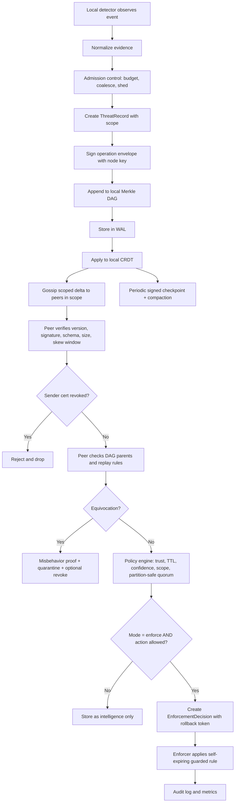
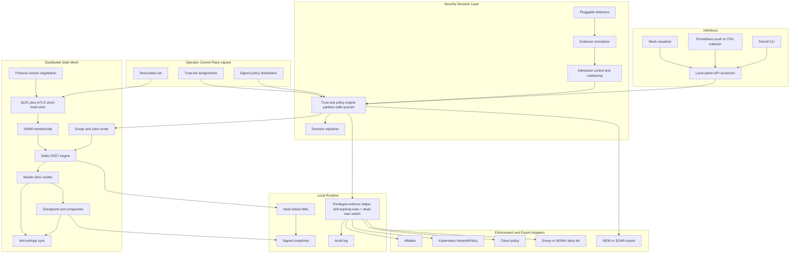
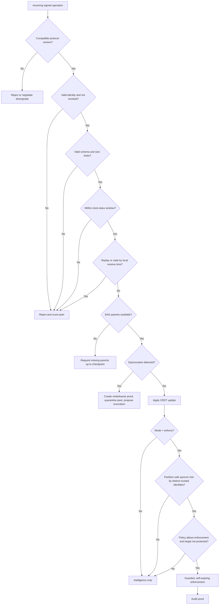
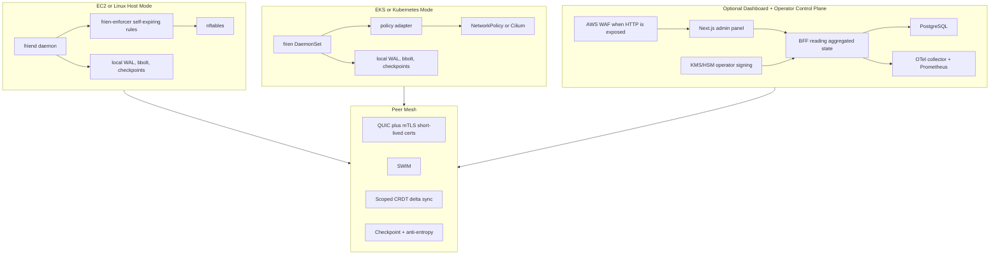

# frien

## Plan of Action

### A Decentralized Security-State Mesh for Secure, Scalable Distributed Infrastructure

frien is a headless distributed systems project focused on secure state sharing, trust-aware decision making, and safe automated response across a fleet of machines. The core idea is simple: when one node observes a security-relevant event, the rest of the fleet should be able to learn about it, verify where it came from, evaluate it through policy, and respond without depending on a single central coordinator.

Post-quantum cryptography can be included as a future-facing hardening option, but it is not the main identity of the project. The main identity of frien is secure distributed coordination for infrastructure defense.

> **Revision note (2026-06-14):** This plan was hardened after an architecture review. The major additions are: (1) checkpoint-based compaction so the tamper-evident layer cannot grow without bound, (2) a formally defined quorum that is safe under partitions and Sybil pressure, (3) decentralized certificate revocation distinct from behavioral quarantine, (4) fail-safe enforcement where the enforcer — not the daemon — owns rule lifetime, (5) a separate operator-signed control plane, (6) state scoping/zones to avoid full fleet replication, (7) admission control for threat storms, (8) protocol versioning for safe rolling upgrades, and (9) deterministic-simulation + Jepsen + TLA+ testing for the safety-critical protocols. Enforcement is now **observe-only by default**. The system is described as **accountable / tamper-evident**, not "Byzantine fault tolerant," because it detects equivocation and provides provenance — it does not run consensus.

---

## 1. Objective

Build a decentralized security-state mesh that allows infrastructure nodes to:

1. Detect security-relevant events locally.
2. Convert local observations into signed, evidence-backed threat records under admission control.
3. Propagate scoped security state across peers using gossip and delta-state CRDTs.
4. Verify operation provenance with signatures and tamper-evident, **compactable** history.
5. Detect protocol-level misbehavior such as equivocation, and **revoke** compromised identities.
6. Evaluate incoming state through a trust and policy engine before action, using a **partition-safe quorum**.
7. Enforce safe mitigations — **observe-only by default** — through pluggable adapters such as nftables, Kubernetes NetworkPolicy, Cilium, Envoy, or SIEM/SOAR export.
8. Protect frien itself through least privilege, network isolation, secure defaults, fail-safe cleanup, and strong auditability.

The reusable primitive is the distributed security-state layer. The first applied use case is autonomous threat sharing and guarded enforcement across edge, cloud, and Kubernetes fleets.

---

## 2. Problem Statement

Modern infrastructure is distributed, but security response is often centralized, slow, or isolated per host.

Common problems:

- Local tools such as log-based blockers can detect abuse on one host but do not naturally coordinate with the rest of a fleet.
- Central security platforms introduce dependency on a control service, network reachability, API limits, and central availability.
- Edge nodes, regional servers, IoT gateways, Kubernetes nodes, and multi-cloud workloads often operate outside a clean perimeter.
- A compromised node can publish misleading security signals if the system blindly trusts authenticated participants.
- Automated blocking is dangerous without policy, TTLs, protected ranges, quorum, rollback, and a clear explanation trail.
- Security agents themselves are high-value targets because they often run with privileged access.
- A security agent that auto-modifies firewalls can take the fleet — or itself — offline; **self-lockout is the single most dangerous failure mode** and must be designed against explicitly.

frien solves this by combining distributed systems primitives with security controls:

> Share scoped security state fast, verify its origin, converge without central coordination, keep history tamper-evident but bounded, and enforce only after policy says the action is safe — defaulting to observe-only until an operator promotes a node to enforce.

---

## 3. Product Positioning

frien is best described as:

> A decentralized security-state mesh that helps infrastructure nodes defend collectively through gossip, CRDT convergence, signed and compactable operation history, trust-aware policy, and guarded enforcement.

frien is not:

- A SIEM replacement.
- A full detection platform.
- A blockchain.
- A central threat-intelligence database.
- A crypto research project.
- A consensus / BFT system. (It is *accountable* — it proves provenance and detects equivocation — not Byzantine-fault-tolerant.)
- A tool that blindly blocks anything another node reports.

The detector layer is intentionally pluggable. The differentiator is the secure distributed coordination layer.

### 3.1 Ideal Customer Profile and Market Wedge

frien deliberately enters the market as **fleet-wide security visibility with a tamper-evident trail**, and expands into **guarded enforcement** only once the operator trusts the decisions. This "observe first, enforce later" motion is both the safety model and the go-to-market wedge.

| Dimension | Position |
|-----------|----------|
| Primary ICP | Platform/SRE-security teams running edge, multi-cloud, or partition-prone fleets that distrust a single SaaS control plane. |
| Secondary ICP | Sovereignty/air-gap-sensitive operators (defense, regulated, on-prem) where no-central-dependency is a hard requirement. |
| Closest competitor | CrowdSec (agent-based, crowd-sourced) — but CrowdSec is centrally curated; frien needs no central coordinator for correctness. Adjacent: fail2ban (local only), Falco/Tetragon (detection), Cilium (enforcement). |
| Wedge | Land as decentralized, tamper-evident visibility; expand to guarded enforcement per node. |
| Commercial model | OSS core (mesh, CRDT, policy, nftables); commercial add-ons: managed dashboard/BFF, multi-tenancy, compliance reporting, long-term audit archive, support. |
| Compliance story | Map features to controls (e.g., tamper-evident audit → SOC 2 CC7/CC8, PCI 10.x; least privilege → CIS, NIST 800-53 AC). Ship a `docs/COMPLIANCE.md` mapping. |

Product gaps to close before serious market entry: multi-tenancy, a compliance mapping, and a managed/observability story that does not re-centralize *correctness*.

---

## 4. Design Principles

| Principle | Meaning in frien |
|-----------|------------------|
| Local-first operation | Nodes keep working when disconnected from a central service because there is no required central service. |
| Secure by default | Admin APIs bind locally, peer traffic requires mTLS, firewall profiles deny unnecessary access, and enforcement starts in observe-only mode. |
| Observe before enforce | Enforcement is disabled by default. A node only acts after an operator explicitly promotes it from `observe` to `enforce`. |
| No implicit trust | A signed message proves who sent it, not that the content is true. Policy decides whether the content can trigger action. Provenance ≠ truth. |
| Two trust planes | Data-plane objects (threat records) are signed by node keys and never trusted directly. Control-plane objects (policies, trust tiers, revocations) are signed by operator/CA keys and are the only objects that may grant authority. |
| Least privilege | The main daemon runs unprivileged; only a small enforcer helper gets the minimum OS capability needed. |
| Fail-safe enforcement | The enforcer owns rule lifetime. Rules self-expire in the kernel where possible, and a dead-man's switch removes frien-managed rules if the daemon dies. Cleanup fails open; enforcement fails closed. |
| Bounded state | The tamper-evident DAG and WAL are periodically checkpointed and compacted. No structure grows without bound in normal operation. |
| Safe enforcement | TTLs, protected CIDRs (IPv4 and IPv6), confidence thresholds, partition-safe quorum, dry-run, rollback, and rate limits are built into the enforcement path. |
| Explainability | Every action must answer: who reported it, what evidence was attached, which signed policy approved it, what quorum was met, and what changed. |
| Tamper evidence | Operation history is signed and linked through a Merkle DAG so peers can detect missing, conflicting, or altered history — and can verify history up to a signed checkpoint without retaining every operation. |
| Accountability over consensus | frien detects equivocation and produces portable misbehavior proofs. It does not claim to tolerate arbitrary Byzantine faults or to reach consensus. |
| Scalability through scoping | Gossip, delta-state CRDTs, anti-entropy sync, snapshots, bounded message sizes, and **state scoping/zones** prevent naive full-fleet flooding. |
| Crypto agility | Classical crypto is the baseline; PQC can be enabled where supported without making the whole design depend on one algorithm family. |
| Safe evolution | Every wire object carries a protocol version; mixed-version clusters negotiate a common version and migrate schemas explicitly. |

---

## 5. Target Use Cases

| Use Case | What frien Does |
|----------|------------------|
| Edge fleet threat sharing | If one edge node sees abusive traffic, peers in the relevant scope receive evidence-backed state within seconds. |
| Kubernetes workload protection | frien can translate approved decisions into NetworkPolicy, Cilium policy, or ingress deny rules. |
| Multi-cloud security coordination | Security state can move across AWS, GCP, Azure, and on-prem nodes without a single coordinator. |
| Tamper-evident incident trail | Security decisions and peer behavior are stored as signed, hash-linked, checkpointed records. |
| Safe automated blocking | Guarded, observe-first enforcement prevents one noisy detector or compromised peer from causing fleet-wide damage. |
| Security posture validation | frien can inspect its own firewall, permissions, certificates, open ports, and runtime hardening. |
| Compromised-node containment | A misbehaving node is quarantined behaviorally and, if operator-authorized, has its certificate revoked across the mesh. |

---

## 6. End-to-End Workflow



Key points:

- Propagation and enforcement are separate. A node may accept a threat record into the mesh but refuse to enforce it.
- Enforcement only happens on nodes an operator has promoted to `enforce`. Default is `observe`.
- Admission control sits before record creation so a threat storm degrades gracefully instead of melting the fleet.
- Checkpointing runs continuously in the background so the tamper-evident layer stays bounded.

---

## 7. High-Level Architecture



The control plane (signed policies, trust tiers, revocations) is a separate trust domain from the data plane (node-reported threat records). Only control-plane objects, signed by operator/CA keys, can grant authority.

---

## 8. Trust-Aware Decision Flow



This is the most important correction to the original plan: **signatures prove provenance, not truth.** frien verifies protocol correctness, confirms the identity is not revoked, requires a quorum of distinct trusted identities that is safe under partition, and only then — and only on an enforce-mode node — takes action.

### 8.1 Partition-Safe Quorum Definition

"Independent reports" is defined precisely to be safe in an eventually-consistent, partitionable system:

- **Distinct identities only.** A report counts toward quorum only if it carries a distinct, currently-valid, CA-issued node certificate. This ties quorum strength directly to certificate-issuance discipline and is the primary Sybil control.
- **Trust-tier weighting.** Each tier carries a weight; quorum is expressed as required *weight*, not raw count (e.g., one `trusted` sensor may equal three `standard` edges). Default weights are conservative.
- **Bounded window by local receive time.** Reports count only within a bounded window measured against the *local* receive clock (not origin wall-clock), so clock skew cannot inflate or deflate quorum.
- **Partition behavior is fail-safe.** A node in a minority partition that cannot observe the required weight from distinct identities **must not** take fleet-scoped enforcement; it falls back to intelligence-only. frien deliberately favors *consistency of the enforcement decision* over *availability of enforcement* (an explicit CAP choice). Local-scope actions on directly-observed local evidence are still permitted under policy.
- **No self-counting of relayed copies.** Receiving the same signed report from many peers counts once (keyed by operation ID + origin identity), preventing gossip amplification from manufacturing quorum.

---

## 9. Core Data Model

### OperationEnvelope

Every data-plane and control-plane object travels inside a signed, versioned envelope.

```json
{
  "proto_version": 1,
  "op_id": "op_01HZX...",
  "op_type": "threat_record",
  "node_id": "node_edge_12",
  "hlc": "2026-05-16T10:20:30.000Z-4-node_edge_12",
  "seq": 184,
  "parents": ["bafy..."],
  "payload_hash": "sha256:...",
  "payload": { "...": "..." },
  "signed_by": "node",
  "key_id": "cert:sha256:...",
  "signature": "base64..."
}
```

### ThreatRecord (payload)

```json
{
  "id": "threat_01HZX...",
  "indicator": "203.0.113.44",
  "indicator_type": "ip",
  "reason": "ssh_bruteforce",
  "severity": "medium",
  "confidence": 0.91,
  "ttl": "1h",
  "scope": "zone:edge-eu-west",
  "detector": "authlog_bruteforce_v1",
  "evidence": {
    "failed_attempts": 128,
    "window": "60s",
    "target_service": "sshd"
  },
  "coalesced_count": 1,
  "reported_by": "node_edge_12"
}
```

`scope` controls replication: `local`, `zone:<name>`, or `fleet`. Most records are zone-scoped; `fleet` is reserved for high-confidence, high-severity indicators.

### EnforcementDecision

```json
{
  "id": "decision_01HZY...",
  "action": "block",
  "target": "203.0.113.44",
  "adapter": "nftables",
  "mode": "observe",
  "expires_at": "2026-05-16T11:20:30Z",
  "kernel_timeout": "1h",
  "approved_by_policy": "edge_block_v1",
  "policy_version": 7,
  "required_weight": 3.0,
  "matched_weight": 4.0,
  "contributing_identities": ["node_edge_12", "node_edge_19", "node_edge_22"],
  "rollback_token": "rollback_01HZZ...",
  "owner": "frien-enforcer"
}
```

`mode` is `observe` (logged, not applied) until the node is promoted to `enforce`. `kernel_timeout` makes the rule self-expire even if the daemon dies. `owner` records that the enforcer, not the daemon, owns the rule's lifetime.

### Policy (control-plane, operator-signed)

```json
{
  "id": "edge_block_v1",
  "version": 7,
  "signed_by": "operator",
  "operator_key_id": "kms:arn:aws:kms:...",
  "signature": "base64...",
  "body": { "...": "see §10 Layer 5" }
}
```

### RevocationRecord (control-plane, operator-signed)

```json
{
  "cert_fingerprint": "sha256:...",
  "node_id": "node_edge_12",
  "reason": "equivocation_proof_01HZX",
  "revoked_at": "2026-05-16T10:25:00Z",
  "signed_by": "operator",
  "signature": "base64..."
}
```

### Checkpoint (signed, compaction anchor)

```json
{
  "checkpoint_id": "ckpt_01J0...",
  "tree_head": "sha256:...",
  "covers_through_hlc": "2026-05-16T10:00:00.000Z-0-*",
  "prev_checkpoint": "ckpt_01HZ...",
  "materialized_state_hash": "sha256:...",
  "signed_by": "node",
  "signature": "base64..."
}
```

### PeerState

```json
{
  "node_id": "node_edge_12",
  "role": "edge",
  "zone": "edge-eu-west",
  "trust_tier": "standard",
  "trust_weight": 1.0,
  "status": "alive",
  "enforce_mode": "observe",
  "cert_fingerprint": "sha256:...",
  "cert_not_after": "2026-05-16T16:20:30Z",
  "revoked": false,
  "last_seen": "2026-05-16T10:20:30Z",
  "misbehavior_score": 0
}
```

---

## 10. Technical Architecture

### Layer 0: Protocol Versioning (cross-cutting)

- Every wire object carries `proto_version`.
- Peers negotiate the highest mutually-supported version at session handshake.
- Mixed-version clusters are a first-class supported state during rolling upgrades; nodes never assume a single version.
- Schema migrations are explicit and forward/backward compatible within a supported window (N-1 at minimum).
- Breaking changes require a deprecation cycle documented in `PROTOCOL.md`.

### Layer 1: Transport and Identity

- QUIC via `quic-go`.
- mTLS for peer authentication, using **short-lived node certificates** (hours, not months) issued by a private CA — bounding the blast radius of a compromised key.
- Certificate pinning or private CA for controlled deployments.
- Revocation is enforced at the transport layer: a session from a revoked fingerprint is dropped (see Layer 10).
- Optional hybrid post-quantum key exchange where supported by the Go TLS stack.
- Connection pooling, bounded streams, deadline handling, and backpressure.
- Explicit max message sizes and per-peer rate limits (handshakes and streams).
- Clock-skew window: operations whose origin HLC implies skew beyond the configured maximum (default a few seconds, NTP recommended as a soft dependency) are rejected.

### Layer 2: Membership

- SWIM-style membership with `alive`, `suspect`, `dead`, and `left` states (Lifeguard-style suspicion refinements recommended).
- Seed-node bootstrap for predictable environments.
- Optional mDNS for local lab and LAN discovery.
- Failure detection tuning per deployment profile.
- Membership messages can piggyback bounded CRDT deltas and revocation-set updates.

### Layer 3: Distributed State and Scoping

- Initial CRDT: expiring delta OR-Set for threat records and enforcement decisions.
- Later CRDTs: LWW-Map for node metadata, G-Counter for telemetry, LWW-Register for small config values.
- **Scope/zone router:** records carry a `scope` (`local`/`zone:<name>`/`fleet`). Nodes replicate only the scopes they subscribe to. This removes the full-fleet-replication scaling wall — an edge node in one zone does not hold every record from every other zone.
- Hybrid Logical Clocks for causality without requiring clock sync.
- Anti-entropy sync through root-hash comparison and DAG walk, **bounded below by the latest common checkpoint** (peers reconcile only the operations above the shared checkpoint).
- Property-based tests for convergence, idempotency, commutativity, and associativity.

### Layer 4: Tamper-Evident Verification and Compaction

- Every operation is placed in a signed envelope (see §9).
- Operation envelopes include operation hash, node identity, HLC, sequence, parent hashes, and signature.
- Operations form a Merkle DAG for tamper-evident history.
- Peers detect missing parents, malformed history, replays, and equivocation.
- Equivocation produces a portable misbehavior proof that can quarantine a peer and trigger a revocation proposal.
- **Checkpoint-and-compact (the bound on growth):**
  - Periodically, a node computes a stable cut below all live causal frontiers it can observe, materializes CRDT state at that cut, and emits a signed `Checkpoint` chaining to the previous one.
  - DAG nodes and WAL entries below a sufficiently old, widely-acknowledged checkpoint are pruned. The checkpoint hash chain preserves verifiability of history *up to* the checkpoint without retaining every operation.
  - Mental model: Certificate Transparency tree-head consistency proofs + log compaction. Verifiers trust the signed tree head, not every leaf.
  - Compaction is conservative: nothing is pruned until it is provably below the causal frontier and the checkpoint is acknowledged by a configurable fraction of in-scope peers.

### Layer 5: Trust and Policy Engine

The policy engine decides whether received state can trigger action. Policies are **control-plane objects: operator-signed and versioned**. A node accepts a policy only if its signature verifies against a pinned operator/CA root — never because a peer sent it.

Policy inputs:

- reporter identity and whether it is revoked
- trust tier and trust weight
- detector type
- evidence fields
- confidence
- TTL (capped)
- severity
- target scope
- protected CIDRs (IPv4 and IPv6) and protected hosts/services
- partition-safe quorum requirement (required weight from distinct identities)
- recent false-positive history
- peer misbehavior score
- node enforce-mode (`observe` vs `enforce`)

Example policy body:

```yaml
policy:
  id: edge_block_v1
  version: 7
  action: block
  default_mode: observe          # nodes must be promoted to enforce
  min_confidence: 0.85
  require_weight: 3.0            # weighted, distinct identities, partition-safe
  quorum_window: 5m             # measured by local receive time
  max_ttl: 1h
  kernel_timeout_required: true # rules must self-expire in the kernel
  protected_cidrs:
    - 127.0.0.0/8
    - 10.0.0.0/8
    - 172.16.0.0/12
    - 192.168.0.0/16
    - 169.254.0.0/16            # link-local incl. cloud metadata 169.254.169.254
    - ::1/128
    - fc00::/7                  # unique local
    - fe80::/10                 # link-local
  protect_self_planes: true     # dynamically protect mesh/admin/management addresses
  deny_if_target_is_admin_endpoint: true
  rollback_on_error: true
```

Optional OPA/Rego integration can replace YAML once policy complexity grows; OPA bundles must also be operator-signed.

### Layer 6: Detection and Admission Control

- Pluggable Go `Detector` interface.
- Initial detectors:
  - SSH brute-force from auth logs.
  - HTTP rate anomaly from access logs.
  - Port scan signal from local firewall logs.
  - Manual operator report through CLI.
- Detectors produce evidence, not direct firewall actions.
- **Admission control** sits between detection and record creation:
  - per-detector and per-node **operation-creation budgets** (token-bucket).
  - **coalescing**: many identical signals (e.g., 10k brute-force hits) collapse into one record with `coalesced_count`, rather than 10k records.
  - **priority shedding**: under storm, low-severity/low-confidence signals are dropped first so signature verification and gossip do not collapse fleet-wide.
- Detector output must pass normalization, admission, and policy before enforcement.

### Layer 7: Enforcement (observe-first, fail-safe)

- **Default mode is `observe`**: decisions are computed, logged, audited, and shown in `explain`, but no rule is applied. An operator promotes a node to `enforce` explicitly (per node, per adapter).
- Primary Linux adapter: nftables (avoid legacy iptables for new work).
- **The enforcer owns rule lifetime, not the daemon:**
  - rules are written with kernel-native expiry (nftables `timeout`) so they self-remove even if `friend` crashes.
  - a **dead-man's switch**: if the enforcer stops receiving heartbeats from `friend`, it removes all frien-managed rules (cleanup fails open) — but only from frien's own chains, never the host baseline.
  - rollback tokens are persisted durably in the WAL and reconciled on restart, so a crash mid-change is recoverable.
  - frien self-protection chains are kept separate from customer enforcement chains so cleanup never touches the host's own firewall.
- Optional adapters: Kubernetes NetworkPolicy, Cilium policy, Envoy/NGINX deny list, cloud firewall export, SIEM/SOAR webhook.
- Enforcement supports dry-run, observe mode, guarded mode, rollback, max changes per minute, and TTL-based expiration.

### Layer 8: Storage

- Append-only WAL for operation durability, hash-linked for tamper evidence.
- **Checkpoint-aware compaction:** WAL entries below an acknowledged checkpoint are pruned (see Layer 4).
- Signed snapshots for faster startup, anchored to a checkpoint.
- bbolt for local indexed metadata (including rollback-token reconciliation state).
- Crash recovery tests.
- Tombstone garbage collection after safe TTL windows and below the checkpoint frontier.

### Layer 9: Observability

- Structured logs.
- Prometheus metrics, exported **push-style to an OpenTelemetry collector** for fleet aggregation (local scrape still available per node). This avoids a dashboard BFF having to fan-out-poll thousands of nodes, which would itself become a bottleneck and SPOF.
- OpenTelemetry traces for gossip, sync, policy decisions, and enforcement.
- Fleet SLOs / health checks:
  - peer count
  - convergence lag (p99)
  - rejected operations rate
  - policy denials rate
  - enforcement-active count (and observe vs enforce ratio)
  - **DAG size and compaction lag**
  - **revocation propagation time**
  - certificate expiry / rotation health
  - WAL health
  - admission-control shed rate (storm signal)

### Layer 10: Identity Lifecycle and Revocation

Quarantine (soft, behavioral) and revocation (hard, cryptographic, operator-authorized) are distinct mechanisms.

- **Short-lived certificates:** node certs are issued for hours and auto-renewed by the agent against the private CA, so an unrenewed compromised key expires on its own quickly.
- **Revocation set:** a control-plane CRDT (OR-Set keyed by cert fingerprint), where each entry is **operator/CA-signed** — not signed by peers. It gossips like other state and is consulted at the transport layer (drop sessions) and policy layer (drop reports).
- **Flow:** equivocation proof → automatic quarantine (immediate, local, behavioral) → revocation *proposal* surfaced to an operator → operator-signed `RevocationRecord` → mesh-wide enforcement of revocation. Automated quarantine contains fast; cryptographic revocation requires operator authority to avoid a self-revocation DoS.

### Layer 11: Control Plane Distribution

- Policies, trust-tier assignments, and revocations are control-plane objects signed by operator/CA keys (HSM/KMS-backed where available).
- They are distributed over the same gossip/CRDT transport but verified against pinned operator roots, never against peer keys.
- Versioned and monotonic: a node never downgrades to an older policy version for the same policy ID.
- This cleanly separates "what nodes observe" (data plane, untrusted) from "what may grant authority" (control plane, operator-rooted).

---

## 11. Self-Protection Plan

frien protects infrastructure, but it must also protect itself.

### Network Protection

Default ports:

| Surface | Default Bind | Default Exposure |
|---------|--------------|------------------|
| Peer mesh | `udp/7443` | Allowed only from configured peer CIDRs or known peers |
| Admin API | Unix socket or `127.0.0.1:9443` | Local only |
| Metrics | `127.0.0.1:9109` | Local or monitoring CIDR only |
| Debug | Disabled | Local only when explicitly enabled |

Firewall defaults:

- deny inbound by default
- allow established and related traffic
- allow peer port only from trusted peer ranges
- allow admin only through localhost, VPN, or bastion
- allow metrics only from monitoring systems
- rate-limit peer handshakes
- rate-limit admin authentication attempts
- separate frien self-protection chains from customer enforcement chains
- **dynamically protect frien's own planes**: the mesh peer addresses, admin API, metrics endpoint, and the node's management/SSH path are added to the protected set at runtime so a policy can never block frien's own control or operator access.

### Built-In Hardening Profiles

Planned CLI:

```bash
frienctl harden status
frienctl harden doctor
frienctl harden apply --profile dev
frienctl harden apply --profile server
frienctl harden apply --profile edge
frienctl harden apply --profile kubernetes
```

Profiles:

| Profile | Purpose |
|---------|---------|
| `dev` | Local-only testing, no kernel enforcement by default. |
| `server` | Peer CIDR allowlist, local admin API, metrics restricted. |
| `edge` | Strict inbound deny, peer-only mesh, stronger rate limits. |
| `kubernetes` | NetworkPolicy or Cilium-aware deployment. |
| `strict` | mTLS required, signed config, signed policies, short-lived certs enforced, no anonymous bootstrap, hardened systemd settings. |

### Privilege Separation

Processes:

| Component | Privilege Level | Responsibility |
|-----------|-----------------|----------------|
| `friend` | unprivileged | mesh, policy, storage, API, detectors |
| `frien-enforcer` | minimal OS capability | nftables or host-level enforcement, rule lifetime, dead-man's switch |
| `frienctl` | user CLI | operator commands |

The main daemon should not run as root. The enforcer helper receives only the minimum capability required for the selected adapter and owns the lifetime of every rule it applies.

Suggested systemd hardening:

```ini
User=frien
Group=frien
NoNewPrivileges=true
ProtectSystem=strict
ProtectHome=true
PrivateTmp=true
PrivateDevices=true
ReadWritePaths=/var/lib/frien /run/frien
RestrictAddressFamilies=AF_INET AF_INET6 AF_UNIX
MemoryDenyWriteExecute=true
```

### API Protection

- Admin API local-only by default.
- Optional OIDC for dashboard access.
- RBAC roles: `viewer`, `operator`, `admin`, `breakglass`.
- Short-lived API tokens with scopes.
- Request size limits.
- Strict CORS when HTTP is enabled.
- CSRF protection for browser sessions.
- Secure cookies for dashboard sessions.
- No default passwords.
- No public registration.
- Read-only mode enforced at the API layer (not only the UI).
- Full audit trail for admin actions; every action maps to a signed, audited API command.

### Storage Protection

Recommended paths:

| Path | Purpose | Permissions |
|------|---------|-------------|
| `/etc/frien` | config | root-owned, `0750` |
| `/etc/frien/keys` | private keys | root-owned, `0700`; key files `0600` |
| `/var/lib/frien` | WAL, DAG, snapshots, checkpoints | `frien` user, `0700` |
| `/run/frien` | sockets | `frien` user, `0750` |

Additional controls:

- encrypted private keys where feasible
- optional TPM, KMS, or HSM-backed keys (required for operator/control-plane signing keys)
- signed snapshots and checkpoints
- hash-linked audit log
- startup integrity checks
- safe backup and restore procedures

### Kubernetes Protection

If deployed as a DaemonSet:

- run main container as non-root
- read-only root filesystem
- drop all Linux capabilities in the main container
- isolate the privileged enforcer into a separate container or DaemonSet
- use minimal Kubernetes RBAC
- use a dedicated namespace
- apply default-deny NetworkPolicy
- allow only peer traffic, DNS, metrics, and required API calls
- sign container images
- scan images in CI

### Supply-Chain Protection (from day one)

- SBOM generation (`syft`) for every build.
- Dependency and image scanning (`grype`, `govulncheck`) in CI; build fails on known criticals.
- Signed releases and signed container images (`cosign`); aim for reproducible builds.
- SLSA-style provenance attestation for artifacts.

A tool that runs privileged on a fleet must be supply-chain clean from the first commit, not at the end.

---

## 12. Safety Model for Enforcement

frien should never treat a new threat record as an automatic block command, and a node never enforces until an operator promotes it.

Required safeguards:

- **observe-only by default; explicit per-node promotion to enforce**
- dry-run mode for new policies
- protected CIDR list (IPv4 and IPv6)
- protected host list
- protected service list
- dynamic self-plane protection (mesh/admin/metrics/management)
- TTL required for all deny actions
- max TTL per policy
- **kernel-native rule expiry required** (rules self-remove even if the daemon dies)
- **enforcer dead-man's switch** (cleanup fails open on daemon death)
- durable, crash-recoverable rollback tokens
- max new actions per minute
- partition-safe quorum for fleet-wide action
- local-only action for low-confidence or partition-isolated records
- rollback token for every adapter change
- policy simulator before rollout
- emergency allowlist
- operator override with audit reason
- **self-lockout recovery / breakglass**: a local, mesh-independent path (e.g., `frienctl --local breakglass`) that flushes all frien enforcement chains and forces observe mode, usable even if the mesh is partitioned or misbehaving.

Example CLI:

```bash
frienctl mode set observe
frienctl mode set enforce --adapter nftables --confirm --reason "rollout phase 2"
frienctl policy test --file edge-block.yaml --record sample-threat.json
frienctl explain block 203.0.113.44
frienctl enforcement rollback rollback_01HZZ
frienctl enforcement dry-run --policy edge_block_v1
frienctl --local breakglass --flush-enforcement --force-observe
```

---

## 13. Differentiators

These features make frien stand out as a serious distributed systems and security project:

1. Live mesh visualizer showing peer health, gossip propagation, convergence status, scope/zone topology, and quarantined/revoked peers.
2. Attack simulation mode for a repeatable demo: detect on node A, propagate, verify, approve, enforce, and audit.
3. **Accountability demo** where a malicious node sends conflicting operations and frien generates a portable misbehavior proof, quarantines, and (operator-authorized) revokes it. (Described honestly as accountability, not BFT.)
4. Policy simulator that shows why a threat record would or would not trigger enforcement.
5. `frienctl explain` for any action, including evidence, contributing identities, quorum weight, signed policy version, TTL, and adapter state.
6. Self-hardening check through `frienctl harden doctor`, including self-lockout-risk detection.
7. Kubernetes and Cilium integration as a practical cloud-native extension.
8. Tamper-evident, **compactable** audit chain for incident review (verifiable up to signed checkpoints without unbounded storage).
9. Safe, observe-first, self-expiring rollback of security actions.
10. **Deterministic-simulation and TLA+-verified** safety-critical protocols (membership, quorum, quarantine, revocation) — a correctness story competitors rarely match.
11. Crypto-agile design with optional PQC hardening where the runtime supports it.

---

## 14. Repository Structure

```text
frien/
  cmd/
    friend/                 # main daemon
    frienctl/               # CLI
    frien-enforcer/         # minimal privileged helper (owns rule lifetime)
  internal/
    admission/              # op-creation budgets, coalescing, shedding
    api/                    # local admin API (versioned, read-only mode)
    audit/                  # audit log and explain data
    checkpoint/             # DAG/WAL compaction + signed checkpoints
    config/                 # config loading and validation
    controlplane/           # operator-signed policy & trust-tier distribution
    crdt/                   # OR-Set, LWW map, counters
    detector/               # detector interface and built-ins
    enforcer/               # adapter interfaces, self-expiring rules, dead-man switch
    harden/                 # self-protection checks and profiles
    membership/             # SWIM membership
    policy/                 # trust + partition-safe quorum evaluation
    revocation/             # short-lived cert lifecycle + signed revocation CRDT
    scope/                  # zones / interest-based replication
    storage/                # WAL, snapshots, bbolt indexes
    transport/              # QUIC, mTLS, peer sessions
    verify/                 # signatures, Merkle DAG, equivocation
    version/                # protocol negotiation + migration
  pkg/
    proto/                  # protobuf definitions + version constants (shared by all binaries)
    sdk/                    # detector and adapter SDK
  specs/
    frien.tla               # TLA+ model: membership + quorum + quarantine + revocation
  deploy/
    docker/
    kubernetes/
    systemd/
  docs/
    ARCHITECTURE.md
    PROTOCOL.md
    SECURITY.md
    THREAT_MODEL.md
    OPERATIONS.md
    UPGRADE.md              # protocol versioning + mixed-version migration
    ENFORCEMENT_SAFETY.md   # observe->enforce, self-lockout recovery, breakglass
    COMPLIANCE.md           # feature -> control mappings (SOC2/PCI/NIST/CIS)
  dashboards/
    grafana.json
  tests/
    integration/
    chaos/
    adversarial/
    simulation/             # deterministic, seeded, reproducible discrete-event sim
    jepsen/                 # partition / consistency testing
  Makefile
  README.md
```

---

## 15. Libraries and Build Choices

### Build Directly

- SWIM membership implementation.
- Delta OR-Set for threat records.
- Hybrid Logical Clock.
- Operation envelope format and protocol-version negotiation.
- Merkle DAG verifier and checkpoint/compaction logic.
- Equivocation detection and revocation set.
- Trust and partition-safe quorum evaluation layer.
- Admission control (budgets, coalescing, shedding).
- Scope/zone replication router.
- WAL and snapshot/checkpoint coordination.
- nftables adapter wrapper with self-expiry and dead-man's switch.
- Self-hardening checks.
- Deterministic simulation harness.

### Use Existing Libraries

- `quic-go` for QUIC transport.
- `google.golang.org/protobuf` for wire types.
- `google.golang.org/grpc` if gRPC is selected for internal APIs.
- Go standard `crypto/tls` and `crypto/x509` for TLS and identity.
- Go standard `crypto/ed25519` for operation signing.
- Go standard `crypto/mlkem` where optional PQC hardening is used.
- `go.etcd.io/bbolt` for embedded metadata indexes.
- `rs/zerolog` or Go `slog` for structured logging.
- `prometheus/client_golang` for metrics; OTel collector for fleet aggregation.
- `go.opentelemetry.io/otel` for traces.
- `pgregory.net/rapid` for property-based tests.
- `sigstore/cosign`, `anchore/syft`, `anchore/grype`, `govulncheck` for supply chain.
- Optional OPA/Rego integration after the first policy engine is stable (operator-signed bundles).

---

## 16. Testing Strategy

| Test Type | What It Proves |
|-----------|----------------|
| Unit tests | Each component behaves correctly in isolation. |
| Property tests | CRDT convergence and operation idempotency hold under random operation orders. |
| Deterministic simulation | Seeded, reproducible discrete-event runs of the full mesh (membership + CRDT + quorum + checkpoint + revocation) under reorder, drop, delay, and partition. The primary distributed-correctness tool. |
| Jepsen-style tests | Consistency and quorum safety under real partitions and clock skew. |
| Formal verification | TLA+ model of membership, partition-safe quorum, quarantine, and revocation; model-checked for safety invariants. |
| Integration tests | Multiple local nodes join, gossip, sync, and enforce safely. |
| Adversarial tests | Malformed messages, replay, stale operations, oversized payloads, equivocation, and revoked-cert reuse are rejected. |
| Crash tests | WAL replay, checkpoint recovery, and rollback-token reconciliation recover state and leave no leaked rules. |
| Chaos tests | Nodes can restart, partition, rejoin, and converge. |
| Policy tests | Enforcement decisions match signed policy under edge cases, including partition and protected-target cases. |
| Upgrade tests | Mixed-version clusters interoperate; schema migration is safe across N-1. |
| Security tests | Admin API, parser boundaries, config validation, privilege separation, and self-lockout protection are checked. |
| Performance / storm tests | Propagation latency, memory, CPU, sync cost, and threat-storm behavior stay within target bounds; DAG stays bounded under sustained load. |

Initial measurable targets:

- 3 to 5 node local cluster syncs a zone-scoped threat record within 2 seconds.
- Replayed operation is rejected; revoked-cert operation is rejected.
- Conflicting operations from the same node sequence produce a misbehavior proof, quarantine, and revocation proposal.
- Protected CIDRs (IPv4 and IPv6) and frien's own planes cannot be blocked by default policy.
- A minority partition does not take fleet-scoped enforcement.
- Daemon crash leaves no firewall rule past its kernel timeout / dead-man's switch.
- DAG and WAL stay bounded across a long-running soak test via checkpoint compaction.
- `frienctl explain` can show why an action happened, including contributing identities and quorum weight.
- Node restart recovers state from checkpoint, WAL, and snapshot.

---

## 17. Reference Material

| Topic | Reference |
|-------|-----------|
| Zero trust architecture | NIST SP 800-207 |
| Secure software development | NIST SP 800-218 SSDF |
| Container security | NIST SP 800-190 |
| Application security verification | OWASP ASVS |
| Supply-chain integrity | SLSA framework; Sigstore/cosign docs |
| Linux packet filtering | nftables documentation (timeouts/sets) |
| Kubernetes traffic isolation | Kubernetes NetworkPolicy documentation |
| Membership protocol | SWIM paper; HashiCorp Lifeguard |
| CRDT foundation | Shapiro et al. CRDT papers |
| Delta-state CRDTs | Almeida, Baquero — Delta-State Replicated Data Types |
| Causal ordering | Hybrid Logical Clocks (Kulkarni et al.) |
| Gossip efficiency | Demers et al. (epidemic algorithms); Plumtree (epidemic broadcast trees) |
| Verifiable + compactable logs | RFC 6962 Certificate Transparency (tree-head consistency proofs) |
| Equivocation / accountable CRDTs | Kleppmann, Making CRDTs Byzantine Fault Tolerant (read to scope claims) |
| Workload identity / short-lived certs | SPIFFE/SPIRE; Netflix Lemur/BLESS patterns |
| Deterministic simulation testing | TigerBeetle / FoundationDB simulation talks |
| Distributed correctness testing | Jepsen reports (Kyle Kingsbury) |
| Formal methods | Lamport, Specifying Systems (TLA+) |
| Data-intensive systems | Kleppmann, Designing Data-Intensive Applications |
| Operational excellence | Google SRE Book; AWS Builders' Library (timeouts, backpressure, isolation) |
| PQC optional hardening | NIST FIPS 203, FIPS 204, SP 800-227, Go crypto docs |

---

## 18. Technology Stack and Architecture Constraints

This section defines the recommended stack and the constraints to keep the project focused. The core mesh should stay small, local-first, and dependency-light. Dashboard, admin, AWS, stream processing, and WAF features should sit around the mesh rather than become required for the mesh to function.

### Core Runtime Stack

| Area | Recommended Choice | Reason |
|------|--------------------|--------|
| Primary language | Go 1.26+ | Strong networking, concurrency, static binaries, good standard crypto, and practical systems tooling. |
| Peer transport | QUIC via `quic-go` | Multiplexed streams over UDP, good fit for gossip and peer sessions. |
| Peer authentication | mTLS with private CA, short-lived certs | Every node has a cryptographic identity; compromise blast radius is bounded; no anonymous peer traffic. |
| Wire format | Protocol Buffers (versioned) | Stable schema evolution and efficient binary encoding. |
| Local API | gRPC or REST over Unix socket (versioned) | Admin operations should be local by default; HTTP can be enabled explicitly. |
| CLI | Go-based `frienctl` | Same language and shared protocol types as the daemon. |
| Local state | bbolt plus append-only WAL with checkpoint compaction | Embedded, simple, durable, bounded, and no required external database. |
| Operator signing keys | KMS/HSM-backed | Control-plane authority must not live on a node. |
| Policy config | YAML initially (operator-signed) | Human-readable and easy to test. OPA/Rego can be added later if policy complexity grows. |
| Logging | Go `slog` or `zerolog` | Structured logs with low overhead. |
| Metrics | Prometheus client, pushed to OTel collector | Easy local scraping plus fleet aggregation without BFF fan-out polling. |
| Tracing | OpenTelemetry | Useful for sync, gossip, policy, and enforcement latency. |
| Linux enforcement | nftables (with rule timeouts) | Modern Linux packet filtering path with kernel-native expiry. |
| Cloud-native enforcement | Kubernetes NetworkPolicy and Cilium | Safer fit for containerized workloads than host firewall mutation alone. |

### Dashboard and Admin Panel Stack

The dashboard should be optional. frien must remain usable through the CLI and local API.

| Area | Recommended Choice | Reason |
|------|--------------------|--------|
| Web framework | Next.js App Router | Good fit for a real-time admin panel, nested views, and API integration. |
| UI language | TypeScript | Stronger contracts for API responses and dashboard state. |
| UI components | Tailwind CSS plus a small component library | Fast dashboard development without custom UI sprawl. |
| Real-time updates | Server-Sent Events first, WebSockets later | SSE is simpler for one-way mesh updates; WebSockets only when bidirectional live control is needed. |
| Charts | Recharts or ECharts | Mesh health, propagation latency, peer state, and enforcement trends. |
| Graph visualization | Cytoscape.js or React Flow | Peer topology, scope/zones, gossip paths, quarantined/revoked nodes, and decision lineage. |
| Auth for dashboard | OIDC | Avoid custom password systems. |
| Dashboard data path | OTel collector + BFF reading aggregated state | The dashboard reads pushed/aggregated state, not by fan-out polling every node. |

Admin panel views:

- mesh topology and scope/zones
- peer health
- propagation timeline
- threat records
- policy decisions (with signed policy version)
- enforcement status (observe vs enforce per node)
- quarantine, misbehavior proofs, and revocations
- hardening posture and self-lockout risk
- audit explorer
- `explain` view for any block or deny action

Dashboard constraints:

- dashboard is not required for mesh operation
- admin API binds locally by default
- public dashboard exposure is disabled by default
- every dashboard action maps to an audited, signed API command
- read-only mode is enforced at the API layer
- dangerous actions require confirmation and audit reason

### Database Choices

frien has two different storage needs: local node state and optional dashboard/query state. They should not be mixed.

| Storage Need | Recommended Choice | Required? | Notes |
|--------------|--------------------|-----------|-------|
| Node WAL | append-only local files (checkpoint-compacted) | Yes | Source of recovery for local operations; bounded by checkpoints. |
| Node indexes, snapshots, checkpoints | bbolt + signed snapshot/checkpoint files | Yes | Embedded local state; no external service needed. |
| Dashboard relational data | PostgreSQL | Optional | Useful for users, saved views, audit search, and dashboard metadata. |
| Time-series metrics | Prometheus | Optional | Best initial choice for metrics and alerts. |
| Long-term metrics | Amazon Managed Service for Prometheus, Timestream, or VictoriaMetrics | Optional | Add only after the metrics volume justifies it. |
| Audit archive | S3-compatible object storage | Optional | Good for signed checkpoints, audit bundles, and support artifacts. |
| Full-text search | OpenSearch | Optional | Useful only if audit/event search becomes large. |

Database constraints:

- the core mesh must not require PostgreSQL, Kafka, Redis, or any cloud database
- each node must be able to start, recover, and enforce local policy using only local disk
- dashboard storage can fail without breaking the mesh
- audit data should be append-only or tamper-evident
- external databases should be adapters, not core dependencies

### Kafka, Queues, and Event Streaming

Kafka is not required for the core design.

Use Kafka, Amazon MSK, Redpanda, or NATS JetStream only when there is a clear integration need:

- exporting high-volume threat events to analytics systems
- feeding SIEM or SOAR pipelines
- replaying audit events into a data lake
- bridging frien events into an existing event platform
- running detached detection jobs outside the mesh

Do not put Kafka in the critical path for peer sync. frien already has its own distributed state propagation through gossip, CRDT deltas, anti-entropy, and checkpoints. Adding Kafka to the core would reintroduce a central dependency and weaken the point of the project. (The only in-process "queue" that matters internally is the bounded admission/coalescing buffer, which is lossy-by-design under storm.)

Recommended stance:

| Question | Decision |
|----------|----------|
| Is Kafka needed for MVP? | No. |
| Is Kafka needed for CRDT sync? | No. |
| Is Kafka useful for external analytics? | Yes, as an optional adapter. |
| AWS equivalent if needed? | Amazon MSK. |
| Simpler alternative for early builds? | Webhook export or local file export. |

### Cache and Coordination Services

Redis is not required for the core mesh.

Use Redis only for optional dashboard caching or rate-limit state if the admin panel becomes multi-instance. Do not use Redis for CRDT correctness, peer membership, quorum, or enforcement decisions.

### WAF and Edge Protection

WAF is relevant only for HTTP-facing surfaces such as the dashboard, public API gateway, or demo site. It does not protect QUIC peer gossip directly.

Recommended WAF plan:

- keep admin and dashboard private by default
- if exposed through AWS, place the dashboard behind CloudFront or an Application Load Balancer with AWS WAF
- enable managed rule groups for common HTTP attacks
- add rate limiting for login and sensitive admin routes
- restrict admin routes by VPN, SSO group, source CIDR, or device posture where possible
- log WAF decisions to the security audit pipeline
- never rely on WAF as the only protection layer

WAF constraints:

- WAF does not replace mTLS
- WAF does not validate peer operations
- WAF does not protect host-level agent ports unless traffic is HTTP(S) through supported AWS resources
- peer mesh traffic should be protected with mTLS, security groups, firewall policy, and message verification

### AWS Deployment Stack

frien should support two AWS deployment paths.

#### EC2 Host Mode

Use this for Linux host enforcement through nftables.

Recommended AWS components:

- EC2 instances in private subnets
- Security Groups allowing peer UDP only between frien nodes
- Systems Manager Session Manager for admin access instead of public SSH where possible
- AWS Private CA or internal CA for node certificates (short-lived)
- AWS KMS for key wrapping and operator/control-plane signing keys
- Secrets Manager or SSM Parameter Store for bootstrap material
- CloudWatch Logs or OpenTelemetry Collector for logs
- Amazon Managed Service for Prometheus and Amazon Managed Grafana for metrics
- S3 for signed audit bundles, checkpoints, and snapshots

Constraints:

- peer ports should not be open to the public internet
- admin API should stay local or behind a private access path
- nftables enforcement requires host-level permissions
- load balancers are not required for the peer mesh
- cross-region mesh needs explicit latency, cost, and failure-domain testing, and should use zones to avoid cross-region full replication

#### EKS Mode

Use this for Kubernetes-native policy enforcement.

Recommended AWS components:

- Amazon EKS
- frien DaemonSet for node-local agent behavior
- restricted main container
- separate enforcer permissions where needed
- Kubernetes RBAC with least privilege
- NetworkPolicy or Cilium for workload enforcement
- AWS Load Balancer Controller only for dashboard ingress
- AWS WAF on dashboard ingress through ALB or CloudFront
- IAM Roles for Service Accounts for AWS API access
- ECR for signed container images
- CloudWatch, Amazon Managed Service for Prometheus, and OpenTelemetry Collector for observability

Constraints:

- avoid privileged pods except for the smallest possible enforcer scope
- host firewall mutation inside Kubernetes should be avoided unless required
- prefer Kubernetes-native policy adapters before nftables inside clusters
- dashboard should be separate from node agents
- cluster network plugin must support NetworkPolicy if that adapter is used

### Deployment Topologies



### Stack Decisions by Phase

| Phase | Required Stack | Explicitly Deferred |
|-------|----------------|---------------------|
| Phase 0 | Go, config, docs, CI, SBOM/scan/sign, protocol version skeleton | dashboard, Kafka, AWS automation |
| Phase 1 | Go daemon, CLI, WAL, metrics, short-lived cert loading | Next.js, PostgreSQL |
| Phase 2 | QUIC, mTLS, SWIM, version negotiation, admission control, deterministic sim | Kafka, Redis |
| Phase 3 | CRDT, HLC, scope/zones, anti-entropy, skew window | OpenSearch, long-term metrics store |
| Phase 4 | signatures, Merkle DAG, checkpoint/compaction, revocation, equivocation, Jepsen/TLA+ | PQC signatures unless needed |
| Phase 5 | signed policy, partition-safe quorum, nftables observe+enforce, self-expiry, dead-man switch, rollback | Kubernetes adapter |
| Phase 6 | Next.js dashboard, graph visualization, push observability | Kafka unless event export needs it |
| Phase 7 | Kubernetes manifests, AWS deployment templates, WAF for dashboard, upgrade/migration tests | multi-region automation until single-region path is stable |

### Non-Negotiable Constraints

- no central service required for mesh correctness
- no external database required for node startup or local enforcement
- no blind enforcement from remote reports
- no enforcement at all until a node is explicitly promoted from observe to enforce
- no fleet-scoped enforcement from a minority partition
- no public admin API by default
- no root main daemon
- no unlimited TTL blocks; all rules must carry kernel-native expiry
- no daemon-owned rule lifetime (the enforcer owns it, with a dead-man's switch)
- no blocking of protected CIDRs (IPv4/IPv6) or frien's own planes by default
- no unbounded gossip messages
- no unbounded DAG/WAL growth (checkpoint compaction required)
- no unsigned operation acceptance; no acceptance from revoked identities
- no authority granted by data-plane objects; only operator-signed control-plane objects grant authority
- no dashboard-only workflows; every critical workflow must be possible through CLI/API

---

## 19. External Service Decision Matrix

| Service or Tool | Use in frien | Decision |
|-----------------|--------------|----------|
| PostgreSQL | dashboard metadata, audit search, users, saved views | Optional |
| bbolt | local node index and snapshots | Required |
| WAL files (checkpoint-compacted) | local operation durability | Required |
| KMS/HSM | operator/control-plane signing keys | Required for control plane in production |
| Kafka or Amazon MSK | external analytics and event replay | Optional adapter only |
| Redis | dashboard cache or rate-limit helper | Optional, not core |
| Prometheus | metrics collection | Recommended |
| OpenTelemetry Collector | logs, metrics, traces routing + fleet aggregation | Recommended |
| OpenSearch | large audit/event search | Optional later |
| S3 | audit archive, signed checkpoints and snapshot bundles | Optional |
| AWS WAF | HTTP dashboard/API protection | Optional when HTTP is exposed |
| AWS Private CA | short-lived node certificate issuing | Recommended on AWS |
| EKS | Kubernetes deployment path | Optional |
| EC2 | host-level deployment path | Recommended for nftables demo |
| CloudFront or ALB | dashboard ingress | Optional |

---

## 20. Phasewise Implementation Roadmap

The sequence is deliberately ordered so the four load-bearing problems — bounded tamper-evident state, partition-safe quorum, revocation, and fail-safe enforcement — are solved *before* any real enforcement is enabled.

### Phase 0: Project Definition and Safety Baseline

Goal: define the exact build target before writing complex distributed code.

Deliverables:

- finalized threat model
- protocol sketch with explicit versioning
- initial data model (incl. OperationEnvelope, Policy, RevocationRecord, Checkpoint)
- config format
- repository scaffold
- CI baseline **including SBOM, dependency/image scanning, and signed builds**
- security defaults document (observe-only enforcement default)
- TLA+ spec skeleton for membership/quorum/quarantine/revocation
- local-only admin API decision

Exit criteria:

- `frien` naming is consistent.
- initial `SECURITY.md`, `THREAT_MODEL.md`, `PROTOCOL.md`, `UPGRADE.md`, `ENFORCEMENT_SAFETY.md` exist.
- CI runs lint, test, build, vuln scan, and produces a signed, SBOM'd artifact.

### Phase 1: Secure Node Foundation

Goal: create a single secure node process with identity, config, storage, and observability.

Deliverables:

- `friend` daemon, `frienctl` CLI
- config validation
- node identity generation + **short-lived cert loading and renewal**
- mTLS certificate loading
- structured logging
- Prometheus metrics (push to OTel collector)
- WAL skeleton
- protocol-version constants in `pkg/proto`
- systemd service draft

Exit criteria:

- one node starts, exposes local health, writes WAL entries, renews its cert, and shuts down cleanly.

### Phase 2: Peer Transport, Membership, and Admission

Goal: form a small mesh, track peer liveness, and protect against storms.

Deliverables:

- QUIC peer sessions, mTLS peer authentication
- protocol-version negotiation at handshake
- SWIM membership, seed-node join, peer state table
- rate limits and message size limits
- admission control (budgets, coalescing, shedding)
- clock-skew window enforcement
- deterministic simulation harness
- local cluster integration test

Exit criteria:

- 3 to 5 nodes discover each other, detect failure, and handle rejoin.
- a simulated storm is coalesced/shed without collapse.

### Phase 3: Scoped CRDT State Mesh

Goal: replicate scoped threat records without central coordination.

Deliverables:

- HLC implementation
- expiring OR-Set, delta propagation
- scope/zone replication router
- anti-entropy sync
- property-based convergence tests
- replay-safe operation IDs

Exit criteria:

- zone-scoped threat records converge across in-scope live peers under reordered and duplicated delivery; out-of-scope peers do not replicate them.

### Phase 4: Tamper-Evidence, Compaction, and Identity Lifecycle

Goal: make state tamper-evident **and bounded**, detect protocol-level misbehavior, and handle revocation.

Deliverables:

- signed operation envelope, canonical encoding
- Merkle DAG parent tracking, root-hash exchange, missing-parent fetch
- **checkpoint + compaction (DAG and WAL pruned below acknowledged checkpoints)**
- equivocation detection, misbehavior proof format, peer quarantine
- **operator-signed revocation set + transport/policy enforcement of revocation**
- Jepsen-style partition tests; TLA+ model-checked for safety invariants

Exit criteria:

- conflicting operations from the same node sequence produce a proof, quarantine, and revocation proposal.
- a revoked cert is rejected mesh-wide.
- DAG and WAL stay bounded across a soak test.

### Phase 5: Signed Policy and Guarded, Fail-Safe Enforcement

Goal: safely decide what can become action — observe first.

Deliverables:

- trust and policy engine; **operator-signed, versioned policies**
- **partition-safe quorum** (distinct identities, trust weight, local-time window)
- confidence, TTL, protected-CIDR (IPv4/IPv6), self-plane protection checks
- **observe-only default; explicit enforce promotion**
- nftables adapter with **kernel-native rule expiry**
- **enforcer-owned lifetime + dead-man's switch + durable rollback**
- breakglass / self-lockout recovery
- `frienctl explain`

Exit criteria:

- in observe mode, an approved record is logged and explained but not applied.
- after promotion, an approved record is enforced locally with TTL, kernel expiry, and rollback.
- a protected/self-plane target is denied by policy and logged with explanation.
- a minority partition refuses fleet-scoped enforcement.
- daemon crash leaves no rule past its kernel timeout / dead-man's switch.

### Phase 6: Detection, Visualization, and Demo

Goal: turn the mesh into a usable security workflow.

Deliverables:

- SSH brute-force detector, HTTP rate anomaly detector, manual report command
- live mesh visualizer (topology, scopes, quarantine/revocation)
- attack simulation mode, accountability (malicious-peer) simulation mode
- push-based observability + Grafana dashboard
- demo cluster scripts

Exit criteria:

- demo shows detect, propagate, verify, policy approval, observe→enforce promotion, enforcement, audit, rollback, quarantine, and revocation.

### Phase 7: Integrations, Upgrades, and Hardening

Goal: add deployment and platform integrations and prove safe evolution.

Deliverables:

- `frienctl harden doctor` (incl. self-lockout-risk detection)
- hardening profiles
- Kubernetes manifests, NetworkPolicy adapter, Cilium adapter prototype
- **mixed-version upgrade/migration tests**
- signed release workflow, SBOM, image scanning
- fuzz tests for protocol handlers
- `COMPLIANCE.md` feature→control mappings

Exit criteria:

- frien can be deployed on Linux hosts and Kubernetes with documented secure defaults.
- a rolling upgrade across protocol versions completes without outage.

---

## 21. Scrum Sprint Plan

Each sprint is two weeks. The roadmap assumes one focused builder. Scope can be expanded with more contributors by splitting ownership across transport, state, policy, and adapters.

### Sprint 0: Planning and Repository Reset

Sprint goal: convert the idea into a buildable specification.

Backlog:

- rename all project language to frien
- write threat model
- define `OperationEnvelope`, `ThreatRecord`, `PeerState`, `EnforcementDecision`, `Policy`, `RevocationRecord`, `Checkpoint`
- define initial config file and protocol version
- scaffold Go module and command layout
- add CI for build, test, lint, vulnerability checks, SBOM, and signing
- TLA+ spec skeleton

Demo:

- repository builds; CLI prints version and validates config
- CI produces a signed, SBOM'd artifact
- threat model and protocol notes are readable

### Sprint 1: Single Node Foundation

Sprint goal: run one secure node locally.

Backlog:

- daemon lifecycle, config loading, node identity
- short-lived cert loading and renewal
- local admin API (versioned)
- WAL append and replay skeleton
- structured logs, metrics endpoint, basic systemd unit

Demo:

- start node; inspect health via `frienctl status`
- restart node and confirm WAL replay; observe cert renewal

### Sprint 2: Mesh Transport, Membership, and Admission

Sprint goal: make nodes find and monitor each other and survive storms.

Backlog:

- QUIC listener/dialer, mTLS peer auth, version negotiation
- peer session manager, SWIM ping/ping-req, seed-node join, peer table command
- admission control (budgets, coalescing, shedding), skew window
- deterministic sim harness
- integration test for 3 nodes

Demo:

- 3 nodes join; one stops; peers mark it suspect then dead
- simulated storm is coalesced/shed

### Sprint 3: Scoped CRDT Replication

Sprint goal: make scoped threat records converge.

Backlog:

- HLC, operation IDs, expiring OR-Set
- scope/zone router, delta gossip, anti-entropy root exchange
- convergence property tests
- `frienctl report ip --scope zone:...`

Demo:

- report an IP on node A in a zone; in-scope nodes B/C converge; out-of-scope node D does not

### Sprint 4: Tamper-Evidence, Compaction, and Revocation

Sprint goal: make history verifiable, bounded, and identities revocable.

Backlog:

- operation signing, canonical encoding
- Merkle DAG storage, parent validation, replay rejection
- checkpoint + compaction
- equivocation proof, quarantine state
- operator-signed revocation set + enforcement
- malicious-node simulation; Jepsen partition test; TLA+ check

Demo:

- malicious node sends conflicting operations; honest peers detect proof, quarantine, and revoke
- soak run shows DAG/WAL stay bounded

### Sprint 5: Signed Policy and Fail-Safe Enforcement

Sprint goal: turn replicated state into safe action, observe-first.

Backlog:

- operator-signed policy YAML, trust tiers/weights
- partition-safe quorum checks, protected CIDR (v4/v6) + self-plane checks
- observe-only default; enforce promotion
- nftables adapter with kernel expiry; enforcer-owned lifetime; dead-man switch; durable rollback; breakglass
- `frienctl explain`

Demo:

- observe mode logs/explains without applying
- after promotion, policy-approved record creates a self-expiring nftables entry
- protected/self-plane target refused; minority partition refuses fleet action
- rollback removes enforcement; daemon kill leaves no leaked rule

### Sprint 6: Detectors and Operator Experience

Sprint goal: make the system useful from end to end.

Backlog:

- SSH brute-force detector, HTTP rate anomaly detector, manual report workflow
- mesh visualizer, push observability + Grafana dashboard, audit views
- attack simulation mode

Demo:

- simulated brute-force event is detected, coalesced, propagated, approved, promoted, enforced, displayed, and explained

### Sprint 7: Deployment Hardening, Upgrades, and Integrations

Sprint goal: prepare safe deployment and evolution paths.

Backlog:

- `frienctl harden doctor`, hardening profiles
- Kubernetes manifests, default-deny NetworkPolicy examples, Cilium adapter prototype
- mixed-version upgrade/migration tests
- signed artifacts, SBOM, fuzz tests, chaos tests
- `COMPLIANCE.md`

Demo:

- hardening report identifies unsafe settings and self-lockout risk
- Kubernetes deployment starts with restricted permissions
- rolling upgrade across versions completes without outage
- chaos test shows nodes rejoin and converge
