# Frien: Distributed Cloud Threat Intelligence Engine
### Architecture Design Document & Software Requirements Specification
**Version:** 2.0.0-target | **Status:** Target Architecture Draft | **Date:** April 2026

---

## Table of Contents

1. [Executive Summary](#1-executive-summary)
2. [Software Requirements Specification (SRS)](#2-software-requirements-specification)
3. [System Architecture Overview](#3-system-architecture-overview)
4. [Distributed Systems Design](#4-distributed-systems-design)
5. [Coordinator (Master) Design](#5-coordinator-master-design)
6. [Worker Design](#6-worker-design)
7. [MapReduce Execution Model](#7-mapreduce-execution-model)
8. [Fault Tolerance & Replication](#8-fault-tolerance--replication)
9. [Security Architecture](#9-security-architecture)
10. [Storage Architecture](#10-storage-architecture)
11. [Task Cancellation & Lifecycle](#11-task-cancellation--lifecycle)
12. [Detection Engine & Plugin System](#12-detection-engine--plugin-system)
13. [Findings Output Layer](#13-findings-output-layer)
14. [Consistency & Concurrency Model](#14-consistency--concurrency-model)
15. [Observability & Audit](#15-observability--audit)
16. [API Specification](#16-api-specification)
17. [Deployment Architecture](#17-deployment-architecture)
18. [Academic Foundations & Lecture Mapping](#18-academic-foundations--lecture-mapping)
19. [Work Breakdown Structure (WBS)](#19-work-breakdown-structure)
20. [Architecture Extensions and Remaining Roadmap](#20-architecture-extensions-and-remaining-roadmap)
21. [Beyond MapReduce: Post-Classical Architecture Evolution](#21-beyond-mapreduce-post-classical-architecture-evolution)
22. [OWASP Top 10:2025 Coverage](#22-owasp-top-102025-coverage)

---

## 1. Executive Summary

### 1.1 Problem Statement

Cloud environments in 2026 generate billions of log events daily across CloudTrail, VPC Flow Logs, IAM audit trails, and Kubernetes audit logs. The recent Vercel breach (April 19, 2026) — caused by a stolen OAuth token from a third-party AI tool pivoting into internal Google Workspace and cloud environments — and the Lovable BOLA vulnerability (April 20, 2026) — which exposed source code, database credentials, and AI chat histories of every project created before November 2025 for 48 days after responsible disclosure — illustrate a structural problem: **the security tooling ecosystem cannot keep pace with the scale and velocity of modern cloud threats.**

Existing solutions are either:
- Too expensive (Splunk at ~$15,000/year for 5GB/day before SIEM add-ons)
- Too operationally complex (ELK stack requiring dedicated cluster engineers)
- Not built for distributed cross-account correlation (native AWS tools produce isolated, uncorrelated alerts)
- Closed-source (Wiz, Datadog), making community contribution and auditability impossible

The result: **multi-environment breaches take an average of 276 days to contain**, and attackers are achieving full AWS environment compromise within 24 hours of credential theft.

### 1.2 Solution

**Frien** is an open-source, distributed cloud threat intelligence engine built on a MapReduce architecture. It ingests raw cloud logs at scale, processes them in parallel across a fleet of workers, and produces correlated threat findings mapped to MITRE ATT&CK techniques — all without requiring expensive proprietary infrastructure.

### 1.3 Key Differentiators

- **Distributed by design** — not a single-process scanner bolted onto a log storage system
- **Pluggable detection rules** — community-contributable detectors as signed WASM modules
- **Cloud-agnostic** — works with AWS, GCP, Azure logs via S3-compatible storage
- **Production-grade fault tolerance** — Raft consensus, checkpointing, speculative execution
- **Security-first internals** — mTLS everywhere, encrypted intermediate files, audit trail on all operations
- **SARIF + MITRE ATT&CK output** — integrates directly with GitHub, VS Code, and every major security workflow
- **Open source** — Apache 2.0, fully auditable, community extensible

### 1.4 Target Users

- Security engineers at cloud-native startups and mid-market companies
- Platform/DevSecOps teams managing multi-account AWS environments
- Incident responders needing rapid distributed log correlation
- Compliance teams requiring automated evidence of continuous monitoring

---

## 2. Software Requirements Specification

### 2.1 Functional Requirements

#### FR-01: Log Ingestion
- The system SHALL ingest logs from S3-compatible object storage
- The system SHALL support low-latency ingestion from event buses such as EventBridge, Kinesis, SNS/SQS, or equivalent cloud-native transports
- The system SHALL support CloudTrail, VPC Flow Logs, IAM Access Analyzer, GuardDuty findings, and Kubernetes audit logs
- The system SHALL support both scheduled batch scans and continuous micro-batch streaming jobs
- The system SHALL allow users to specify time ranges and account filters for ingestion scope
- The system SHALL handle out-of-order and late-arriving events using source-specific watermarks and replay-safe deduplication

#### FR-02: Distributed Processing
- The system SHALL distribute log processing across multiple worker nodes via a coordinator
- The system SHALL support parallel Map phase execution across all available workers
- The system SHALL plan Map work using logical input splits based on object size and record boundaries rather than assuming one object equals one task
- The system SHALL allow partition-level Reduce execution as soon as a partition's upstream splits or streaming window are sealed
- The system SHALL handle worker failures by reassigning tasks within a configurable timeout (default: 10 seconds)
- The system SHALL use a durable shuffle layer so Reduce execution does not depend on the continued survival of the original Map worker

#### FR-03: Threat Detection
- The system SHALL execute pluggable threat detector functions in the Map phase
- The system SHALL correlate threat signals across log sources in the Reduce phase
- The system SHALL produce structured findings with severity scores (CRITICAL, HIGH, MEDIUM, LOW, INFO)
- The system SHALL map every finding to at least one MITRE ATT&CK technique ID
- The system SHALL calculate blast radius for each finding (affected accounts, services, resources)

#### FR-04: Job Management
- The system SHALL accept job submissions via HTTP REST API
- The system SHALL maintain a priority queue with three tiers: EMERGENCY, SCHEDULED, BACKGROUND
- The system SHALL assign unique Job IDs upon submission
- The system SHALL support graceful and immediate job cancellation
- The system SHALL provide real-time job status via API

#### FR-05: Output & Integration
- The system SHALL output findings in SARIF v2.1.0 format
- The system SHALL output findings in JSON format for programmatic consumption
- The system SHALL support webhook notifications on finding emission
- The system SHALL retain findings in S3-compatible storage with configurable retention

#### FR-06: Security
- The system SHALL authenticate all coordinator-worker communication via mTLS
- The system SHALL encrypt intermediate files at rest (AES-256, per-job key)
- The system SHALL maintain an immutable audit log of all operations
- The system SHALL never log or store raw credential values from scanned logs

### 2.2 Non-Functional Requirements

#### NFR-01: Performance
- The system SHALL process 1GB of CloudTrail logs within 60 seconds on a 4-worker cluster
- The system SHALL support horizontal scaling to 1000+ workers through per-job schedulers under a shared coordinator control plane
- The coordinator SHALL assign tasks to idle workers within 500ms of heartbeat receipt
- Finding emission latency for sealed batch partitions SHALL be under 30 seconds
- End-to-end detection latency for streaming sources SHALL be under 2 minutes p95 excluding upstream cloud-provider delivery delay
- CloudTrail-over-S3 freshness SHALL explicitly be documented as bounded by provider delivery delay, typically 10-15 minutes
- Finding emission latency (Map completion → SARIF output) SHALL be under 30 seconds

#### NFR-02: Reliability
- The system SHALL tolerate the failure of up to N/2 - 1 coordinator replicas (Raft quorum)
- The system SHALL guarantee at-least-once task execution with exactly-once committed finding output
- The system SHALL recover coordinator state from the latest valid checkpoint after a crash
- Task reassignment after worker failure SHALL occur within 2x the heartbeat timeout
- The system SHALL keep heartbeat and worker-load tracking off the Raft write path to avoid consensus instability under large scans

#### NFR-03: Security
- All inter-node communication SHALL use TLS 1.3
- Worker certificates SHALL be rotated on each worker restart
- Intermediate files containing parsed log events SHALL be encrypted and securely wiped on job completion or worker exit
- The system SHALL be deployable in air-gapped environments with no external network dependencies

#### NFR-04: Operability
- The system SHALL be distributed as a single binary supporting `coordinator` and `worker` modes
- The system SHALL load configuration from `config.toml`
- The system SHALL expose Prometheus-compatible metrics on `/metrics`
- Deployment SHALL be compatible with systemd, Docker, and Kubernetes

#### NFR-05: Extensibility
- New detector plugins SHALL be deployable without recompiling the core binary
- The plugin interface SHALL be stable across minor versions
- The system SHALL use capability-scoped WASM as the default detector runtime
- The system SHALL support optional out-of-process trusted adapters for enrichers that cannot run inside the WASM sandbox

### 2.3 Constraints

- Written in Go 1.22+
- S3-compatible object storage required (AWS S3, MinIO, GCS with S3 interop)
- Minimum cluster: 1 coordinator + 1 worker (single-node mode for development)
- No JVM dependency (intentional — avoids Spark/Flink operational overhead)

### 2.4 Assumptions

- Input objects may be large or uneven; the split planner creates logical tasks using object metadata, range requests, and record-boundary detection
- All nodes have network access to the S3-compatible storage endpoint
- Workers are deployed in the same network segment or VPN as the coordinator
- Users manage their own S3 credentials and IAM permissions for log access
- Real-time alerting quality depends on the source: S3-delivered audit logs are inherently delayed, while bus-based ingestion provides near-real-time visibility

---

## 3. System Architecture Overview

### 3.1 High-Level Architecture

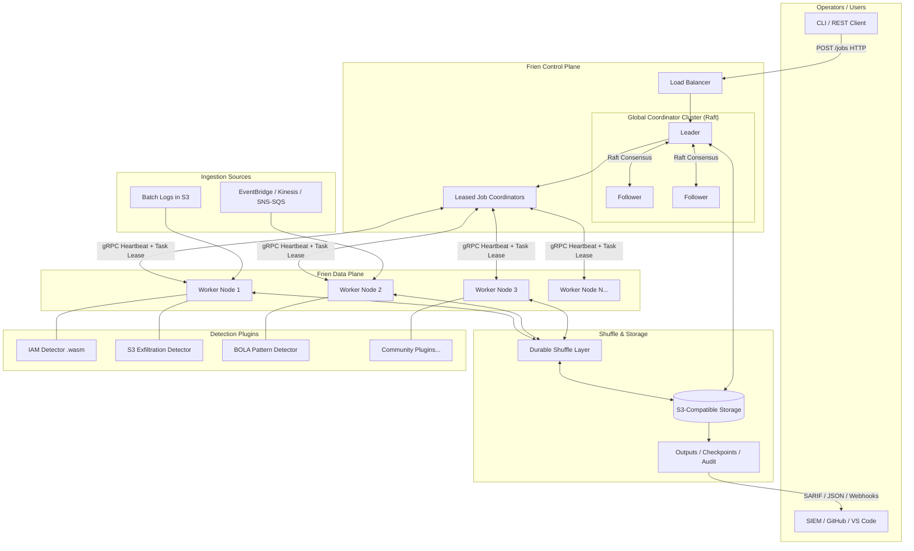

### 3.2 Single Binary Execution Model

Frien is compiled into a single executable with two operational modes:

```
frien coordinator    # Runs as coordinator daemon
frien worker         # Runs as worker daemon
frien submit         # CLI client for job submission
frien status         # CLI client for job/finding status
```

Configuration is loaded from `config.toml`. This model ensures:
- Single artifact to build, version, and deploy
- systemd, Docker, and Kubernetes friendly
- No dependency mismatch between coordinator and worker versions

### 3.3 Network Topology

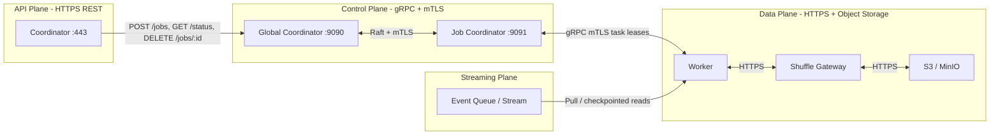

---

## 4. Distributed Systems Design

### 4.1 Coordinator Cluster with Raft Consensus

The target architecture uses Raft for **durable intent and fencing**, not as a sink for every heartbeat. Worker liveness, cache manifests, and throughput samples remain leader-local volatile state, while job admission, task-group lease issuance, partition sealing, cancellation, and final completion records are committed through Raft.

Frien runs the coordinator as a **replicated state machine** using the **Raft consensus algorithm**. This is the most critical distributed systems decision in the architecture — it transforms a single point of failure (one coordinator process) into a fault-tolerant cluster.

#### Why Raft Over ZooKeeper?

ZooKeeper is a proven external coordination service. However, for Frien:
- Raft is embedded directly — no external dependency, simpler deployment
- ZooKeeper's ZAB protocol has similar guarantees but requires a separate operational footprint
- Raft's leader election and log replication are simpler to reason about for our specific state (job queue + task status)
- Raft is natively available in Go via the `etcd/raft` library

#### Raft Implementation Details

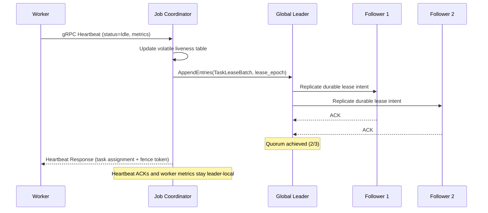

**State Machine Transitions:**
- Raft persists only durable control events: job admitted, task-group lease issued, partition sealed, completion committed, cancellation, failure fences
- Worker heartbeats, load metrics, cache manifests, and transient lease renewals are tracked in volatile leader memory and rebuilt after failover
- Each job is owned by a leased **Job Coordinator** actor; lease ownership is fenced by an epoch stored in Raft to prevent split-brain scheduling
- On leader failure, Raft elects a new leader within a configurable election timeout (default: 150-300ms randomized), and leased schedulers are rehydrated from durable job state plus the latest committed completion bitmaps

#### Coordinator Cluster Size Recommendations

| Cluster Size | Tolerated Failures | Use Case |
|---|---|---|
| 1 | 0 | Development / single-node |
| 3 | 1 | Standard production |
| 5 | 2 | High-availability enterprise |

### 4.2 Worker Architecture

Workers are **stateless compute nodes** that:
1. Register with the coordinator via gRPC on startup
2. Receive tasks via heartbeat responses (pull model)
3. Execute Map or Reduce functions via loaded WASM detector plugins
4. Write intermediate results to a durable shuffle layer backed by local spill, peer replication, and object-store fallback
5. Report task completion via heartbeats
6. Exit cleanly or crash — the coordinator detects failure via missed heartbeats

Workers are intentionally stateless with respect to job metadata. All job state lives in the coordinator cluster. This means a crashed worker can be replaced by simply starting a new worker process — it registers, gets reassigned tasks, and processing continues.

### 4.3 Pull-Based Scheduling with Backpressure

Frien uses a **pull-based scheduling model** piggybacked on gRPC heartbeats. Workers do not receive pushed task assignments. Instead:

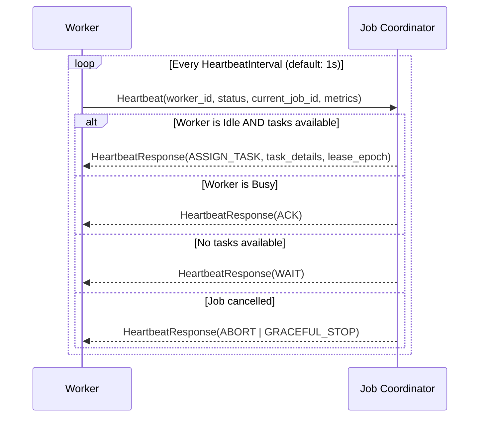

**Why pull-based?**
- Keeps liveness on the fast path and out of the Raft commit path, reducing GC pressure and phantom failover risk
- The coordinator only assigns work to workers proven alive (just sent a heartbeat)
- Natural backpressure: busy workers don't receive new tasks
- Simplifies coordinator logic — no need to track worker capacity separately from liveness

#### 4.3.1 Locality-Aware Task Assignment

*"The MapReduce master takes the location information of the input files into account and attempts to schedule a map task on a machine that contains a replica of the corresponding input data."* This principle remains essential in cloud-native systems where cross-AZ data transfer costs $0.01/GB and adds 1-2ms of latency per hop.

Frien implements a **multi-tier locality preference** for Map task assignment:

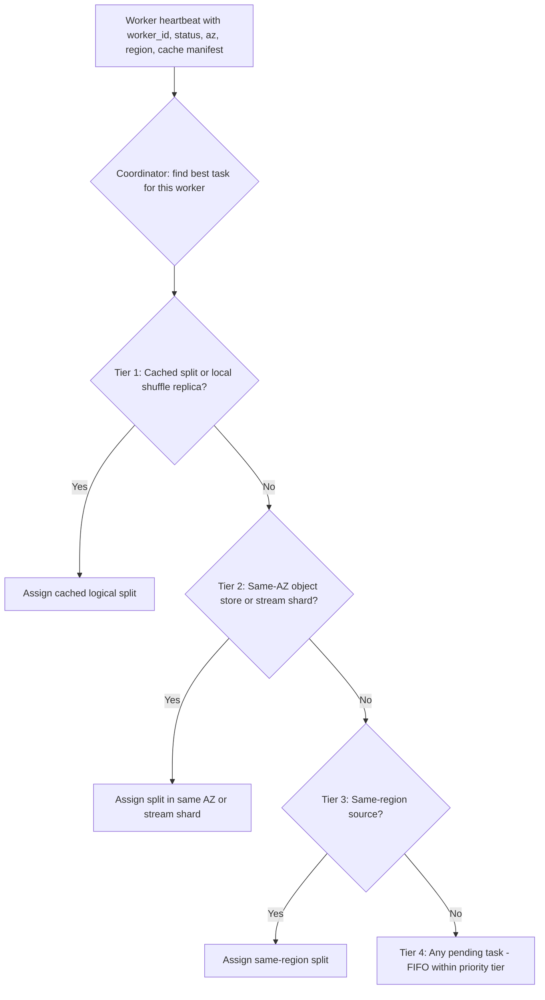

**How it works:**

1. **Worker registration includes placement metadata**: Workers report their availability zone (e.g., `us-east-1a`), region, and instance type during gRPC registration. This is extracted from the EC2 instance metadata service (`169.254.169.254/latest/meta-data/placement/`) or from `config.toml` in non-AWS environments.

2. **Coordinator enriches task metadata with data location**: The split planner resolves bucket or stream placement once per source, not once per object. It combines bucket-region metadata, storage class hints, stream shard ownership, and worker cache manifests to annotate each logical split.

3. **Assignment preference cascade**: When an idle worker heartbeats in, the scheduler evaluates pending tasks in priority order but **breaks ties using locality score**:
   - **Score 3 (best)**: Split or shuffle replica already exists in the worker's local cache
   - **Score 2**: Source data or stream shard is in the same AZ as the worker
   - **Score 1**: Source data is in the same region as the worker
   - **Score 0**: No locality advantage — pure FIFO assignment

4. **Fallback to non-local assignment**: If no locality-optimal task is available, the coordinator assigns the highest-priority pending task regardless of location. Locality is a **preference, not a constraint** — it must never cause task starvation.

**Impact on the MapReduce paper's observations:**
> *"When running large MapReduce operations on a significant fraction of the workers in a cluster, most input data is read locally and consumes no network bandwidth."* — Dean & Ghemawat, §3.4

In Frien's cloud context, "local" means same-AZ. For a 100-worker cluster scanning CloudTrail logs in `us-east-1`, locality-aware scheduling can eliminate ~60-80% of cross-AZ data transfer, reducing both latency and cost.

### 4.4 Priority Queue Scheduling

Unlike simple FIFO scheduling, Frien implements a **three-tier priority queue**:

| Tier | Priority | Use Case | Examples |
|---|---|---|---|
| EMERGENCY | Highest | Active incident response | Triggered by GuardDuty finding, manual IR invocation |
| SCHEDULED | Medium | Routine security scans | Nightly CloudTrail analysis, weekly IAM review |
| BACKGROUND | Lowest | Historical analysis | Forensic investigation of past time windows |

The coordinator's task scheduler always drains EMERGENCY tasks before SCHEDULED, and SCHEDULED before BACKGROUND. Within a tier, tasks are ordered FIFO.

---

## 5. Coordinator (Master) Design

### 5.1 Coordinator State Machine

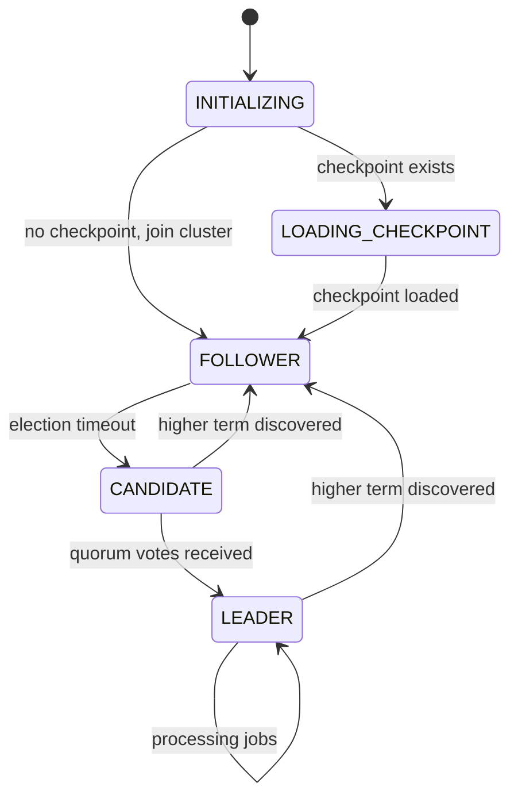

### 5.2 Job Lifecycle State Machine

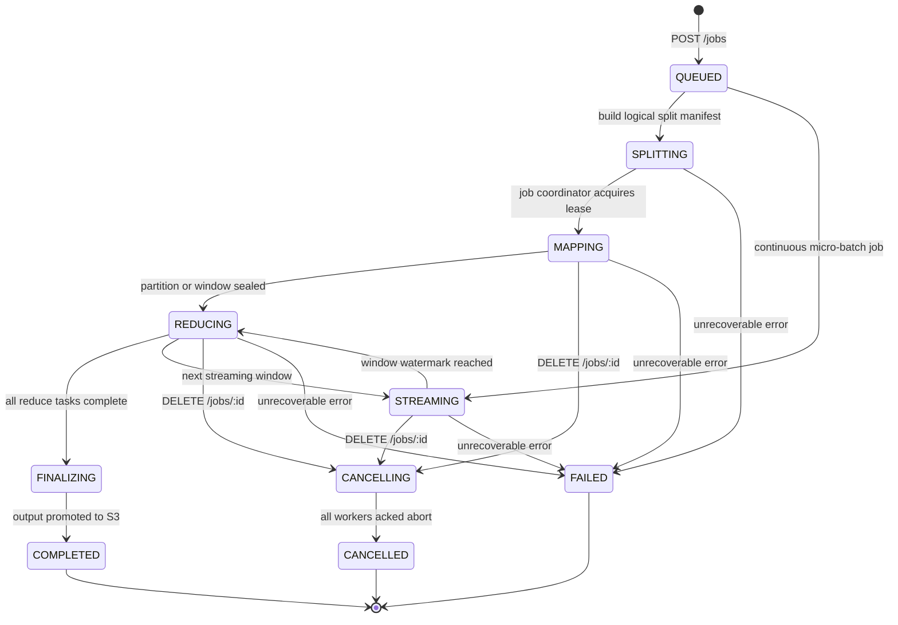

### 5.3 Coordinator Internal Components

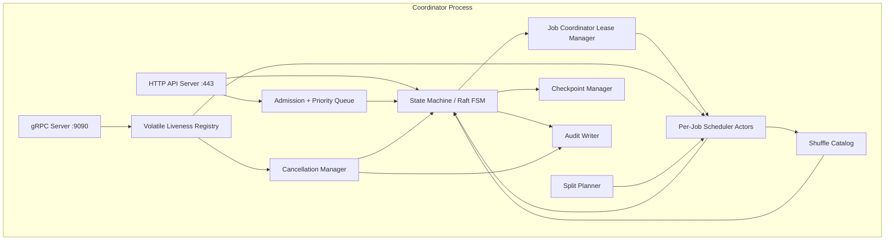

### 5.4 Checkpointing Strategy

Coordinator state is periodically snapshotted to S3 using a safe write pattern:

```
1. Serialize state → JSON blob
2. Write to s3://bucket/checkpoints/checkpoint-<timestamp>.tmp
3. CopyObject → s3://bucket/checkpoints/checkpoint-latest.json
4. DeleteObject(checkpoint-<timestamp>.tmp)
5. Prune: retain last N checkpoints (default: 5)
```

**Why snapshots over WAL?**
- Bounded size — a snapshot is the full state at a point in time, not an unbounded log
- Simpler recovery — load latest valid snapshot, re-execute tasks since snapshot (idempotent)
- If newest snapshot is corrupt (crash mid-write), fall back to snapshot N-1

**Checkpoint interval:** Configurable, default 30 seconds. Critical state transitions (job completion, cancellation, worker failure) trigger immediate checkpoints.

### 5.5 Coordinator Metadata Scalability

*"The master must make O(M+R) scheduling decisions and keeps O(M∗R) state in memory."* For Frien, if a large scan produces M=100,000 map tasks with R=100 reduce partitions, the coordinator must track up to 10 million intermediate file location entries. Left unaddressed, this becomes a scalability bottleneck.

Frien mitigates this with the following strategies in the target architecture:

**1. Volatile liveness kept out of Raft**
Worker heartbeats, cache manifests, throughput samples, and queue depth telemetry live only in the leader's in-memory liveness registry. They are intentionally excluded from the replicated FSM so normal cluster churn does not flood the Raft log or create unnecessary garbage-collection pressure.

**2. Per-job schedulers with leased ownership**
The global coordinator only admits jobs, stores durable state, and grants fenced leases to job-specific scheduler actors. Each actor owns one job's active split queue, completion bitmap, and partition state, which spreads working-set pressure across many lightweight schedulers instead of one monolithic loop.

**3. Completion bitmaps and split manifests**
Instead of storing verbose per-task objects after submission, the coordinator persists compact split manifests and bitmap-based completion vectors. This reduces the hot metadata footprint from object-heavy maps to dense arrays and roaring-bitmaps that are far friendlier to Go's allocator and GC.

**4. Shuffle manifest compaction**
The coordinator does not retain an explicit MxR table of every intermediate location forever. Shuffle outputs are registered as partition manifests with chunk lists, replica descriptors, and object-store fallback pointers. Once a partition is reduced and committed, its manifest is pruned aggressively.

**5. Memory budget enforcement**
The coordinator enforces a configurable memory budget for task metadata (default: 256MB per active scheduler). If the projected metadata size for a submitted job would exceed this budget, the coordinator rejects the job with a `413 Payload Too Large` response and suggests increasing split size, reducing reducer cardinality, or enabling a deeper external spill strategy.

**1. Bounded Intermediate Location Table**
The coordinator does not store all M×R intermediate file locations simultaneously. Instead, it stores only the **active set**: intermediate file locations for map tasks that are complete but whose data has not yet been consumed by a reduce task. Once a reduce task successfully fetches all intermediate files for its partition, the coordinator prunes those entries from its state. This bounds the active set to approximately `M × (R_active / R_total)` entries at any time.

**2. Hierarchical Task Grouping**
For very large jobs (M > 10,000), the coordinator groups map tasks into **task groups** of configurable size (default: 100 tasks per group). The Raft FSM tracks group-level completion status, and only expands to individual task tracking for the currently active group. This reduces the Raft log entry volume from O(M) individual task completions to O(M/group_size) group completions.

**3. Metadata Compaction on Phase Transition**
When the job transitions from MAPPING → REDUCING:
- All map task metadata (except intermediate file locations needed by reduce) is compacted into a summary record
- Individual map task states are removed from the Raft FSM
- A compaction checkpoint is taken immediately
- This reduces the coordinator's working memory from O(M+R) to O(R) for the reduce phase

**4. Memory Budget Enforcement**
The coordinator enforces a configurable memory budget for task metadata (default: 256MB). If the projected metadata size for a submitted job would exceed this budget, the coordinator rejects the job with a `413 Payload Too Large` response and suggests either reducing M (by increasing input chunk size) or reducing R.

---

## 6. Worker Design

### 6.1 Worker Lifecycle

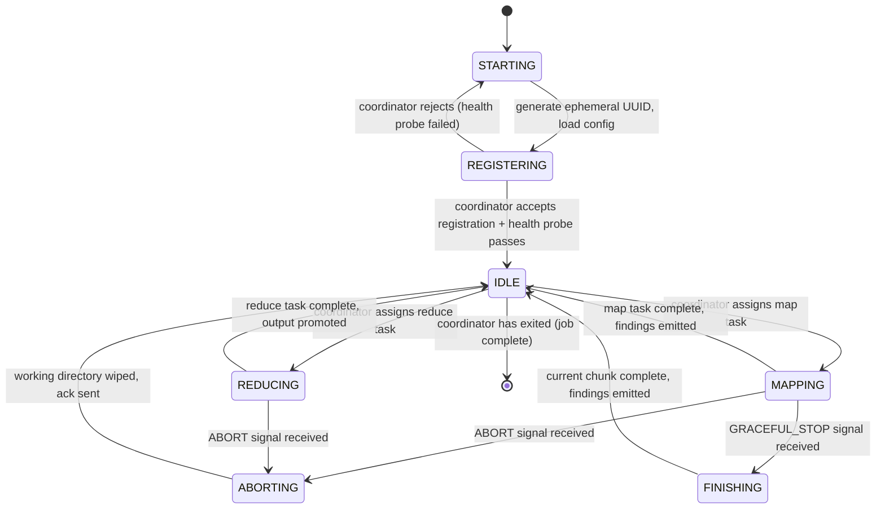

### 6.2 Worker Registration with Health Probe

Worker identity is **ephemeral** — a new UUID is generated on each startup. This means:
- Crashed and restarted workers register as completely new workers
- The coordinator never attempts to reconcile returning workers with past identities
- No stale state can bleed between worker restarts

During registration, the coordinator issues a `GET /health` probe to the worker's self-reported HTTPS address. This verifies:
- The worker is actually reachable at its reported address
- The worker's TLS certificate is valid
- The worker's HTTP server is operational before any intermediate file URLs are distributed to Reduce workers

Workers whose health probe fails are **rejected** — their registration is denied. They must retry.

### 6.3 Worker Directory Structure

```
/tmp/frien-worker-<uuid>/         # systemd RuntimeDirectory, wiped on exit
    map/
        mr-<job_id>-<task_id>-<partition>.tmp    # in-progress intermediate
        mr-<job_id>-<task_id>-<partition>.signals # completed, ready to serve
    reduce/
        reduce-<job_id>-<task_id>-<attempt_id>.tmp  # in-progress reduce output
    plugins/
        <detector_name>.wasm         # loaded detector plugins
    keys/
        job-<job_id>.key             # per-job AES-256 key for intermediate encryption
```

All files under this directory are encrypted at rest. The directory is managed by systemd's `RuntimeDirectory=` directive — automatically provisioned on start, automatically destroyed on exit/crash.

### 6.4 Intermediate File Atomicity

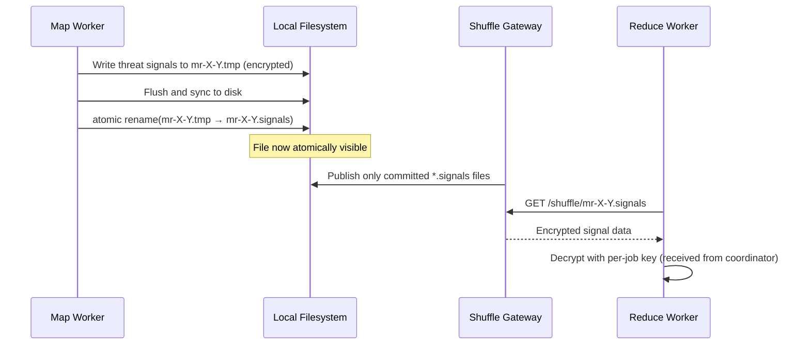

The `.tmp` → `.signals` atomic rename guarantees that the shuffle gateway can never advertise a partial intermediate file, even if the Map worker crashes mid-write.

---

## 7. MapReduce Execution Model

### 7.1 Overall Execution Flow

The target-state execution path supersedes the classic global-barrier-only flow below:

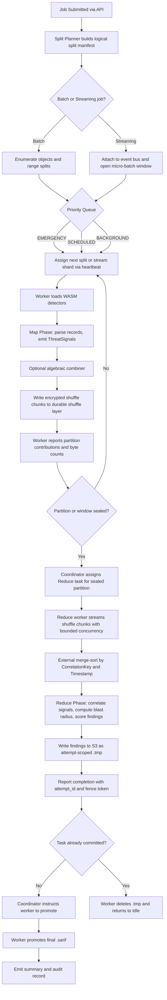

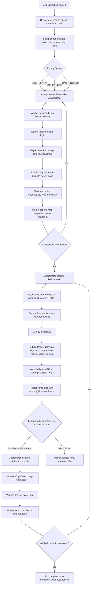

### 7.2 Map Phase: Threat Signal Emission

In the target architecture, a Map task processes a **logical split** rather than blindly mapping one object to one task. Splits may come from S3 range scans, pre-generated manifests, or sealed streaming windows. This eliminates the worst object-size skew and gives the scheduler a stable unit for prediction, speculation, and retry.

Each Map worker processes one S3 log object (one chunk). The Map function:

1. Downloads the raw log file from S3
2. Parses it into structured `RawLogEvent` objects (JSON-aware for CloudTrail, TSV for VPC Flow)
3. Passes each event through all loaded detector plugins
4. Each detector's `Map()` function emits zero or more `ThreatSignal` objects
5. Signals are partitioned into R buckets using `ihash(signal.CorrelationKey) % R`
6. Each bucket is written as an encrypted intermediate file

**ThreatSignal structure:**
```go
type ThreatSignal struct {
    CorrelationKey  string          // e.g., "iam:role/DataPipelineRole"
    SignalType      string          // e.g., "PRIVILEGE_ESCALATION_ATTEMPT"
    Severity        SeverityLevel
    Timestamp       time.Time
    SourceAccount   string
    SourceRegion    string
    RawEvent        json.RawMessage // original log event (encrypted at rest)
    DetectorName    string
    MITREAttackID   string          // e.g., "T1078"
    Evidence        map[string]any
}
```

### 7.3 Reduce Phase: Correlation and Scoring

In the target architecture, Reduce workers read from the durable shuffle layer with bounded parallelism, exponential backoff, and jitter. Large partitions are processed through an external merge-sort pipeline so correctness does not depend on loading an entire hot partition into memory.

Each Reduce worker processes all signals for one correlation key partition. The Reduce function:

1. Fetches all shuffle chunks for partition K from the durable shuffle layer
2. Decrypts files using the per-job key (received from coordinator at task assignment)
3. Groups signals by `CorrelationKey`
4. For each key, runs the detector's `Reduce()` function to correlate signals across accounts/regions/time
5. Computes **blast radius**: which accounts, services, and resources are reachable from the compromised identity
6. Scores the finding based on: signal severity × count × blast radius × asset criticality
7. Emits a structured `Finding` object

### 7.4 Reduce Phase Fault Tolerance — Dead Map Worker Scenario

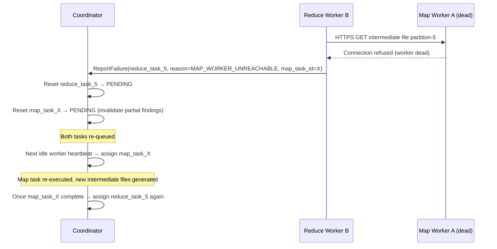

This handles the critical scenario where a Map worker completes its task, goes idle, and then dies — taking its intermediate files offline before Reduce workers can fetch them.

In the target architecture, a dead Map worker is not automatically a fatal shuffle event. Reduce workers first try the peer replica and object-store fallback registered in the shuffle manifest. Only if every replica is unavailable or corrupt is the corresponding Map split re-executed.

### 7.5 Speculative Execution (Straggler Mitigation)

If a job is near completion (configurable threshold, e.g., >90% tasks done) but blocked on one slow worker:

1. Coordinator identifies the straggler (task running > 2× median task duration)
2. Coordinator assigns the same task to another idle worker as a **speculative attempt**
3. Both workers race to complete the task
4. First worker to report completion is blessed as the winner
5. The slower worker receives an ABORT signal on its next heartbeat
6. Speculative tasks are only launched after a minimum delay (default: 10s) to avoid thrashing on transient slowdowns

### 7.6 Combiner Optimization (Local Pre-Aggregation)

The **Combiner function** — is a critical optimization for reducing intermediate data volume: *"We allow the user to specify an optional Combiner function that does partial merging of this data before it is sent over the network. [...] Partial combining significantly speeds up certain classes of MapReduce operations."*

This optimization is critical for Frien because certain detectors produce high-volume, highly redundant intermediate data. For example, the `resource_discovery` detector emits a `ThreatSignal` for every `List*` / `Describe*` API call — a single CloudTrail chunk from an enumeration attack may contain 10,000+ such calls, all producing signals with the same `CorrelationKey` and `SignalType`. Without a combiner, all 10,000 signals are written to intermediate files and shuffled to the Reduce worker.

#### Combiner Interface

Detectors may optionally implement a `Combine()` method:

```go
// OptionalCombiner is implemented by detectors that support local pre-aggregation.
// If a detector implements this interface, the worker invokes Combine() on the
// locally-emitted signals before writing intermediate files.
type OptionalCombiner interface {
    // Combine merges signals with the same CorrelationKey locally on the Map worker.
    // This reduces shuffle volume without affecting correctness.
    // The Combine function MUST be associative and commutative.
    Combine(key string, signals []ThreatSignal) ([]ThreatSignal, error)
}
```

#### Combiner Execution Flow

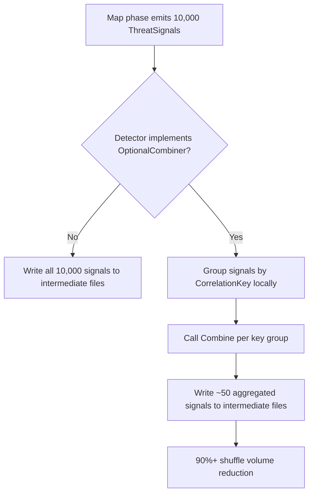

#### Correctness Constraint

The combiner function **must be associative and commutative** — the same constraint as the original paper. This is because:
- The combiner may run zero, one, or multiple times (the worker decides based on buffer pressure)
- Signals may be combined in any order
- The Reduce function must produce the same output regardless of whether the combiner ran

For Frien's detectors, this means the `Combine()` function can:
- **Merge counts**: 10 signals of `PRIVILEGE_ESCALATION_ATTEMPT` → 1 signal with `Evidence.count = 10`
- **Union evidence sets**: Merge `AffectedResources` lists, deduplicate
- **Keep max severity**: If signals have different severities, keep the highest

But **cannot**:
- Compute temporal correlations (those require global ordering, done in Reduce)
- Compute blast radius (requires cross-key information, done in Reduce)

**Framework enforcement:** A detector that declares ordered or stateful temporal semantics for a correlation key cannot also register an algebraic combiner for that same key family. Plugin loading fails fast if a detector attempts to combine chronological state collapse with sequence-sensitive Reduce logic, preventing the false negatives highlighted in peer review.

### 7.7 Deterministic Task Semantics

*"When the user-supplied map and reduce operators are deterministic functions of their input values, our distributed implementation produces the same output as would have been produced by a non-faulting sequential execution of the entire program."*

Frien relies on re-execution for fault recovery (a crashed worker's Map task is re-executed on a different worker) and uses speculative execution where two workers may execute the same task simultaneously. **Both mechanisms require deterministic task behavior for correctness** — if re-execution produces different signals, the coordinator may bless inconsistent results.

#### TaskContext: Enforcing Determinism

Instead of relying on detector authors to avoid non-deterministic operations (which is error-prone), Frien provides a **TaskContext** that supplies deterministic alternatives:

```go
// TaskContext is passed to every Map() and Reduce() invocation.
// It provides deterministic alternatives to common non-deterministic operations.
type TaskContext struct {
    // TaskTimestamp is the frozen timestamp assigned when the task was created
    // by the coordinator. All workers executing this task (including speculative
    // attempts) receive the same TaskTimestamp. Detectors MUST use this instead
    // of time.Now() for any temporal calculations.
    TaskTimestamp  time.Time

    // TaskRNG is a deterministic pseudo-random number generator seeded with
    // a task-specific seed derived from (job_id, task_id). Detectors that need
    // randomness (e.g., sampling) MUST use this instead of crypto/rand or math/rand.
    TaskRNG        *rand.Rand

    // TaskID uniquely identifies this task. Deterministic across re-executions.
    TaskID         string

    // JobID uniquely identifies the parent job.
    JobID          string

    // AttemptID is unique per execution attempt. NOT deterministic across
    // re-executions. Use only for logging/debugging, never for signal content.
    AttemptID      string

    // Counters provides the per-task counter interface (see §7.10).
    Counters       CounterSet
}
```

#### Updated Detector Interface

The `Map()` and `Reduce()` methods now receive a `TaskContext`:

```go
type Detector interface {
    // ... metadata methods unchanged ...

    Map(ctx TaskContext, event RawLogEvent) ([]ThreatSignal, error)
    Reduce(ctx TaskContext, key string, signals []ThreatSignal) ([]Finding, error)
}
```

#### Determinism Validation

During development (`frien debug`), the local execution engine runs each Map task **twice** with the same `TaskContext` and compares outputs. Any non-determinism is flagged immediately, enabling detector authors to catch determinism bugs before deployment.

### 7.8 Bad Record Skipping

*"Sometimes there are bugs in user code that cause the Map or Reduce functions to crash deterministically on certain records. [...] It provides an optional mode of execution where the MapReduce library detects which records cause deterministic crashes and skips these records in order to make forward progress."*

In security log processing, this is particularly important. CloudTrail log files contain records from dozens of AWS services, each with slightly different JSON schemas. A detector that handles `iam:CreateUser` events correctly may panic on a `glue:CreateCrawler` event with an unexpected field structure. A single malformed record should not block an entire security scan.

#### Skip List Mechanism

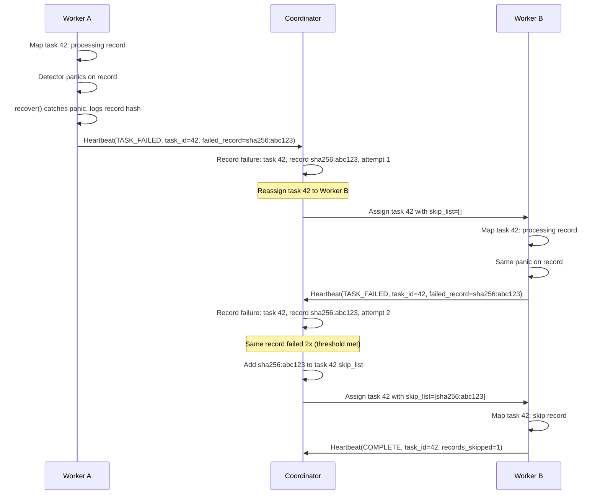

#### Configuration

```toml
[bad_records]
enabled = true
skip_threshold = 2        # failures on same record before skipping
max_skipped_per_task = 10  # if more than 10 records cause crashes, fail the task
audit_skipped = true       # write skipped records to audit log for investigation
```

#### Security Consideration

Skipped records are logged to the audit trail with their SHA-256 hash (not content, to avoid logging sensitive data). An operator can retrieve the original record from S3 for investigation. The finding output for the job includes a `skipped_records` count so that security teams know the scan was not exhaustive.

### 7.9 Ordering Guarantees

*"Within a given partition, the intermediate key/value pairs are processed in increasing key order."*

Frien adopts this guarantee: **within each reduce partition, intermediate `ThreatSignal` records are sorted by `CorrelationKey` before being passed to the Reduce function.** This provides two benefits:

1. **Deterministic Reduce output**: Regardless of which Map workers produced the signals, or in what order they completed, the Reduce function receives signals in a canonical order — ensuring deterministic findings.

2. **Efficient grouping**: The Reduce worker can stream through sorted signals and group by `CorrelationKey` in a single pass without building an in-memory hash map — important when a partition contains millions of signals.

The sort is performed by the Reduce worker using a bounded-memory external merge-sort pipeline: decrypted shuffle chunks are sorted in runs, spilled to encrypted local scratch space, and then streamed through a final merge using `CorrelationKey` as the primary key and `Timestamp` as the tiebreaker. This preserves deterministic ordering without forcing hot partitions into RAM.

### 7.10 Counters Framework

**counters** — is a lightweight mechanism for aggregating statistics across all workers: *"The counter values from individual worker machines are periodically propagated to the master (piggybacked on the ping response)."*

While Frien already exposes Prometheus metrics , those metrics are infrastructure-level (task counts, durations, error rates). The counters framework provides **detector-level semantic counters** that detector authors define and that are aggregated across the entire job.

#### Counter Interface

```go
// CounterSet is available to detectors via TaskContext.Counters
type CounterSet interface {
    // Increment adds delta to the named counter. Counter names are scoped
    // to the detector that created them.
    Increment(name string, delta int64)

    // Get returns the current local value of a counter (for conditional logic).
    Get(name string) int64
}
```

#### Example Usage in a Detector

```go
func (d *CredentialExposureDetector) Map(ctx TaskContext, event RawLogEvent) ([]ThreatSignal, error) {
    ctx.Counters.Increment("events_processed", 1)

    if event.SourceIP != "" && d.isImpossibleTravel(event) {
        ctx.Counters.Increment("impossible_travel_detected", 1)
        return []ThreatSignal{d.emitSignal(event)}, nil
    }

    if d.isMultiRegionKeyUsage(event) {
        ctx.Counters.Increment("multi_region_key_usage", 1)
        return []ThreatSignal{d.emitSignal(event)}, nil
    }

    return nil, nil
}
```

#### Aggregation

Counter values are piggybacked on the worker heartbeat (adding negligible overhead). The coordinator aggregates counters per job, deduplicating values from speculative executions and re-executed tasks (only the blessed attempt's counters are counted). Final counter values are included in the job summary:

```json
{
  "job_id": "...",
  "status": "COMPLETED",
  "counters": {
    "credential_exposure": {
      "events_processed": 1482933,
      "impossible_travel_detected": 7,
      "multi_region_key_usage": 3
    },
    "iam_privilege_escalation": {
      "events_processed": 1482933,
      "role_assumption_chains": 42
    }
  }
}
```

### 7.11 Local Execution Mode (`frien debug`)

*"An alternative implementation of the MapReduce library that sequentially executes all of the work for a MapReduce operation on the local machine. [...] Users invoke their program with a special flag and can then easily use any debugging or testing tools they find useful."*

Frien implements this as the `frien debug` command — a single-process, sequential execution mode designed for detector development and testing:

```bash
# Run a single detector against a local log file
frien debug \
  --detector ./plugins/iam_privilege_escalation.wasm \
  --input ./sample-cloudtrail.json \
  --reduce-partitions 1 \
  --output ./findings.sarif

# Run with determinism validation (runs Map twice, compares outputs)
frien debug --detector ./plugins/my_detector.wasm --input ./logs/ --validate-determinism

# Run with Go debugger attached
dlv exec ./frien -- debug --detector ./plugins/my_detector.wasm --input ./logs/
```

**Key properties of debug mode:**
- **No gRPC, no mTLS, no coordinator**: Everything runs in a single process
- **No S3**: Input is read from local filesystem; output is written to local filesystem
- **Sequential execution**: Map tasks run one at a time, then Reduce tasks run one at a time — deterministic execution order for reproducible debugging
- **Determinism validation**: Optionally runs each Map task twice and diffs the outputs to detect non-deterministic detector behavior
- **Full counter reporting**: Counters are aggregated and printed to stdout at completion
- **Plugin hot-reload**: In debug mode, plugins are reloaded on each invocation without caching — no need to restart between detector code changes

### 7.12 Adaptive Scheduling

Frien's baseline scheduling uses static heuristics: priority tiers, locality scoring, and FIFO ordering. While effective for uniform workloads, real-world CloudTrail scans exhibit significant variance — a chunk from `us-east-1` containing 50,000 `sts:AssumeRole` events processes 10× slower than a chunk from a development account with 500 events. **Adaptive scheduling** uses runtime feedback to make smarter decisions.

#### Task Duration Prediction

The coordinator maintains a per-detector, per-log-source **exponential moving average** of task durations:

```go
type TaskProfile struct {
    DetectorName   string
    LogSource      LogSource
    AvgDurationMs  float64   // EMA with α=0.3
    P95DurationMs  float64   // 95th percentile from last 100 tasks
    AvgInputSizeKB int64     // average input chunk size
}
```

When assigning tasks, the coordinator estimates the expected duration based on the task's detector/log-source profile and the input chunk size. This enables:

1. **Straggler prediction**: If a task has been running for >2× its predicted duration, it becomes a straggler candidate for speculative execution — rather than waiting for a fixed 2× median duration threshold.

2. **Worker capacity matching**: Workers with faster CPUs (detected via heartbeat-reported processing throughput) receive larger or more complex tasks. Workers that consistently complete tasks under the predicted duration get assigned more work.

#### Hotspot Detection

If multiple Map tasks in the same job are producing disproportionately large intermediate files for a single reduce partition (a "hot key" — e.g., one IAM role appears in 80% of all CloudTrail events), the coordinator:

1. **Detects the skew**: When map tasks report completion, they include the byte size of each intermediate partition file. If partition K's total exceeds 3× the median partition size, it is flagged as a hot partition.

2. **Applies heavy-hitter mitigation**: The coordinator identifies the dominant key or key family inside the hot partition and rewrites future shuffle records for that heavy hitter using bounded salts (for example `iam:role/Admin#0..N`). Reduce then runs as a two-stage process: salted partial reduce followed by a deterministic merge-reduce for the original unsalted key. This fixes the classic mistake of hashing the same hot key again and expecting skew to disappear.

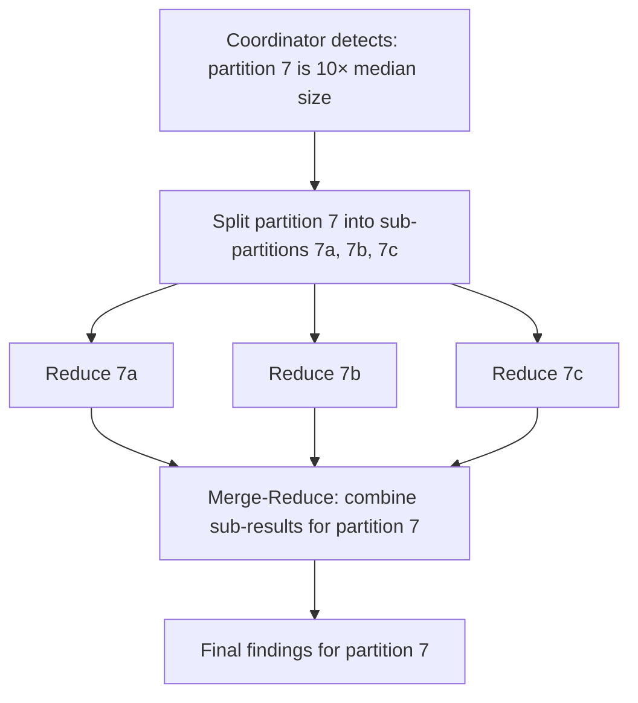

The illustrative flow above should be read as a two-stage salted reduce for the heavy hitter, not as a naive re-hash of the same dominant key.

#### Feedback-Driven Scheduling

Worker heartbeats report runtime metrics that the coordinator uses for adaptive decisions:

```toml
[adaptive_scheduling]
enabled = true
task_ema_alpha = 0.3             # smoothing factor for duration EMA
skew_threshold_ratio = 3.0       # flag partition as hot if > 3× median
straggler_prediction = true      # use predicted vs. fixed duration for speculation
capacity_matching = true         # assign based on worker throughput
```

---

## 8. Fault Tolerance & Replication

### 8.1 Failure Taxonomy

| Failure Type | Detection Mechanism | Recovery Action |
|---|---|---|
| Worker crash mid-Map | Missed heartbeats (timeout) | Reset task → PENDING, reassign |
| Worker crash mid-Reduce | Missed heartbeats OR Reduce worker reports fetch failure | Retry Reduce from shuffle replica; re-execute Map only if all shuffle replicas are unavailable |
| Worker network partition | Missed heartbeats | Same as crash |
| Coordinator leader crash | Raft leader election | New leader elected within election timeout |
| Coordinator follower crash | Raft continues with remaining quorum | No action needed if quorum maintained |
| S3 write failure (checkpoint) | Explicit error return | Retry with exponential backoff |
| Partial intermediate file | Atomic rename prevents this | Not applicable |
| Corrupt checkpoint | Checksum validation on load | Fall back to checkpoint N-1 |

### 8.2 Primary-Backup Replication for Coordinator

The coordinator cluster uses Raft, which is a form of **primary-backup replication with strong consistency**:

- The **leader** (primary) handles all writes and task assignments
- **Followers** (backups) replicate the log and are ready to become leader on failure
- All state transitions are **committed** only after quorum acknowledgement — no split-brain possible
- Unlike basic primary-backup, Raft handles the case where the primary crashes **while sending** a log entry — the entry is only committed if a majority received it

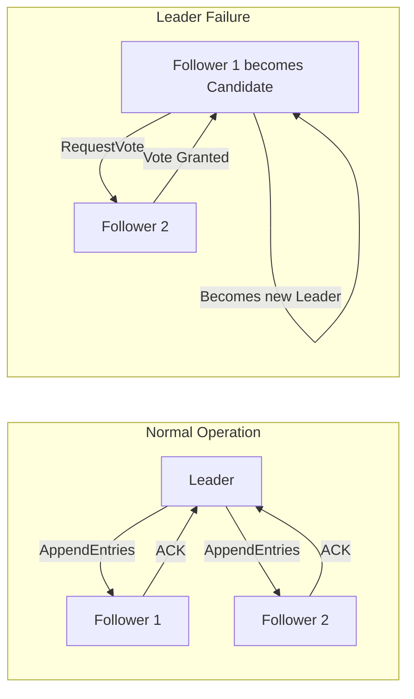

### 8.3 Idempotency and At-Least-Once Semantics

MapReduce tasks in Frien are **idempotent by design**:
- Re-executing a Map task on the same log chunk produces the same threat signals
- Reduce finalization uses attempt-scoped UUIDs (worker-generated on task start) — if two workers race to complete the same Reduce task, the coordinator blesses exactly one winner; the other's output is discarded
- The coordinator's finalization check (`task already completed?`) is protected by the Raft state machine — it's an atomic compare-and-set

This means **at-least-once task execution** with **exactly-once finding output** — the correct semantics for a security tool where duplicate findings would create noise.

### 8.4 Worker Failure During Reduce Finalization (Race Condition Handling)

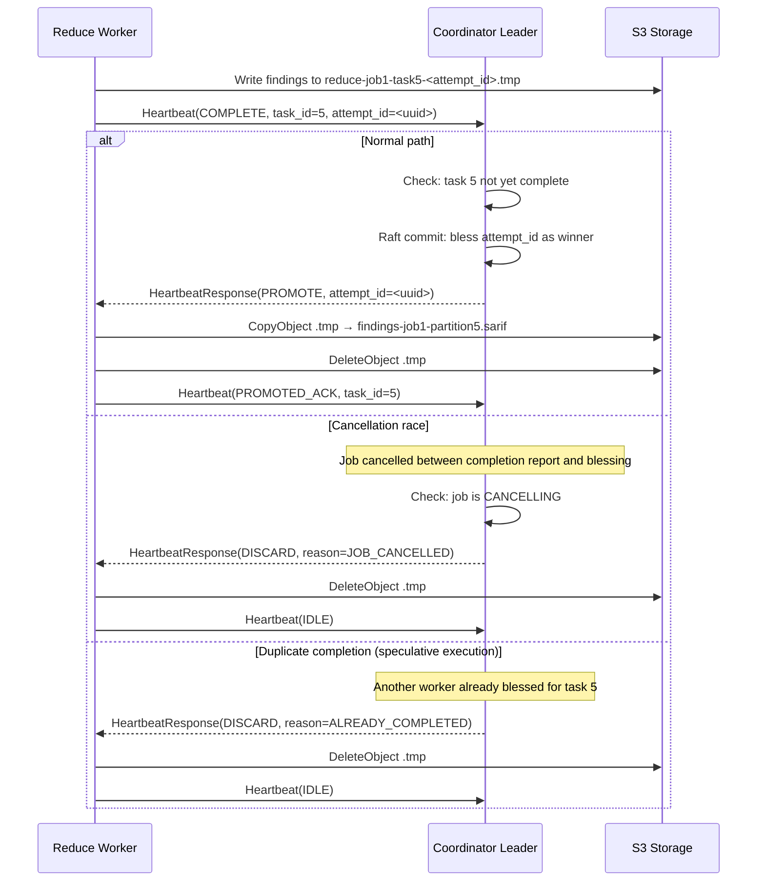

---

## 9. Security Architecture

### 9.1 mTLS Between All Nodes

Frien replaces network-level security dependencies with **mutual TLS (mTLS)** for all coordinator-worker communication:

- Each coordinator generates a self-signed CA on first boot
- Workers receive a signed certificate from the coordinator CA during registration
- Worker certificates include the worker UUID as the Common Name
- Certificates are rotated on each worker restart (ephemeral identity = ephemeral cert)
- The coordinator validates the worker's certificate on every gRPC call — a worker presenting an expired or revoked cert is immediately disconnected

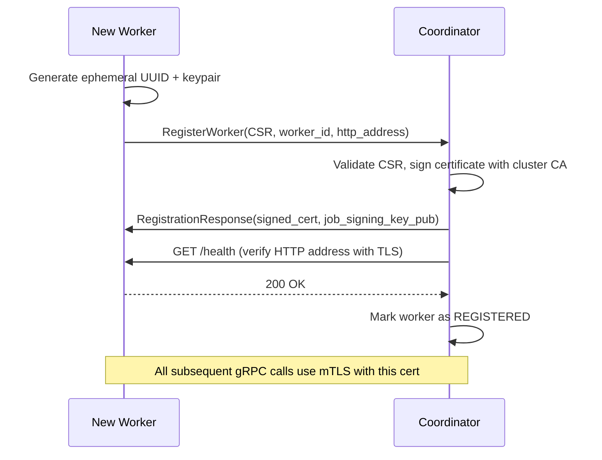

### 9.2 Encrypted Intermediate Files

All intermediate files stored on worker local storage are encrypted with **AES-256-GCM**:

- A unique 256-bit key is generated per job by the coordinator
- The key is distributed to workers only at task assignment time (via the encrypted gRPC channel)
- Keys are never written to disk — held in memory only for the duration of the task
- On task completion, the in-memory key is zeroed
- Worker directories are securely wiped on exit (not just unlinked — overwritten then deleted)

### 9.3 No Credential Retention Policy

Frien processes logs that may contain credential values (API keys in CloudTrail events, tokens in VPC flow metadata). The system enforces:

- **Redaction**: The log parser layer redacts known credential patterns (AWS access key format, JWT tokens, private key material) before passing events to detectors
- **No raw event storage**: The `RawEvent` field in `ThreatSignal` is encrypted and only decrypted in the Reduce phase — never written to plaintext storage
- **Finding output scrubbing**: SARIF findings output never includes the raw credential value — only its presence, format, and location are noted

### 9.4 Audit Trail

Every operation in Frien generates a structured audit record written to an immutable S3 bucket (with Object Lock enabled):

```json
{
  "event_id": "uuid",
  "event_type": "TASK_ASSIGNED | JOB_SUBMITTED | JOB_CANCELLED | WORKER_REGISTERED | FINDING_EMITTED",
  "timestamp": "RFC3339",
  "actor": "api_token_id | worker_id | system",
  "job_id": "...",
  "task_id": "...",
  "worker_id": "...",
  "details": {},
  "mitre_relevance": "T1562.001"
}
```

Cancellation of an active threat detection job is mapped to **MITRE ATT&CK T1562 — Impair Defenses**, flagged as a potential security event, and included in the findings output.

### 9.5 Threat Model

| Threat | Mitigation |
|---|---|
| Man-in-the-middle between coordinator and worker | mTLS with certificate pinning |
| Rogue worker claiming to be legitimate | Worker certificate signed by coordinator CA; unauthorized workers cannot present a valid cert |
| Intermediate file snooping | AES-256-GCM encryption at rest; key never persisted to disk |
| Coordinator state tampering | Raft consensus — requires compromising quorum (N/2 + 1 nodes) |
| Log injection in scanned data | Input validation + redaction layer before detector invocation |
| Cancellation used to suppress findings | Audit log + MITRE T1562 mapping; cancelled jobs' partial findings preserved in GRACEFUL mode |
| Checkpoint corruption | Checksum validation; N checkpoint retention with fallback |

---

## 10. Storage Architecture

### 10.1 S3 Bucket Layout

In the target architecture, the bucket layout also includes a `shuffle/` prefix for durable shuffle manifests and fallback chunks, and the plugin registry stores `.wasm` artifacts rather than Go `.so` modules.

```
s3://frien-<cluster-id>/
├── jobs/
│   └── <job_id>/
│       ├── manifest.json          # job metadata, task list, detector config
│       └── status.json            # current job status (for fast API queries)
├── outputs/
│   └── <job_id>/
│       ├── findings-partition-0.sarif
│       ├── findings-partition-1.sarif
│       └── summary.json           # aggregated finding counts, severity distribution
├── checkpoints/
│   ├── checkpoint-latest.json
│   ├── checkpoint-<ts-1>.json
│   └── checkpoint-<ts-2>.json
├── audit/
│   └── <YYYY>/<MM>/<DD>/
│       └── audit-<ts>.jsonl       # append-only audit records
└── plugins/
    └── <detector_name>-<version>.wasm # community detector plugins
```

### 10.2 Intermediate Storage (Local to Worker)

In the target design, intermediate data is **local-first but not local-only**. Workers spill encrypted shuffle chunks to local NVMe, register them in the shuffle manifest, and optionally replicate them to a peer worker and object storage. Reduce workers read through the shuffle layer rather than making a direct worker-to-worker HTTP fan-out.

Intermediate files — threat signals emitted by Map workers — are stored **locally on worker nodes**, not in S3. This avoids:
- Write amplification: writing transient data to object storage
- Latency: local filesystem reads are faster than S3 GETs for the Reduce phase
- Cost: S3 PUT/GET costs for ephemeral data

Committed shuffle chunks are exposed through the internal shuffle gateway only after the atomic rename completes; `.tmp` artifacts are never advertised in the shuffle manifest.

### 10.3 GFS-Inspired Design Decisions

Frien's storage model draws inspiration from the **Google File System (GFS)** paper:
- **Large sequential reads over random access**: Log chunks are read sequentially; Frien's S3 layout is optimized for this (range requests for large files)
- **Relaxed consistency for intermediate data**: Intermediate files are write-once, read-once — no need for strong consistency here
- **Master (coordinator) tracks chunk locations**: The coordinator tracks which worker holds which intermediate partition, analogous to GFS's master tracking chunk server locations
- **Append-only outputs**: Findings files are written once and never modified — same pattern as GFS append semantics

### 10.4 Worker-Side Data Caching

The locality optimization assumes data is co-located on worker disks via GFS. In Frien's cloud-native model, all input data lives in S3 — a remote object store. To bridge this gap, Frien implements **worker-side data caching** that creates "virtual locality" by keeping frequently-accessed S3 objects on worker local storage.

> **Note on CDN/Edge Caching:** Traditional CDN (CloudFront, Fastly) is designed for HTTP content delivery to end users and is **not appropriate** for Frien's use case. Frien's data flows are machine-to-machine within a VPC: workers fetching log chunks from S3, and reduce workers fetching intermediate files from map workers. CDN would add unnecessary latency (edge PoP round-trips) and cost, while providing no benefit since there are no geographically distributed end-user consumers. Instead, Frien implements **worker-local caching** — a more effective pattern for distributed compute systems.

#### 10.4.1 Input Data Cache (S3 Read-Through)

Each worker maintains a **bounded LRU cache** of recently-fetched S3 objects on local NVMe/SSD storage:

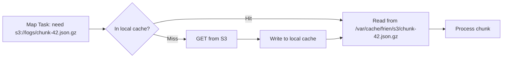

**Configuration:**
```toml
[worker.cache]
enabled = true
max_size_gb = 50          # LRU eviction when cache exceeds this size
path = "/var/cache/frien"  # fast local storage (NVMe preferred)
ttl_hours = 24            # cached objects expire after TTL
report_to_coordinator = true  # tell coordinator what's cached (for locality scoring)
```

**When caching helps:**
- **Repeated scans of the same time window**: A nightly CloudTrail scan followed by an ad-hoc investigation of the same time range. The second scan hits cache for ~100% of its input data.
- **Job re-execution after failure**: If a job fails and is resubmitted, workers that processed chunks from the first attempt still have them cached.
- **Speculative execution (§7.5)**: The speculative worker may already have the input chunk cached if it previously processed a task from the same S3 prefix.

**When caching does NOT help (and is correctly bypassed):**
- First-time ingestion of new log data — no cache hits possible
- Each S3 object is only processed by one worker in one job — no reuse

#### 10.4.2 Plugin Distribution Cache

Detector plugins are downloaded from S3 by every worker at startup. For a 100-worker cluster all starting simultaneously (e.g., Kubernetes rolling deployment), this creates 100 identical S3 GET requests for each plugin binary.

Frien mitigates this with a **pull-through plugin cache**:

1. **Per-node cache**: In Kubernetes, a DaemonSet-managed sidecar maintains a shared plugin cache on each node's local storage. All worker pods on the same node share this cache via a hostPath volume.
2. **Digest-based cache keys**: Plugins are cached by their SHA-256 digest (from the plugin manifest), not by name/version. This ensures that a version bump with identical content doesn't cause unnecessary re-downloads.
3. **Coordinator-advertised plugin manifest**: The coordinator distributes a signed plugin manifest containing `{name, version, s3_key, sha256_digest}` during worker registration. Workers only download plugins whose digest doesn't match a locally cached file.

#### 10.4.3 Tiered Intermediate Storage

*intermediate data stored on worker local disks is lost if the worker fails, requiring re-execution of the map task.* Frien's current design inherits this limitation.

Frien implements a **three-tier intermediate storage model** that balances speed, resilience, and cost:

```mermaid
flowchart LR
    subgraph "Tier 1: Memory (Hot)"
        MEM[In-memory buffer - signals < 4MB]
    end
    subgraph "Tier 2: Local Disk (Warm)"
        DISK[NVMe/SSD - encrypted .signals files]
    end
    subgraph "Tier 3: S3 (Cold Fallback)"
        S3F[(S3 - async replica)]
    end

    MEM -->|Flush when buffer full or task complete| DISK
    DISK -->|Async replicate if enabled| S3F
    DISK -->|Served to Reduce workers via HTTPS| REDUCE[Reduce Worker]
    S3F -.->|Fallback if Map worker dead| REDUCE
```

**Tier 1 — Memory (Hot):** Intermediate signals are first accumulated in an in-memory buffer (bounded at 4MB per partition). If the entire Map task's output for a partition fits in memory, the buffer is flushed to disk only once at task completion — avoiding many small disk writes. For the common case where the combiner reduces output to a few hundred signals, this means zero intermediate disk I/O during processing.

**Tier 2 — Local Disk (Warm):** When the memory buffer exceeds its size limit or the task completes, signals are flushed to the worker's encrypted local storage. This is the primary source for Reduce workers fetching intermediate data.

**Tier 3 — S3 (Cold Fallback):** As a configurable optimization, workers can **asynchronously replicate intermediate files to S3** after writing them locally:

```toml
[worker.intermediate_cache]
# Asynchronously upload intermediate files to S3 as a backup.
# If the map worker dies, reduce workers can fetch from S3 instead of
# triggering a full map task re-execution.
replicate_to_s3 = false             # disabled by default (cost vs. speed tradeoff)
s3_prefix = "intermediate-cache/"   # stored under the job's S3 prefix
cleanup_on_job_complete = true       # delete cached intermediates after job finishes
min_size_for_replication_kb = 512    # only replicate partitions > 512KB (skip small ones)
```

When enabled, if a reduce worker cannot reach a map worker's intermediate files (worker died), the coordinator checks S3 for the cached copy before re-executing the map task. This trades S3 storage cost for reduced recomputation — configurable per deployment based on cost tolerance.

#### 10.4.4 Cache-Aware Scheduling Integration

Worker heartbeats include a **cache manifest** — a bloom filter of cached S3 object keys. The coordinator's locality-aware scheduler uses this to achieve Tier 1 locality scores for workers that already have the input data cached locally, even if they are in a different AZ than the S3 bucket. This creates a feedback loop:

1. Worker A processes chunk-42, caching it locally
2. Job 2 needs chunk-42 again
3. Worker A's heartbeat advertises chunk-42 in its cache bloom filter
4. Coordinator assigns chunk-42 to Worker A (Tier 1 locality: cache hit)
5. Worker A reads from local NVMe instead of S3 — 10-50× faster

---

## 11. Task Cancellation & Lifecycle

### 11.1 Cancellation Modes

Frien supports two cancellation modes, addressing different operational scenarios:

**Immediate Cancellation** (`DELETE /jobs/{id}?mode=immediate`)
- All in-flight workers are instructed to abort immediately
- Working directories are wiped securely
- All partial S3 outputs are deleted
- Findings are marked `INVALIDATED`
- Use case: job submitted by mistake, emergency resource reclamation

**Graceful Cancellation** (`DELETE /jobs/{id}?mode=graceful`)
- Workers currently executing a task are allowed to finish their current log chunk
- No new tasks are assigned after the cancellation signal
- Findings emitted before cancellation are preserved as `PARTIAL`
- Use case: operator wants to stop a long scan but preserve findings collected so far

### 11.2 Complete Cancellation Flow

```mermaid
sequenceDiagram
    participant API as REST API
    participant C as Coordinator
    participant S3 as S3 Storage
    participant W1 as Worker (in-flight)
    participant W2 as Worker (already idle)

    API->>C: DELETE /jobs/{id}?mode=graceful
    C->>C: Raft commit: mark job as CANCELLING
    C->>S3: Write cancellation audit record
    C->>C: [Immediate only] Proactive S3 cleanup of output prefix
    API-->>API: 202 Accepted

    Note over W2: Already idle, no heartbeat with this job_id
    Note over W2: Cleanup handled by S3 proactive deletion above

    W1->>C: Heartbeat(status=MAPPING, job_id=<id>)
    alt Immediate mode
        C-->>W1: HeartbeatResponse(ABORT)
        W1->>W1: Stop processing immediately
        W1->>W1: Securely wipe /tmp/frien-worker-<uuid>/
        W1->>C: Heartbeat(status=ABORT_ACK, job_id=<id>)
        C->>C: Record worker W1 abort acknowledged
    else Graceful mode
        C-->>W1: HeartbeatResponse(GRACEFUL_STOP)
        W1->>W1: Complete current log chunk
        W1->>W1: Emit findings for completed chunk
        W1->>C: Heartbeat(status=GRACEFUL_COMPLETE, job_id=<id>, findings_emitted=true)
        C->>C: Record worker W1 graceful completion
    end

    C->>C: All in-flight workers accounted for?
    C->>S3: Write final cancellation state
    alt Immediate
        C->>C: Mark findings as INVALIDATED
    else Graceful
        C->>C: Mark findings as PARTIAL — include collected findings
    end
    C->>C: Raft commit: mark job as CANCELLED
    C->>S3: Write final audit record (actor, timestamp, findings_state)
```

### 11.3 Cancellation Fence for Reduce Finalization

If a cancellation arrives while a Reduce task is in the process of being blessed:

```
Worker reports COMPLETE for task 5
    → Coordinator checks: is job CANCELLING?
        → YES (Immediate): discard completion report, send ABORT, skip CopyObject
        → YES (Graceful): bless completion, include findings in PARTIAL output
        → NO: normal finalization path
```

This is an atomic check in the Raft state machine — no race condition is possible because the cancellation and the task completion are both Raft log entries that are applied in order.

### 11.4 Cancellation as a Security Event

Cancellation of an active threat detection scan is itself a potentially suspicious action. Frien:
- Maps cancellation events to **MITRE ATT&CK T1562.001 — Disable or Modify Tools**
- Includes cancellation in the findings output as an `INFO` severity finding
- Retains the audit record in the immutable audit S3 bucket regardless of findings invalidation
- Alerts via webhook if an EMERGENCY-tier job is cancelled (configurable)

---

## 12. Detection Engine & Plugin System

### 12.1 Detector Plugin Interface

```go
// All detectors implement this interface.
// Map() and Reduce() receive a TaskContext that provides deterministic
// alternatives to time.Now(), crypto/rand, and other non-deterministic operations.
type Detector interface {
    // Metadata
    Name()         string
    Version()      string
    Description()  string
    Severity()     SeverityLevel
    LogSources()   []LogSource   // CloudTrail, VPCFlow, IAMAnalyzer, GuardDuty, K8sAudit
    MITREAttackIDs() []string    // e.g., ["T1078", "T1136"]

    // Map phase: called once per log event.
    // ctx provides deterministic timestamp, RNG, and counter access.
    // Returns zero or more threat signals.
    Map(ctx TaskContext, event RawLogEvent) ([]ThreatSignal, error)

    // Reduce phase: called with all signals for a correlation key.
    // Signals are sorted by CorrelationKey within the partition .
    // Returns zero or more correlated findings.
    Reduce(ctx TaskContext, key string, signals []ThreatSignal) ([]Finding, error)
}

// OptionalCombiner may be implemented by detectors that support local
// pre-aggregation. If implemented, the worker calls Combine() on
// locally-emitted signals before writing intermediate files.
// The Combine function MUST be associative and commutative.
type OptionalCombiner interface {
    Combine(key string, signals []ThreatSignal) ([]ThreatSignal, error)
}
```

Each detector also declares semantic metadata in its signed manifest, including whether it is order-sensitive, whether it uses stateful processing, and whether its combiner is algebraic. The loader rejects invalid combinations such as `StatefulDetector + algebraic combiner on the same key family`.

Plugins are loaded at runtime using the `wazero` WASM runtime. Community detectors ship as signed `.wasm` artifacts, and workers load them from their local `plugins/` directory, which is populated from S3 at startup (using the pull-through cache described in §10.4.2). Trusted internal enrichers that cannot fit the WASM sandbox run as separate out-of-process adapters with explicit capability grants.

### 12.2 Built-in Detectors (Target Baseline)

| Detector | Log Source | MITRE ATT&CK | What it detects |
|---|---|---|---|
| `iam_privilege_escalation` | CloudTrail | T1078, T1098 | IAM role assumption chains, policy attachment to self, `sts:AssumeRole` anomalies |
| `s3_exfiltration` | CloudTrail, VPC Flow | T1530 | Unusual `GetObject` volumes, cross-account S3 access, bucket policy changes |
| `credential_exposure` | CloudTrail | T1552 | Access key usage from new IPs/regions, simultaneous multi-region usage |
| `resource_discovery` | CloudTrail | T1580 | Enumeration patterns (`List*`, `Describe*` in rapid succession) |
| `lateral_movement` | CloudTrail | T1021 | Cross-account role assumption, ECS Exec abuse |
| `defense_impairment` | CloudTrail | T1562 | CloudTrail logging disabled, GuardDuty suspended, Security Hub suppressed |
| `bola_pattern` | API Gateway Logs | T1190 | Missing ownership checks in API call patterns (cross-user resource access) |
| `oauth_token_abuse` | CloudTrail, IdP Logs | T1550 | OAuth token reuse from new locations, unusual scope grants |
| `misconfiguration_scan` | AWS Config | T1190 | Public S3 buckets, open security groups, unencrypted RDS, missing MFA |

### 12.3 Detector Plugin Lifecycle

```mermaid
sequenceDiagram
    participant W as Worker
    participant S3 as S3 Plugin Bucket
    participant PE as Plugin Engine
    participant D as Detector

    W->>S3: List plugins required for job
    W->>S3: Download <detector>.wasm
    W->>PE: LoadPlugin(<detector>.wasm)
    PE->>PE: Verify plugin signature (SHA-256 + GPG)
    PE->>D: Initialize(config)
    D-->>PE: Ready
    loop For each log event
        W->>D: Map(event)
        D-->>W: []ThreatSignal
    end
    W->>PE: UnloadPlugin (after task complete)
```

Plugin signatures are verified against a community-maintained public key registry before loading. This prevents supply chain attacks — a malicious plugin cannot be loaded without a valid signature.

### 12.4 Stateful Detection Model

The base Detector interface is **stateless** — each `Map()` invocation processes a single log event independently. While this is correct for simple pattern matching (e.g., "API call from unauthorized IP"), it cannot detect **multi-event attack patterns** that unfold over time:

- **Lateral movement chains**: Attacker assumes role A → uses A to assume role B → uses B to access S3 bucket. Each step is benign individually.
- **Slow credential stuffing**: 5 failed logins per hour over 48 hours — too slow for per-event detection, too persistent to be accidental.
- **Session-based anomalies**: A session that starts normally but gradually escalates privileges over 30 minutes.

#### StatefulDetector Interface

Frien includes an optional `StatefulDetector` interface for detectors that need to reason about event sequences:

```go
// StatefulDetector extends the base Detector interface with state management.
// Detectors implementing this interface maintain per-key state across events
// within a Map task. State is NOT shared across Map tasks — cross-chunk
// correlation is still handled by the Reduce phase.
type StatefulDetector interface {
    Detector

    // Init is called once per Map task before any events are processed.
    // The detector may initialize its state (e.g., empty session map).
    Init(ctx TaskContext) error

    // MapStateful processes an event with access to accumulated state.
    // Unlike Map(), this receives a mutable StateStore scoped to this task.
    MapStateful(ctx TaskContext, event RawLogEvent, state StateStore) ([]ThreatSignal, error)

    // Flush is called once per Map task after all events are processed.
    // The detector may emit signals based on accumulated state.
    Flush(ctx TaskContext, state StateStore) ([]ThreatSignal, error)
}

// StateStore provides key-value state scoped to a single Map task.
// State is deterministic (same input → same state transitions).
type StateStore interface {
    Get(key string) ([]byte, bool)
    Set(key string, value []byte)
    Delete(key string)
    // Window returns all events for a key within a time window.
    // Useful for sliding window detection (e.g., "5 failed logins in 1 hour").
    Window(key string, duration time.Duration) []TimestampedValue
}
```

#### How Stateful Detection Works

```mermaid
flowchart TD
    A[Map task starts] --> B[Init: detector initializes state]
    B --> C[Event 1: MapStateful - updates session state]
    C --> D[Event 2: MapStateful - updates state, no signal yet]
    D --> E[Event N: MapStateful - pattern complete, emit signal]
    E --> F[Flush: emit signals for incomplete patterns]
    F --> G[Combine: aggregate signals locally]
    G --> H[Write intermediate files]
```

**Key constraints:**
- State is **per-Map-task, not global**. A detector cannot see events from other chunks. Cross-chunk correlation is still the Reduce phase's responsibility.
- State transitions must be **deterministic** — same events in same order must produce same state. The `StateStore` is serializable for determinism validation.
- Sliding window queries (`Window()`) operate on events processed so far within the current Map task. For cross-chunk temporal windows, the Reduce phase performs the final correlation.
- In streaming mode, bounded carry-over state may be checkpointed between adjacent windows only through a framework-managed, deterministic window-state API; detectors do not manage their own external state.

#### Example: Slow Brute Force Detection

```go
func (d *BruteForceDetector) MapStateful(ctx TaskContext, event RawLogEvent, state StateStore) ([]ThreatSignal, error) {
    if event.EventName != "ConsoleLogin" || event.ErrorCode != "LoginFailure" {
        return nil, nil
    }

    // Track failures per source IP within a 1-hour window
    key := "failures:" + event.SourceIP
    state.Set(key, append(state.Get(key), event.Timestamp...))

    // Check if failures in the last hour exceed threshold
    recentFailures := state.Window(key, 1*time.Hour)
    if len(recentFailures) >= 5 {
        ctx.Counters.Increment("brute_force_detected", 1)
        return []ThreatSignal{{
            CorrelationKey: event.SourceIP,
            SignalType:     "BRUTE_FORCE_ATTEMPT",
            Evidence:       map[string]any{"failure_count": len(recentFailures), "window": "1h"},
        }}, nil
    }
    return nil, nil
}
```

**Why this is better than external enrichment**: The stateful model keeps detection logic within the detector, making it portable, testable (via `frien debug`), and deterministic. External enrichment (calling a database during Map) would break determinism and add network dependencies.

---

## 13. Findings Output Layer

### 13.1 Finding Structure

```go
type Finding struct {
    ID              string          // UUID
    JobID           string
    Title           string
    Description     string
    Severity        SeverityLevel   // CRITICAL, HIGH, MEDIUM, LOW, INFO
    Score           float64         // 0.0 - 10.0, CVSS-inspired
    MITREAttackIDs  []string
    AffectedResources []Resource
    BlastRadius     BlastRadius
    Evidence        []EvidenceItem
    Remediation     RemediationGuide
    Timestamp       time.Time
    DetectorName    string
    DetectorVersion string
}

type BlastRadius struct {
    AffectedAccounts  []string
    AffectedServices  []string
    AffectedResources []string
    LateralMovementPaths []MovementPath
    EstimatedDataExposureGB float64
}
```

### 13.2 SARIF v2.1.0 Output

Findings are serialized to SARIF v2.1.0 format for integration with:
- GitHub Advanced Security (native SARIF import)
- VS Code Security extensions
- Jira / Linear (via SARIF import plugins)
- Any SIEM with SARIF support

### 13.3 Severity Scoring Model

Findings are scored using a model inspired by CVSS but adapted for cloud infrastructure:

```
Score = (Signal Severity Base) × (Blast Radius Multiplier) × (Asset Criticality) × (Temporal Factor)

Signal Severity Base:   CRITICAL=9, HIGH=7, MEDIUM=5, LOW=3, INFO=1
Blast Radius Multiplier: 1.0 (1 resource) → 2.0 (50+ resources)
Asset Criticality:      1.0 (dev) → 1.5 (staging) → 2.0 (production)
Temporal Factor:        1.0 (historical) → 1.3 (active, last 1h) → 1.5 (real-time)
```

---

## 14. Consistency & Concurrency Model

### 14.1 Consistency Guarantees by Layer

| Layer | Consistency Model | Rationale |
|---|---|---|
| Coordinator state | **Linearizable** (Raft) | Job state, task assignment must be strongly consistent — no two workers should be assigned the same task |
| Checkpoint reads | **Read-your-writes** | Coordinator always reads its own latest checkpoint |
| Intermediate files | **Write-once, eventual** | Map workers write once; Reduce workers read when all writes are confirmed complete |
| Findings output | **Linearizable at finalization** | Reduce finalization uses Raft-backed atomic compare-and-set |
| Audit log | **Append-only, eventually consistent** | S3 Object Lock ensures immutability; slight delay acceptable |

### 14.2 Distributed Transactions for Job State

Job lifecycle transitions (QUEUED → MAPPING → REDUCING → COMPLETED) require **atomic multi-key updates** — updating both the job status and the task list atomically. Frien handles this via the Raft FSM:

All state mutations are encoded as Raft log entries and applied atomically by the state machine. This is conceptually equivalent to a distributed transaction where the Raft cluster is the transaction coordinator — inspired by the design of **Google Spanner's Paxos-based transaction management**, but simplified to a single Raft group covering the coordinator cluster.

### 14.3 Optimistic Concurrency Control for Reduce Finalization

The Reduce finalization race (multiple speculative workers completing the same task) is handled using **Optimistic Concurrency Control (OCC)**:

1. Worker completes task, generates `attempt_id`
2. Worker reports completion — this is the "commit request"
3. Coordinator validates: no other attempt for this task has been committed (validation phase)
4. If valid: commit the attempt (write to Raft log, instruct worker to promote)
5. If conflict: abort this attempt (discard, instruct worker to delete `.tmp`)

This is exactly OCC's read-validate-commit cycle, applied to distributed task finalization.

### 14.4 Causal Consistency for Audit Log

The audit log uses **causal consistency** — each audit record includes a `causal_predecessor` field pointing to the previous audit record for the same job. This creates a causally ordered chain of events per job, enabling forensic reconstruction of the exact sequence of operations even if audit records arrive out of order in S3.

This is inspired by the **COPS (Clusters of Order-Preserving Servers)** model for causal consistency in geo-distributed systems.

### 14.5 Go Concurrency Model

Frien is written in Go and leverages its concurrency primitives extensively:

**Coordinator:**
- One goroutine per connected worker (handling heartbeat gRPC stream)
- One goroutine for the Raft tick loop
- One goroutine for the checkpoint writer
- One goroutine for the priority scheduler
- `sync.RWMutex` protecting the job/task state map
- `sync.Cond` for workers waiting on task availability (avoid busy-polling)

**Worker:**
- One goroutine for the gRPC heartbeat loop
- One goroutine for the shuffle gateway client and local replica manager
- One goroutine per task execution (Map or Reduce)
- `context.Context` propagated through all task execution paths — enables clean cancellation via context cancellation when ABORT is received

---

## 15. Observability & Audit

### 15.1 Metrics (Prometheus)

All components expose `/metrics` in Prometheus format:

**Coordinator metrics:**
- `frien_jobs_total{status}` — counter of jobs by final status
- `frien_tasks_pending{phase}` — gauge of pending Map/Reduce tasks
- `frien_worker_count{status}` — gauge of workers by status
- `frien_raft_leader` — gauge (1 if this node is Raft leader)
- `frien_checkpoint_age_seconds` — age of latest checkpoint

**Worker metrics:**
- `frien_tasks_processed_total{detector,phase}` — counter of processed tasks
- `frien_events_parsed_total{log_source}` — counter of parsed log events
- `frien_signals_emitted_total{detector,severity}` — counter of threat signals
- `frien_task_duration_seconds{phase}` — histogram of task durations

### 15.2 Structured Logging

All components emit structured JSON logs (compatible with CloudWatch, Datadog, Loki):
```json
{
  "level": "info",
  "timestamp": "2026-04-23T10:00:00Z",
  "component": "coordinator",
  "event": "task_assigned",
  "worker_id": "...",
  "task_id": "...",
  "job_id": "...",
  "trace_id": "..."
}
```

### 15.3 Distributed Tracing (OpenTelemetry)

Frien implements **full OpenTelemetry (OTel) integration** for distributed tracing, providing end-to-end visibility into job execution:

#### Trace Hierarchy

```
Job Trace (root span)
├── Map Task 1 (child span)
│   ├── S3 Download (child span)
│   ├── Detector: iam_privilege_escalation (child span)
│   ├── Detector: credential_exposure (child span)
│   ├── Combiner (child span)
│   └── Write Intermediate Files (child span)
├── Map Task 2 (child span)
│   └── ...
├── Reduce Task 1 (child span)
│   ├── Fetch Intermediate Files (child span)
│   ├── Sort + Merge (child span)
│   └── Detector Reduce (child span)
└── Finalization (child span)
    └── Write SARIF to S3 (child span)
```

Each span carries:
- `job_id`, `task_id`, `worker_id` as span attributes
- `detector_name`, `log_source`, `events_processed` for Map spans
- `signals_emitted`, `signals_combined` for Combiner spans
- `records_skipped` if bad record skipping was triggered

#### Slow Task Diagnostics

The coordinator exposes a `/v1/jobs/{id}/diagnostics` endpoint that returns:

```json
{
  "job_id": "...",
  "phase": "MAPPING",
  "progress": { "completed": 847, "pending": 12, "in_progress": 41, "failed": 0 },
  "stragglers": [
    {
      "task_id": "map-392",
      "worker_id": "worker-17",
      "running_for_seconds": 45.2,
      "predicted_duration_seconds": 8.0,
      "straggler_ratio": 5.65,
      "input_size_mb": 512,
      "events_processed": 89234,
      "signals_emitted": 3,
      "speculative_attempt_launched": true
    }
  ],
  "hotspots": [
    { "partition": 7, "total_bytes": 524288000, "median_partition_bytes": 52428800, "skew_ratio": 10.0, "split_into_sub_partitions": 3 }
  ]
}
```

#### Execution Graph Visualization

Frien exports a per-job **execution timeline** as a Grafana-compatible JSON model, showing:
- Task parallelism (which workers are running which tasks at each timestamp)
- Phase transitions (Map → Reduce)
- Straggler tasks highlighted in red
- Speculative execution attempts shown as parallel bars
- Cache hits vs. S3 downloads distinguished by color

This is accessible via `frien status --job <id> --graph` which outputs the timeline to stdout or serves it as an HTML page with embedded visualization.

#### OTel Configuration

```toml
[observability.tracing]
enabled = true
exporter = "otlp"                    # otlp, jaeger, stdout
otlp_endpoint = "otel-collector:4317"
sampling_rate = 1.0                   # 1.0 = trace every job, 0.1 = sample 10%
propagate_to_plugins = true           # inject trace context into WASM plugin calls
```

---

## 16. API Specification

### 16.1 Job Submission

```
POST /v1/jobs
Authorization: Bearer <api_token>
Content-Type: application/json

{
  "name": "nightly-cloudtrail-scan",
  "priority": "SCHEDULED",
  "log_sources": {
    "cloudtrail": "s3://my-logs/cloudtrail/2026/04/22/",
    "vpc_flow": "s3://my-logs/vpc-flow/2026/04/22/"
  },
  "aws_account_ids": ["123456789012"],
  "time_range": {
    "start": "2026-04-22T00:00:00Z",
    "end": "2026-04-22T23:59:59Z"
  },
  "detectors": ["iam_privilege_escalation", "s3_exfiltration", "credential_exposure"],
  "reduce_tasks": 10,
  "output": {
    "format": "sarif",
    "destination": "s3://my-findings/2026/04/22/",
    "webhook": "https://my-siem.example.com/webhook"
  },
  "severity_threshold": "MEDIUM"
}

Response 202 Accepted:
{
  "job_id": "job-uuid",
  "status": "QUEUED",
  "estimated_start": "2026-04-23T00:01:00Z"
}
```

### 16.2 Job Status

```
GET /v1/jobs/{job_id}

Response 200:
{
  "job_id": "...",
  "status": "MAPPING",
  "progress": {
    "map_tasks_total": 48,
    "map_tasks_complete": 31,
    "reduce_tasks_total": 10,
    "reduce_tasks_complete": 0
  },
  "findings_so_far": {
    "CRITICAL": 2,
    "HIGH": 7,
    "MEDIUM": 23
  },
  "started_at": "...",
  "elapsed_seconds": 47
}
```

### 16.3 Job Cancellation

```
DELETE /v1/jobs/{job_id}?mode=graceful|immediate
Authorization: Bearer <api_token>

Response 202 Accepted:
{
  "job_id": "...",
  "cancellation_mode": "graceful",
  "findings_state": "PARTIAL",
  "audit_record_id": "..."
}
```

### 16.4 Findings Query

```
GET /v1/jobs/{job_id}/findings?severity=HIGH,CRITICAL&mitre=T1078

Response 200:
{
  "job_id": "...",
  "findings": [ ... ],
  "total": 9,
  "sarif_download_url": "s3://..."
}
```

---

## 17. Deployment Architecture

### 17.1 Single-Node Development

```
frien coordinator &
frien worker &
frien submit --config config.toml --job job.json
```

### 17.2 Production Kubernetes Deployment

```mermaid
graph TB
    subgraph "Kubernetes Cluster"
        subgraph "frien-system namespace"
            subgraph "Coordinator StatefulSet (3 replicas)"
                C1[coordinator-0 Leader]
                C2[coordinator-1 Follower]
                C3[coordinator-2 Follower]
            end
            subgraph "Worker Deployment (autoscaled)"
                W1[worker-pod-1]
                W2[worker-pod-2]
                WN[worker-pod-N]
            end
            SVC[coordinator-svc ClusterIP :9090]
            API_SVC[api-svc LoadBalancer :443]
        end
        subgraph "Storage"
            PV1[PersistentVolume worker-1]
            PV2[PersistentVolume worker-2]
        end
    end
    subgraph "External"
        S3_EXT[(AWS S3 / MinIO)]
        PROM[Prometheus]
    end

    C1 --- SVC
    C2 --- SVC
    C3 --- SVC
    API_SVC --> C1
    W1 --> SVC
    W2 --> SVC
    WN --> SVC
    W1 --- PV1
    W2 --- PV2
    C1 --> S3_EXT
    W1 --> S3_EXT
    C1 --> PROM
    W1 --> PROM
```

### 17.3 systemd Unit File (Worker)

```ini
[Unit]
Description=Frien Worker
After=network.target

[Service]
Type=simple
ExecStart=/usr/local/bin/frien worker --config /etc/frien/config.toml
RuntimeDirectory=frien-worker   # automatically creates + destroys /run/frien-worker/
RuntimeDirectoryMode=0700
Restart=on-failure
RestartSec=5s
# Security hardening
NoNewPrivileges=true
PrivateTmp=true
ProtectSystem=strict
ProtectHome=true

[Install]
WantedBy=multi-user.target
```

---

## 18. Academic Foundations & Lecture Mapping

This section maps every major distributed systems concept from the lecture curriculum to its concrete application in Frien. This is intentional — Frien is designed to be a **complete applied demonstration** of these concepts.

| Lecture Topic | Application in Frien |
|---|---|
| **gRPC and Threads** | Coordinator-worker heartbeat and task assignment channel. Each worker connection is handled by a dedicated goroutine. `sync.RWMutex` and `sync.Cond` protect shared state. |
| **Google File System (GFS)** | Storage architecture: coordinator tracks "chunk" (log object) locations like GFS master tracks chunk servers. Sequential read optimization, write-once intermediate files, append-only audit log. |
| **Primary-Backup Replication** | Coordinator cluster: leader handles all writes, followers are hot standbys. Raft formalizes the primary-backup model with leader election. |
| **Go Threads (goroutines)** | Worker task executor, heartbeat loop, and HTTP server each run in separate goroutines. Context cancellation propagates abort signals through goroutine trees. |
| **Raft Consensus Algorithm** | Coordinator cluster uses Raft for all state mutations. Job queue, task assignments, and cancellations are Raft log entries committed after quorum. Leader election on coordinator failure. |
| **Fault Tolerance via Raft** | Coordinator failures are handled by Raft leader election. Worker failures are handled by heartbeat timeout + task reassignment. Coordinator state survives any N/2-1 coordinator failures. |
| **ZooKeeper** | Raft is chosen over ZooKeeper for embedded operation, but ZooKeeper's sequential consistency model informs the coordinator's state machine design. The priority queue uses ZooKeeper-inspired watch semantics for task availability notification. |
| **CRAQ (Chain Replication with Apportioned Queries)** | Checkpoint replication to S3 follows a chain pattern: write to `.tmp` → copy to `latest` → delete `.tmp`. Read operations (status queries) can be served from any coordinator replica (followers) for read scaling, analogous to CRAQ's clean read from tail. |
| **Aurora (Cloud Replicated DB)** | Coordinator checkpoint storage draws from Aurora's design: write the log (Raft entries) not the data pages; storage nodes (S3) reconstruct state. Quorum writes for checkpoint durability. |
| **Frangipani / Memcached Cache Consistency** | Worker plugin cache: plugins downloaded from S3 are cached locally. Cache invalidation uses a version tag in the plugin manifest — workers re-download only when the version changes. Analogous to Frangipani's cache coherence via lock server (coordinator acts as lock server for plugin versions). |
| **Distributed Transactions** | Job lifecycle transitions (QUEUED→MAPPING→REDUCING→COMPLETED) are atomic multi-key state updates implemented as Raft log entries — equivalent to a single-shard distributed transaction. |
| **Google Spanner** | Severity scoring uses a TrueTime-inspired approach: findings include a confidence interval on detection timestamp derived from log ingestion lag. Cross-region log correlation uses causal timestamps rather than wall-clock time. |
| **Optimistic Concurrency Control** | Reduce task finalization: multiple speculative workers may complete the same task. OCC's read-validate-commit cycle selects the winner atomically without locking. |
| **Apache Spark** | Frien's architecture is consciously compared to Spark's DAG execution model. Frien chooses MapReduce's simpler two-phase model for auditability and fault-isolation. Future pipelined execution (see roadmap) moves toward Spark's DAG approach. |
| **Causal Consistency (COPS)** | Audit log uses causal predecessors per job — causally ordered chain of events enables forensic reconstruction even with out-of-order S3 delivery. |
| **Fork Consistency / Certificate Transparency** | Plugin signature verification uses a Certificate Transparency-inspired append-only log of plugin releases. Each plugin version is signed and its hash is published to an append-only transparency log — forks (signing the same version with different content) are detectable. |
| **Bitcoin / Blockchain** | Audit log tamper-evidence: audit records include the SHA-256 hash of the previous record — forming a hash chain analogous to a blockchain. Any tampering with a record invalidates all subsequent hashes, detectable on audit log verification. |
| **Blockstack** | Plugin identity and versioning uses a Blockstack-inspired model: detector plugin authors register a decentralized identity; plugin releases are signed with the author's private key and verified against their public key stored in a distributed registry. This enables community contribution without a central trusted authority for plugin signing. |
| **MapReduce** | Frien's core execution model is a direct application of the MapReduce programming model. Beyond the basic Map/Reduce phases, Frien implements the paper's key refinements: combiner functions for local pre-aggregation , deterministic task semantics for correct re-execution , bad record skipping for forward progress , ordering guarantees within partitions , counters for per-detector statistics , local execution mode for debugging , data locality-aware scheduling, and speculative execution for straggler mitigation. |

---

## 19. Work Breakdown Structure (WBS)

### Phase 1 — Foundation (Weeks 1–4)

```
1.0 Core Infrastructure
    1.1 Repository setup, CI/CD (GitHub Actions), Go module init
    1.2 Config loader (config.toml with viper)
    1.3 Single binary CLI (cobra) with coordinator/worker/submit/status commands
    1.4 Structured logging (zerolog)
    1.5 Prometheus metrics scaffolding

2.0 Storage Layer
    2.1 S3 client abstraction (AWS SDK + MinIO compatibility)
    2.2 S3 bucket layout implementation
    2.3 Safe write pattern (tmp → copy → delete) utility
    2.4 Checkpoint serialization/deserialization (JSON)
    2.5 Audit log writer (append-only S3 JSONL)
```

### Phase 2 — Core MapReduce Engine (Weeks 5–8)

```
3.0 gRPC Protocol
    3.1 Protobuf definitions (heartbeat, task assignment, registration)
    3.2 mTLS setup (coordinator CA, worker cert signing)
    3.3 gRPC server (coordinator) with per-connection goroutines
    3.4 gRPC client (worker) with reconnect logic

4.0 Coordinator
    4.1 Raft integration (etcd/raft library)
    4.2 Job queue (priority queue, FIFO within tier)
    4.3 Task assignment state machine
    4.4 Heartbeat monitor + worker liveness tracking
    4.5 Checkpoint manager (periodic + on critical transitions)
    4.6 HTTP API server (job submit, status, cancel)
    4.7 Locality-aware scheduler (AZ/region scoring, bloom filter cache matching)
    4.8 Coordinator metadata scalability (bounded location table, task grouping, compaction)
    4.9 Counters aggregation engine (heartbeat-piggybacked, deduplication for speculative tasks)

5.0 Worker
    5.1 Registration flow with health probe (includes AZ/region metadata reporting)
    5.2 Heartbeat loop with task consumption (includes counter values + cache bloom filter)
    5.3 Local directory management (encrypted, systemd RuntimeDirectory)
    5.4 Shuffle gateway integration (publish committed chunks, replica metadata, TLS)
    5.5 Atomic rename for intermediate files
    5.6 Graceful shutdown + secure directory wipe
    5.7 S3 read-through cache (LRU, bounded, bloom filter advertised to coordinator)
    5.8 Intermediate data S3 resilience cache (async replication, configurable)
    5.9 Bad record skip list execution (recover from detector panics, report to coordinator)
```

### Phase 3 — Detection Engine (Weeks 9–12)

```
6.0 Log Parsing
    6.1 CloudTrail JSON parser
    6.2 VPC Flow Log TSV parser
    6.3 IAM Access Analyzer parser
    6.4 GuardDuty finding parser
    6.5 K8s audit log parser
    6.6 Credential redaction layer

7.0 Plugin System
    7.1 Detector interface definition (with TaskContext + OptionalCombiner)
    7.2 WASM plugin loader (wazero)
    7.3 Trusted out-of-process adapter runtime for privileged enrichers
    7.4 Plugin cache with version invalidation (pull-through cache per §10.4.2)
    7.5 Combiner optimization engine (detect OptionalCombiner, invoke before intermediate write)
    7.6 TaskContext provider (frozen timestamp, deterministic RNG, counter injection)
    7.7 Ordering guarantees (sort intermediate signals by CorrelationKey before Reduce)
    7.8 Local execution mode: `frien debug` command (sequential, no gRPC, determinism validation)

8.0 Built-in Detectors (v1.0)
    8.1 IAM privilege escalation detector
    8.2 S3 exfiltration detector
    8.3 Credential exposure detector
    8.4 Resource discovery (enumeration) detector
    8.5 Lateral movement detector
    8.6 Defense impairment detector
    8.7 BOLA pattern detector
    8.8 OAuth token abuse detector
    8.9 Misconfiguration scanner
```

### Phase 4 — Output & Integration (Weeks 13–15)

```
9.0 Findings Layer
    9.1 Finding struct + SARIF v2.1.0 serializer
    9.2 Severity scoring model
    9.3 Blast radius calculator
    9.4 MITRE ATT&CK tagging
    9.5 Remediation guide templates

10.0 Integration
    10.1 Webhook notification on finding emission
    10.2 GitHub SARIF upload action example
    10.3 Findings query API
    10.4 Summary report generator
```

### Phase 5 — Hardening & Open Source Release (Weeks 16–18)

```
11.0 Fault Tolerance Testing
    11.1 Worker crash simulation tests
    11.2 Coordinator failover tests (Raft leader election)
    11.3 Network partition simulation
    11.4 Speculative execution correctness tests
    11.5 Cancellation race condition tests
    11.6 Bad record skipping tests (deterministic crash, skip after threshold, audit trail)
    11.7 Combiner correctness tests (with/without combiner produces identical Reduce output)
    11.8 Determinism validation tests (same TaskContext → identical outputs)
    11.9 Intermediate data S3 resilience cache failover test
    11.10 Locality-aware scheduling integration test (mock AZ placement, verify assignment preference)

12.0 Security Hardening
    12.1 mTLS certificate rotation test
    12.2 Intermediate file encryption verification
    12.3 Audit log hash chain verification
    12.4 Plugin signature verification test
    12.5 Credential redaction test suite

13.0 Open Source Release
    13.1 Apache 2.0 LICENSE
    13.2 CONTRIBUTING.md + plugin authoring guide
    13.3 README with quickstart (Docker Compose)
    13.4 Architecture documentation (this document)
    13.5 GitHub Actions CI (test + lint + build)
    13.6 Docker images (coordinator + worker)
    13.7 Helm chart for Kubernetes deployment
```

---

## 20. Architecture Extensions and Remaining Roadmap

### 20.1 Core Architecture: WASM Plugin Runtime with Capability-Based Sandboxing

Go's `.so` plugin system requires exact compiler version matches and does not support Windows. Frien therefore standardizes on **WebAssembly (WASM)** using the `wazero` runtime:
- Detectors written in any language that compiles to WASM (Rust, Python via Pyodide, Go)
- Cross-platform: works on Linux, macOS, Windows
- Sandboxed execution: WASM sandbox prevents malicious plugins from accessing host resources

#### Capability-Based Security Model

Plugins are the **largest attack surface** in Frien's architecture — they execute arbitrary code provided by third parties. Even with GPG signature verification, a legitimately signed plugin could be malicious or compromised. The WASM runtime enforces defense-in-depth:

**Resource Limits:**
```toml
[plugins.sandbox]
max_memory_mb = 256           # OOM-kill plugin if it exceeds this
max_cpu_time_seconds = 30     # kill plugin if a single Map() call exceeds this
max_output_signals = 10000    # cap signals per Map() call to prevent output flooding
max_state_size_mb = 64        # for StatefulDetector: cap per-task state
```

**Capability Grants (deny-by-default):**
Each plugin declares the capabilities it needs in its manifest. The runtime grants only those capabilities:

| Capability | Description | Default |
|---|---|---|
| `log_read` | Read the input log event | Granted (required) |
| `signal_emit` | Emit ThreatSignals | Granted (required) |
| `state_store` | Use StateStore for stateful detection | Denied unless declared |
| `counter_write` | Increment counters | Granted |
| `network` | Make outbound HTTP requests (for enrichment) | **Denied** — breaks determinism |
| `filesystem` | Read/write local files | **Denied** |
| `env_read` | Read environment variables | **Denied** |

**Syscall Restriction:**
The `wazero` runtime provides no WASI (WebAssembly System Interface) by default. Only the capabilities listed above are exposed via host function imports. A WASM plugin literally cannot open a file, make a network connection, or spawn a process — the instructions don't exist in its import table.

**Audit Trail:**
Every capability grant and resource limit violation is logged to the audit trail. If a plugin attempts to exceed its memory limit, the event is recorded with the plugin's name, version, and the specific violation.

### 20.2 Core Architecture: Partition-Level Pipelined Execution

Frien's target architecture no longer relies on a strict global synchronization barrier between Map and Reduce phases. Instead, it uses partition-level sealing and window completeness so Reduce begins as soon as the relevant upstream work is complete.

**Architecture decision:**

1. **Partition-level barrier instead of global barrier**: A Reduce task for partition K begins as soon as all Map tasks that contribute signals to partition K have completed — not when all Map tasks globally are done. The coordinator tracks a `contributors_complete[K]` count per partition.

2. **Early reduce benefit for Frien's workload**: In a typical CloudTrail scan, some correlation keys (e.g., high-privilege IAM roles) appear in many log chunks, while others appear in only one. Partitions that contain only rare keys will have all their contributing Map tasks complete early — their Reduce tasks can start while other partitions' Map tasks are still running.

3. **Implementation approach**: The coordinator maintains a `partition_dependency_map[K] -> Set[map_task_id]` built during job initialization by sampling the first N records of each input chunk to estimate partition distribution. When a Map task completes, the coordinator decrements the dependency count for each partition K that the task contributed to. When `partition_dependency_map[K]` reaches zero, reduce task K is eligible for scheduling.

4. **Correctness**: Pipelining does not affect the determinism or exactly-once guarantees — each Reduce task still receives all signals for its partition before executing. The only change is *when* the Reduce task becomes eligible, not *what* it processes.

### 20.3 Core Architecture: Hybrid Batch + Real-Time Streaming

Batch processing of historical logs remains essential, but the target architecture also includes a streaming ingestion path so EMERGENCY workflows are not limited by S3 delivery cadence alone:

```mermaid
flowchart TD
    subgraph "Batch Path (v1.0)"
        S3_BATCH[(S3 Log Bucket)] -->|List + GET| MAP_B[Map Workers]
        MAP_B -->|Barrier| RED_B[Reduce Workers]
        RED_B --> SARIF_B[SARIF Findings]
    end

    subgraph "Streaming Path (v1.2)"
        CT[CloudTrail] -->|Real-time events| SNS[SNS Topic]
        SNS --> SQS[SQS Queue per Worker]
        SQS -->|Pull-based| MAP_S[Map Workers - Streaming Mode]
        MAP_S -->|Micro-batch window: 30s| WINDOW[Windowed Combiner]
        WINDOW -->|Flush on window close| RED_S[Reduce Workers]
        RED_S --> SARIF_S[SARIF Findings - sub-minute latency]
    end

    MAP_B -.->|Same Detector interface| MAP_S
    RED_B -.->|Same Reduce logic| RED_S
```

**Key design decisions for streaming mode:**

1. **Same Detector interface**: The `Map(ctx TaskContext, event RawLogEvent)` signature is unchanged. A detector author writes one detector that works in both batch and streaming modes. The only difference is how events are sourced (S3 GET vs. SQS pull).

2. **Micro-batch windowing**: Rather than true per-event streaming (which would require a fundamentally different execution model), Frien uses **micro-batch windows** (configurable, default 30 seconds). Events arriving within a window are buffered, then processed as a batch through the standard Map → Combine → Reduce pipeline. This gives sub-minute detection latency while reusing 100% of the existing MapReduce infrastructure.

3. **Windowed combiner**: In streaming mode, the combiner runs automatically at window close — aggregating all signals emitted within the window before flushing to the Reduce phase. This prevents signal volume from growing unboundedly.

4. **Exactly-once via SQS deduplication**: SQS FIFO queues with content-based deduplication ensure each CloudTrail event is processed exactly once, even if SNS retries delivery.

5. **Graceful degradation**: If the streaming pipeline falls behind (workers overwhelmed), events accumulate in SQS. An operator can switch to batch mode to process the backlog, then resume streaming. The system never drops events.

### 20.4 Multi-Cloud Log Sources (Phase 2)

Expanding beyond AWS to GCP (Cloud Audit Logs, VPC Flow) and Azure (Activity Logs, NSG Flow Logs), with a unified log event schema across all three.

### 20.5 Core Architecture: Even Task Sizing via S3 Range Requests

Frien does not assume one S3 object equals one Map task. The split planner uses size-based logical splitting with S3 `Range` request headers and record-boundary detection to keep task durations more uniform.

### 20.6 Decentralized Plugin Registry

A Blockstack-inspired decentralized plugin registry where plugin authors register their identity on a public append-only log, publish plugins signed with their private key, and users verify plugins against the author's registered public key — enabling a trustless community plugin ecosystem.

### 20.7 DAG-Based Execution Engine (v2.0)

The current two-phase model (Map → Reduce) is sufficient for Frien's core detector interface. However, advanced detection pipelines may require multi-stage processing:

```
Map (parse + detect) → Enrich (add context from threat intel feeds)
    → Correlate (cross-source signal correlation)
    → Score (blast radius + severity calculation)
    → Reduce (produce findings)
```

A DAG-based execution engine would allow detectors to define multi-stage pipelines where each stage is a separate computation phase with its own parallelism. This is modeled after Apache Spark's stage-based DAG scheduler:

```mermaid
flowchart LR
    A[Stage 1: Map - Parse + Detect] --> B[Stage 2: Enrich - ThreatIntel Lookup]
    B --> C[Stage 3: Correlate - Cross-Source Join]
    C --> D[Stage 4: Score - Blast Radius]
    D --> E[Stage 5: Reduce - Produce Findings]

    A -->|Shuffle| C
    B -->|Broadcast| C
```

**Key design decisions:**
- Each stage has independent parallelism (Map might use 50 workers, Enrich might use 10)
- Shuffle boundaries between stages define fault-tolerance checkpoints
- Stage-level combiner optimization applies independently
- The coordinator manages the DAG lifecycle as a state machine in Raft

**Why this remains an extension rather than the baseline:** The two-phase model is already sufficient for the core detector set. DAG execution adds significant coordinator complexity and is only justified when detection pipelines genuinely need intermediate processing stages.

### 20.8 Multi-Tenant Isolation (v2.0)

The baseline architecture is single-tenant — one coordinator cluster processes jobs from one organization. For SaaS or enterprise multi-team deployments, a later extension introduces:

**Job-Level Isolation:**
- **Namespace separation**: Each tenant gets a namespace prefix for all S3 paths, audit logs, and API tokens
- **Resource quotas**: Per-tenant limits on concurrent jobs, max workers, max Map tasks per job
- **Priority isolation**: Each tenant gets its own priority queue. A BACKGROUND job from Tenant A cannot starve an EMERGENCY job from Tenant B

**Data Isolation:**
- **Separate encryption keys**: Each tenant's intermediate files are encrypted with a tenant-specific AES-256 key derived from a per-tenant KMS key
- **Audit trail separation**: Each tenant's audit records are written to a separate S3 prefix, preventing cross-tenant audit log access
- **Worker affinity**: Optionally, workers can be pinned to a tenant (e.g., for compliance requirements that prohibit shared compute)

**Authentication:**
- Each tenant receives separate API tokens scoped to their namespace
- Coordinator validates tenant ID on every API call and task assignment
- Workers are registered to a tenant and only receive tasks for that tenant

---

## 21. Beyond MapReduce: Post-Classical Architecture Evolution

Frien's target architecture is still rooted in MapReduce semantics, but it now incorporates pipelined partitions, durable shuffle, logical split planning, and hybrid batch/stream ingestion. This section therefore focuses on the **remaining structural limits** after those upgrades, not the issues that were already closed in the core design.

The distributed systems field has evolved significantly since 2004. Apache Spark (2012), Apache Flink (2014), and Google Dataflow/Apache Beam (2015) each addressed fundamental limitations of MapReduce. The following analysis maps the **remaining** limitations to Frien's target-state design.

### 21.1 Remaining Limitation: Partition Sealing Instead of True Per-Event Streaming


**What modern systems do differently:**
Spark uses a DAG (Directed Acyclic Graph) execution model where stages can overlap. Flink provides true per-event streaming with no barriers. Google Dataflow unifies batch and streaming under the Beam model with event-time windowing.

**Why Frien still accepts this tradeoff:**
Frien now reduces on sealed partitions and micro-batch windows instead of a global barrier, but it still values **auditability** over true per-event speculative updates. When a finding is produced, an auditor can trace it to a complete, bounded set of inputs for that partition or window.
The Map→Reduce barrier provides a critical property for a **security tool**: **auditability**. When a finding is produced, an auditor can trace it to a complete, bounded set of Map outputs. In a pipelined or streaming model, the provenance chain becomes more complex — a finding might be based on a partial view of the data, requiring additional reasoning about whether all relevant signals were available at Reduce time.

For Frien's threat detection use case, correctness and auditability still outweigh the last increment of latency optimization. The remaining cost is that Frien is micro-batch and partition-complete, not a true record-by-record streaming engine like Flink.

**Evolution path:**
- Event-time watermarks and late-data correction for longer-running streams
- DAG execution when enrichment, correlation, and scoring genuinely need independent schedulers
- Continuously updated materialized views for selected high-value detections
- **v1.1**: Partition-level barrier (already designed in §20.2) — relaxes the global barrier while maintaining per-partition completeness guarantees
- **v1.2**: Micro-batch streaming (§20.3) — windowed processing that preserves the batch semantics within each window
- **v2.0 (if needed)**: Full DAG execution for multi-stage detection pipelines (e.g., Map → Enrich → Correlate → Score), inspired by Spark's stage model

### 21.2 Remaining Limitation: Durable Shuffle Still Trades Latency for Resilience

**What modern systems do differently:**
Spark persists RDDs to a distributed storage layer (HDFS) with configurable replication. Flink uses a distributed state backend (RocksDB + checkpointing to HDFS/S3). Google Dataflow manages all intermediate data in its proprietary shuffle service (no user-visible intermediate storage).

**Why Frien still accepts this tradeoff:**
Frien's shuffle layer is much stronger than local-disk-only MapReduce, but it is not free. Peer replication, manifest tracking, and object-store fallbacks consume bandwidth and metadata budget. That is an acceptable cost because it removes the most fragile failure mode in the original design: reducers depending on the survival of the original map worker.
Frien's intermediate data is **threat signals** — typically 100-1000× smaller than the input log data (thanks to the combiner optimization). A 1GB CloudTrail chunk might produce 5MB of intermediate signals. Recomputing a Map task on failure (re-downloading and re-processing 1GB from S3) takes ~10-15 seconds on a modern worker — acceptable for a batch security scan.

The alternative — writing all intermediate data to a distributed storage system — would add latency to the happy path (every Map task writes to S3/HDFS instead of local disk) to optimize the failure path (which occurs rarely in well-operated clusters).

The alternative — a fully remote managed shuffle for every write — would further reduce failure coupling but would add latency and cost to the happy path for every task.

**Mitigation already in the target architecture:**
- Peer replication across workers or AZs for hot shuffle chunks
- Object-store fallback manifests for durable recovery
- Reduce-side retry with bounded concurrency, exponential backoff, and jitter

**Evolution path:**
- **v1.1**: Promote intermediate S3 replication from optional to **recommended for production** with intelligent cost controls (replicate only if intermediate file size > configurable threshold)
- **v1.2**: **Peer replication** — each Map worker replicates its intermediate files to one peer worker (chosen by the coordinator based on AZ diversity), modeled after HDFS's 2nd replica. This provides resilience without S3 write cost:

```mermaid
sequenceDiagram
    participant MW as Map Worker A
    participant PW as Peer Worker B (chosen by coordinator)
    participant C as Coordinator

    MW->>MW: Write intermediate to local disk
    MW->>PW: Async replicate intermediate file (gRPC stream)
    PW->>PW: Store in /tmp/frien-peer-replica/
    MW->>C: Heartbeat(COMPLETE, replicated_to=worker_B)
    C->>C: Record: partition 5 available from Worker A (primary) OR Worker B (replica)

    Note over MW: If Worker A dies...
    C->>C: Reduce worker fetches partition 5 from Worker B instead
    Note over C: No Map task re-execution needed
```

### 21.3 Remaining Limitation: Admission Plane Still Logically Centralized

**What modern systems do differently:**
Spark uses a distributed driver + executor model where the driver can delegate scheduling to YARN/Mesos/K8s. Flink's JobManager can be run in HA mode with multiple independent job managers for different jobs. Google Dataflow fully manages scheduling in a multi-tenant service.

**Why Frien still accepts this tradeoff:**
Frien now delegates active scheduling to leased per-job coordinators, but the admission plane, worker registry, and fencing authority still live behind a logically centralized Raft cluster. That remains acceptable because it keeps correctness tractable while scaling the hot scheduling loops horizontally at the job level.

The coordination complexity of a fully distributed scheduler (split-brain risk, cross-shard consistency, distributed deadlock) would add significant implementation and operational complexity for a marginal throughput gain that Frien's workload doesn't require.

**Evolution path:**
- Deeper coordinator sharding for very large deployments
- Independent worker registries per region with federated admission control
- Optional control-plane partitioning by tenant or data domain

```mermaid
flowchart TD
    subgraph "Global Coordinator (Raft Cluster)"
        GC[Job Admission + Worker Registry + Priority Queue]
    end

    subgraph "Per-Job Coordinators (ephemeral)"
        JC1[Job Coordinator: job-001 - MAPPING]
        JC2[Job Coordinator: job-002 - REDUCING]
        JC3[Job Coordinator: job-003 - MAPPING]
    end

    subgraph "Worker Pool"
        W1[Worker 1]
        W2[Worker 2]
        WN[Worker N]
    end

    GC -->|Spawn + assign workers| JC1
    GC -->|Spawn + assign workers| JC2
    GC -->|Spawn + assign workers| JC3
    JC1 <-->|gRPC direct| W1
    JC2 <-->|gRPC direct| W2
    JC3 <-->|gRPC direct| WN
```

This model distributes the O(M×R) metadata across Job Coordinators while keeping global state (worker registry, job priority queue) in the Raft cluster.

### 21.4 Limitation: Cloud Locality vs. True Data-Local Execution

**What modern systems do differently:**
Spark/HDFS achieves true data-local execution: the scheduler assigns computation to the node that physically stores the data block. Network I/O is zero for the happy path. This is fundamentally impossible with S3 — S3 is a remote object store, not a distributed filesystem with data-local compute.

**Why Frien still accepts this tradeoff:**
Frien is designed for **cloud-native deployment** where S3 is the standard log storage medium. Requiring customers to maintain an HDFS cluster alongside S3 would defeat Frien's operational simplicity advantage. The cloud-native equivalent of data locality is:

1. **Same-AZ scheduling** — S3 within the same AZ has ~1ms latency and zero transfer cost
2. **S3 Express One Zone** — single-digit millisecond latency, 10× cheaper requests, zone-affine
3. **Worker-local caching** — after first access, data is local

**Quantitative comparison:**

| Metric | HDFS Data-Local | S3 Same-AZ | S3 Cross-AZ | S3 Express One Zone |
|---|---|---|---|---|
| First-byte latency | <1ms | ~10ms | ~15ms | ~3ms |
| Throughput (per worker) | 1-3 GB/s (local disk) | 100 Gbps (VPC) | 100 Gbps (VPC) | 100 Gbps (VPC) |
| Transfer cost | $0 | $0 | $0.01/GB | $0 |
| Cache hit latency | N/A (always local) | <1ms (NVMe cache) | <1ms (NVMe cache) | <1ms (NVMe cache) |

For Frien's workload (sequential reads of 16-64MB log chunks), the throughput difference between HDFS data-local and S3 same-AZ is negligible — both saturate the processing pipeline. The latency difference (1ms vs. 10ms) is amortized over the ~500ms-2s it takes to actually process the chunk through detectors.

**Evolution path:**
- **v1.1**: S3 Express One Zone integration — automatically detect Express One Zone buckets and enable zone-affine scheduling
- **v1.2**: **Tiered storage** — "hot" logs (last 24h) are pre-staged to worker-local NVMe by a background process, achieving true data-local execution for real-time scans while retaining S3 for historical analysis

### 21.5 Remaining Limitation: Source Freshness Is Still Bounded by Cloud Log Delivery

**What modern systems do differently:**
Flink processes events one-at-a-time with exactly-once semantics and event-time windowing. Spark Structured Streaming processes micro-batches with end-to-end exactly-once. Google Dataflow (Beam) provides a unified batch+stream model where the same pipeline code handles both.

**Why Frien still accepts this tradeoff:**
Frien now supports streaming ingestion, but it cannot make S3-delivered audit sources arrive faster than the cloud provider emits them. CloudTrail in particular is often 10-15 minutes behind event time when delivered through S3. Frien can eliminate internal processing delay, but not upstream source staleness.

For active attack detection, Frien therefore relies on direct event-bus ingestion for low-latency paths and treats S3-delivered audit logs as authoritative but delayed evidence for deeper correlation.

**Evolution path:**
- Broader direct-ingestion connectors beyond AWS
- Event-time watermarks and late-data correction for lagging sources
- Dual-path detections that fuse low-latency alerts with later authoritative audit evidence

### 21.6 Summary: Conscious Tradeoffs, Not Blind Spots

| Post-MapReduce Gap | Modern Solution | Frien Target Choice | Rationale | Next Evolution |
|---|---|---|---|---|
| Partition-complete processing | DAG execution (Spark), per-event streaming (Flink) | Partition sealing + micro-batches | Keeps findings auditable while cutting global barrier latency | Event-time watermarks + DAG stages |
| Shuffle resilience cost | Managed shuffle service (Dataflow), distributed state (Flink) | Local-first durable shuffle with peer and object-store replicas | Removes map-worker dependency without forcing every write remote | Smarter adaptive replica placement |
| Admission-plane centralization | Distributed schedulers (YARN, Mesos) | Raft admission + leased per-job coordinators | Keeps correctness tractable while scaling active scheduling loops | Federated regional control planes |
| Cloud locality gap | Data-local compute (HDFS) | AZ-aware scheduling + NVMe cache + logical split planning | Cloud object storage remains the operationally simplest source of truth | Hot-data pre-staging and deeper tiering |
| Source freshness lag | Unified batch+stream engines with event-time watermarks | Hybrid batch + streaming ingestion | Near-real-time is possible only when the source emits near-real-time events | More direct connectors + late-data correction |

Historical comparison to the earlier draft is retained below so readers can see which tradeoffs were closed by the revised target architecture.

| Historical Baseline Gap | Modern Solution | Earlier Choice | Rationale | Original Evolution |
|---|---|---|---|---|
| Map→Reduce barrier | DAG execution (Spark), streaming (Flink) | Retained for auditability | Security findings must be based on complete data | v1.1 (partition-level barrier) |
| Intermediate recomputation | Distributed state (Flink), shuffle service (Dataflow) | Local disk + optional S3 cache | Intermediate signals are small; recomputation is fast | v1.2 (peer replication) |
| Centralized coordinator | Distributed schedulers (YARN, Mesos) | Raft-replicated single coordinator | Sufficient for target scale (100 workers, 100K tasks) | v2.0 (coordinator sharding) |
| Cloud locality gap | Data-local compute (HDFS) | AZ-aware scheduling + NVMe cache | S3 same-AZ performance is sufficient for Frien's workload | v1.1 (S3 Express One Zone) |
| No streaming | Per-event streaming (Flink, Dataflow) | Batch-only v1.0 | Batch forensic analysis is the primary use case | v1.2 (micro-batch streaming) |

**The key insight is that these tradeoffs are domain-appropriate.** Frien is not a general-purpose distributed compute engine competing with Spark or Flink. It is a **security tool** where correctness, auditability, and operational simplicity are more valuable than raw throughput or sub-second latency. The evolution path is designed to relax these constraints incrementally as the project matures, without compromising the security-first design principles.

---

## 22. OWASP Top 10:2025 Coverage

The OWASP Top 10:2025 (confirmed January 2026) is the industry-standard reference for the most critical application security risks. Frien addresses all ten categories in two distinct ways:

- **As a detector** — Frien actively scans cloud infrastructure logs to *detect* violations of each OWASP category in the systems it monitors
- **As a secure system** — Frien's own internals are designed to *not exhibit* any of these vulnerabilities itself

Both dimensions are documented below for each category.

---

### A01:2025 — Broken Access Control *(includes SSRF)*

**Frien detects it:**
The `bola_pattern` detector specifically targets Broken Object Level Authorization — the exact vulnerability that caused the Lovable breach (April 2026), where `/projects/{id}/*` endpoints verified authentication but skipped ownership checks entirely. Frien's Map phase extracts API call patterns per identity from API Gateway logs and CloudTrail, while the Reduce phase correlates cross-user resource access attempts. The `lateral_movement` detector also catches SSRF-style patterns where compute resources (ECS, Lambda) make unexpected calls to internal metadata endpoints (`169.254.169.254`) or cross-account resources they should not reach.

**Frien is not vulnerable:**
- The coordinator API enforces resource-scoped authorization: a job can only be read, cancelled, or queried by the API token that submitted it
- mTLS ensures workers cannot impersonate each other or the coordinator
- SSRF is mitigated by restricting outbound HTTP calls from workers to a whitelist (S3 endpoint + peer worker addresses registered with the coordinator)
- All coordinator API endpoints enforce ownership checks — there is no path where `GET /v1/jobs/{id}` returns a job belonging to a different API token

---

### A02:2025 — Security Misconfiguration *(moved up from #5 in 2021)*

**Frien detects it:**
The `misconfiguration_scan` detector is entirely dedicated to this category. It ingests AWS Config snapshots and evaluates every resource against a hardened baseline:
- Public S3 buckets (the fintech scenario: bucket set to public for testing, never reverted)
- Open security groups exposing admin panels or databases to `0.0.0.0/0`
- Unencrypted RDS instances, EBS volumes, and S3 buckets
- IAM password policies not meeting minimum requirements
- CloudTrail disabled in one or more regions
- Default VPC in use for production workloads
- Missing MFA on root account and privileged IAM users

Each misconfiguration finding includes a blast radius calculation showing which downstream resources are exposed as a result.

**Frien is not vulnerable:**
- Default configuration is secure-by-default: TLS required, no debug endpoints exposed, no default credentials anywhere in the codebase
- Docker images are built with `USER nonroot` and read-only root filesystems
- The Helm chart enforces `securityContext.readOnlyRootFilesystem: true` and drops all Linux capabilities
- systemd unit enforces `NoNewPrivileges=true`, `ProtectSystem=strict`, `PrivateTmp=true`

---

### A03:2025 — Software Supply Chain Failures *(new in 2025)*

**Frien detects it:**
The `oauth_token_abuse` detector catches the exact supply chain attack vector used in the Vercel breach — a compromised third-party tool (Context.ai) whose OAuth token was used to pivot into Vercel's internal systems. Frien maps OAuth grant activity in CloudTrail and IdP logs, flagging tokens that:
- Were issued to third-party applications with broad scopes
- Are being used from new geographic locations or IP ranges not previously associated with that grant
- Belong to vendor applications that have had their own credentials compromised (cross-referenced with threat intel feeds)

**Frien is not vulnerable:**
- Plugin supply chain is hardened via GPG signature verification and a Certificate Transparency-inspired append-only plugin release log (Section 12.3)
- Go module dependencies are pinned with `go.sum` checksums and verified in CI
- Docker base images are pinned to digest (`FROM golang:1.22@sha256:...`), not floating tags
- Dependency scanning runs on every PR via GitHub Actions (govulncheck + trivy)
- No third-party OAuth integrations in Frien's own runtime — it uses static API tokens with explicitly scoped permissions

---

### A04:2025 — Cryptographic Failures

**Frien detects it:**
The `credential_exposure` detector flags cryptographic failures in monitored environments:
- Unencrypted S3 buckets storing sensitive data
- RDS instances without encryption at rest
- API calls over HTTP instead of HTTPS (detectable via CloudTrail `tlsDetails` field)
- KMS key policy misconfigurations that allow unintended decryptors
- Secrets stored in EC2 user data, environment variables, or unencrypted Parameter Store entries (detectable via CloudTrail `GetParameter` calls without `--with-decryption` flag patterns)

**Frien is not vulnerable:**
- All inter-node communication uses TLS 1.3 — TLS 1.2 and below are disabled
- Intermediate files are encrypted with AES-256-GCM — authenticated encryption, not just confidentiality
- Per-job encryption keys are generated fresh for every job, never reused, never written to disk
- No hardcoded secrets anywhere in the codebase — enforced by `gitleaks` pre-commit hook and CI secret scanning
- S3 buckets used by Frien (checkpoints, audit, output) are created with SSE-KMS encryption enforced via bucket policy

---

### A05:2025 — Injection

**Frien detects it:**
The `resource_discovery` detector flags injection-style attack patterns in cloud logs — particularly where attacker-controlled strings in API calls attempt to manipulate resource identifiers, IAM policy conditions, or S3 key paths in ways consistent with injection exploitation (e.g., path traversal in S3 key names, wildcard abuse in IAM conditions).

**Frien is not vulnerable:**
- Frien has no database backend — no SQL, NoSQL, or LDAP injection surface
- All S3 key construction uses parameterized path builders, never string concatenation with user input
- Log event data is parsed into typed structs before being passed to detectors — raw strings from log events never reach Go `exec.Command`, `os.Open`, or any shell invocation
- The HTTP API uses `gorilla/mux` with strict route patterns; path parameters are validated against allowlists before use

---

### A06:2025 — Identification and Authentication Failures

**Frien detects it:**
Authentication failures in monitored cloud environments are detected across multiple detectors:
- `credential_exposure`: Simultaneous use of the same AWS access key from multiple geographic regions (impossible travel), or access key usage from an IP not previously associated with that identity
- `iam_privilege_escalation`: Console login without MFA for privileged accounts, failed authentication spikes suggesting brute force, root account usage
- `oauth_token_abuse`: OAuth token reuse after credential rotation should have invalidated the grant

**Frien is not vulnerable:**
- The coordinator API uses signed bearer tokens (HMAC-SHA256) with short expiry (configurable, default 1 hour)
- Worker authentication uses mTLS certificates — no username/password surface exists in the worker registration flow
- Failed authentication attempts to the coordinator API are rate-limited and logged to the audit trail
- The coordinator never stores API tokens in plaintext — only HMAC-SHA256 hashes of tokens are stored, analogous to password hashing

---

### A07:2025 — Insecure Design

**Frien detects it:**
Insecure design in monitored systems manifests as structural IAM and network architecture flaws that Frien detects:
- IAM roles with `*:*` wildcard permissions (not a misconfiguration — a design flaw)
- Absence of resource-based policies on S3 buckets storing sensitive data (detected via Config)
- VPC designs with no private subnets — all resources in public subnets
- Missing VPC endpoint policies allowing all traffic

**Frien is not vulnerable:**
- The threat model (Section 9.5) was produced before a line of code was written — security is a design constraint, not an afterthought
- The pull-based scheduling model (Section 4.3) is itself a secure design choice: workers cannot be fed malicious task payloads by a rogue entity impersonating the coordinator, because mTLS certificate validation happens before any task data is accepted
- Raft consensus prevents a single compromised coordinator replica from corrupting job state — requiring quorum compromise (N/2 + 1 nodes) for any state manipulation

---

### A08:2025 — Software and Data Integrity Failures

**Frien detects it:**
Data integrity failures in monitored environments are caught by:
- `defense_impairment`: CloudTrail log tampering, S3 Object Lock removal, CloudWatch log stream deletion — all are integrity failures and map to MITRE T1562
- `misconfiguration_scan`: S3 buckets without versioning or Object Lock enabled on compliance-critical data stores
- Cross-account replication misconfigurations where audit logs are replicated to an account that the audited account can also write to (defeating the purpose of immutable logging)

**Frien is not vulnerable:**
- The audit log uses a SHA-256 hash chain (Section 9.4) — any record tampering invalidates all subsequent hashes, detectable on verification
- Plugin integrity is enforced via GPG signature verification before loading (Section 12.3)
- Checkpoint files include a SHA-256 checksum — a corrupt checkpoint is detected on load and the system falls back to checkpoint N-1
- Frien's own S3 audit bucket is configured with Object Lock in Compliance mode — records cannot be deleted or modified even by the bucket owner during the retention period

---

### A09:2025 — Security Logging and Alerting Failures

**Frien directly addresses this category** — it is, at its core, a solution to exactly this problem. The OWASP 2025 update renamed this category from "Security Logging and Monitoring Failures" to "Security **Logging and Alerting** Failures" specifically to emphasize that logs without alerting have minimal value.

**Frien detects it in monitored environments:**
- CloudTrail disabled in any region (a logging failure by definition)
- GuardDuty suspended or findings suppressed
- VPC Flow Logs disabled on production VPCs
- S3 access logging not enabled on sensitive buckets
- No alerting configured on CloudWatch alarms despite metrics existing
- Security Hub findings sitting unacknowledged beyond a configurable SLA threshold

**Frien is not vulnerable:**
- Every security-relevant event in Frien emits both a structured log record AND, where configured, a webhook alert — logs without alerting are explicitly avoided
- The audit log is append-only and written to immutable S3 storage — it cannot be silently disabled
- Prometheus metrics expose `frien_findings_emitted_total` by severity — a sudden drop to zero is itself an alertable signal (Frien going silent = Frien is broken or suppressed)
- The cancellation-as-security-event design (Section 11.4) means suppression of Frien itself is detected and alerted on

---

### A10:2025 — Mishandling of Exceptional Conditions *(new in 2025)*

**Frien detects it:**
Exceptional condition mishandling in monitored systems often manifests in logs as:
- HTTP 500 responses with stack traces in API Gateway access logs (information disclosure)
- Lambda function timeouts followed by retries that create unintended side effects (detected via CloudWatch Logs patterns)
- IAM policy evaluation errors that result in implicit denies being logged but not acted on
- S3 replication failures that silently drop objects (detectable via S3 replication metrics in CloudWatch)

**Frien is not vulnerable:**
- All error paths in Frien return typed `error` values — no panics are allowed in production code paths (enforced by `go vet` + `staticcheck` in CI)
- The worker's task executor wraps detector plugin calls in `recover()` to catch panics from third-party plugin code — a panicking plugin cannot crash the worker process
- gRPC errors use structured status codes — no stack traces are ever returned to API callers
- The coordinator's Raft FSM uses explicit error handling for every state transition — an unexpected input to the state machine logs and rejects, it does not fail open
- HTTP API error responses are sanitized — internal error details are logged server-side but never included in the response body

---

### OWASP Coverage Summary

| OWASP Top 10:2025 | Frien Detects It | Frien Is Protected | Key Detector / Mechanism |
|---|---|---|---|
| A01 — Broken Access Control (incl. SSRF) | ✅ | ✅ | `bola_pattern`, `lateral_movement`; resource-scoped API auth |
| A02 — Security Misconfiguration | ✅ | ✅ | `misconfiguration_scan`; secure-by-default config |
| A03 — Software Supply Chain Failures | ✅ | ✅ | `oauth_token_abuse`; GPG plugin signing, pinned deps |
| A04 — Cryptographic Failures | ✅ | ✅ | `credential_exposure`; AES-256-GCM, TLS 1.3 only |
| A05 — Injection | ✅ | ✅ | `resource_discovery`; typed log parsing, no shell exec |
| A06 — Identification & Authentication Failures | ✅ | ✅ | `credential_exposure`, `iam_privilege_escalation`; mTLS, HMAC tokens |
| A07 — Insecure Design | ✅ | ✅ | IAM wildcard detector; threat-modeled architecture |
| A08 — Software & Data Integrity Failures | ✅ | ✅ | `defense_impairment`; hash chain audit log, GPG plugins |
| A09 — Security Logging & Alerting Failures | ✅ (core purpose) | ✅ | Frien *is* the solution; immutable audit, alerting-first design |
| A10 — Mishandling of Exceptional Conditions | ✅ | ✅ | Lambda/API error detectors; typed errors, plugin panic recovery |

**Frien achieves full OWASP Top 10:2025 coverage** — both as a detection tool for cloud environments and as a securely engineered system in its own right. This dual coverage is intentional: a security tool that itself violates the standards it enforces would be a contradiction. Frien is designed to be auditable, demonstrable, and trustworthy by construction.

---

*Frien Architecture Design Document v1.0*
*Designed for open source cloud security tooling*
*Apache License 2.0*
